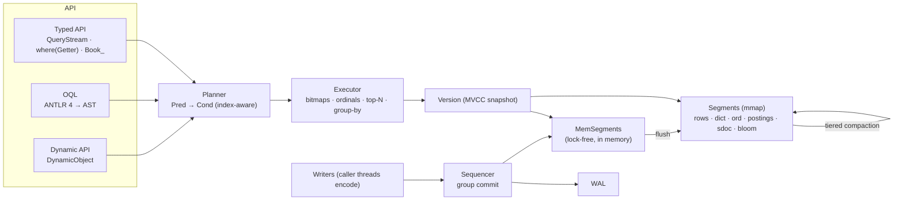

<p align="center">
  
</p>

<h1 align="center">Kookaburra</h1>

<p align="center"><b>Query Java objects like a database — bitmaps underneath, streams on top.</b></p>

<p align="center">
  <a href="https://openjdk.org/projects/jdk/17/"></a>
  <a href="LICENSE"></a>
  <a href="https://central.sonatype.com/namespace/com.github.paganini2008"></a>
  
  
  <a href="https://paganini2008.github.io/kookaburra/"></a>
</p>

Kookaburra is an **embedded object database for Java 17+**. You store plain annotated objects. Then you query them with a type-safe, Stream-like API (`where(Book::getYear).ge(1960)`) or with **OQL**, a JPQL-style query language. Filters, sorts and aggregates run on **RoaringBitmap** indexes over memory-mapped segment files, with a WAL, MVCC snapshots and crash recovery. **Kookaburra Studio** is a desktop admin tool for browsing, editing and querying any database.

<p align="center">
  
</p>

---

## Features

| | Feature | Problem it solves |
|---|---|---|
| 🧭 | **Type-safe queries from method references**: `where(Book::getGenre).eq(SCIFI)`, or a generated metamodel `Book_.price.lt(10.0)` | No string field names, refactoring-safe, no SQL / ORM mapping layer |
| ⚡ | **Bitmap & ordinal indexes** (Roaring postings, sorted dictionaries, value-sorted doc lists) | Filter, count, top-N and group on 10 M objects in milliseconds |
| 🔤 | **OQL**: JPQL-style `SELECT / UPDATE / DELETE`, SQL-92 core (expressions, `CASE`, `LIKE`, `DISTINCT`, `GROUP BY … HAVING`, aggregates, `ORDER BY` alias / position) | Text queries for tools, configs and ad-hoc analysis |
| 🧬 | **Inheritance & embedded objects**: polymorphic queries via a `$type` bitmap, dot paths into embedded values, lists, maps, references with `fetch` | Rich domain models without flattening |
| 🛡 | **Durable and consistent**: WAL with group commit, crash recovery, MVCC snapshots, cross-collection atomic `WriteBatch`, optimistic locking (`@Version`) | Safe local persistence without an external server |
| 🧩 | **Self-describing schema & dynamic API** (`DynamicObject`) with schema evolution (layouts) | Open any database without its classes; add / remove fields freely |
| 🗜 | **Compact, zero-copy storage**: immutable mmap'd segments, LSM write path, tiered compaction, ~150 B / object | Small heap (6.5 MiB after reopening 10 M objects), fast restarts (1.6 ms) |
| 🖥 | **Kookaburra Studio** (JavaFX): CRUD, OQL console with completion, schema & segments, JSON / JSONL / CSV export, themes | Inspect and fix data visually; one jar for Windows, Linux and macOS |

## Architecture



| Layer | Responsibility |
|---|---|
| API | typed fields from getters / metamodel, OQL, dynamic access; all compile to the same `Pred` / plan |
| Planner / Executor | pushes predicates to postings and ordinals, orders conjuncts by cost, evaluates residuals on rows |
| Write path | single sequencer thread (LevelDB-style): validate → WAL (fsync per group) → MemSegment → publish `visibleSeq` |
| Storage | immutable segment files (dictionary, bit-packed ordinals, Roaring postings, value-sorted docs, nulls, bloom), delete logs, commit files |

Full design: [docs/design.md](docs/design.md).

## Requirements

| Item | Version |
|---|---|
| Java | **17+** (JDK for building; JRE for running) |
| Runtime dependencies | RoaringBitmap 1.6.22, ANTLR 4.13.2 runtime, SLF4J API 2.0 (bring any backend) |
| Build | Maven 3.8+ |
| Studio | Java 17+ runtime; Windows x64, Linux x64 (GTK 3) or macOS Apple Silicon — JavaFX is bundled |

## Quick Start

**1. Add the dependency** (and the optional annotation processor for the `Book_` metamodel):

```xml
<dependency>
    <groupId>com.github.paganini2008</groupId>
    <artifactId>kookaburra-core</artifactId>
    <version>1.0.0-SNAPSHOT</version>
</dependency>
```
```xml
<!-- maven-compiler-plugin → configuration -->
<annotationProcessorPaths>
    <path>
        <groupId>com.github.paganini2008</groupId>
        <artifactId>kookaburra-processor</artifactId>
        <version>1.0.0-SNAPSHOT</version>
    </path>
</annotationProcessorPaths>
```

**2. Declare an entity:**

```java
@Entity
public class Book {
    @Id long oid;
    @Version long version;
    @Index String title;
    @Index String author;
    @Index Genre genre;
    @Index(IndexKind.ORDINAL) int year;
    double price;
    @Index List<String> tags;
    // constructors, getters …
}
```

**3. Store and query:**

```java
try (ObjectDB db = ObjectDB.open(Path.of("data"))) {
    db.batch()
      .insert(new Book("Dune", "Frank Herbert", Genre.SCIFI, 1965, 9.99, "classic", "desert"))
      .insert(new Book("Neuromancer", "William Gibson", Genre.SCIFI, 1984, 12.50, "cyberpunk"))
      .insert(new Book("Hyperion", "Dan Simmons", Genre.SCIFI, 1989, 14.20))
      .commit();

    List<String> titles = db.from(Book.class)
            .filter(where(Book::getGenre).eq(Genre.SCIFI))
            .filter(where(Book::getYear).ge(1960))
            .sorted(where(Book::getYear).desc())
            .limit(2)
            .map(where(Book::getTitle))
            .toList();
    System.out.println(titles);
}
```
```text
[Hyperion, Neuromancer]
```

**4. Look at it in Studio:**

```bash
mvn install -DskipTests                                  # library
mvn -f kookaburra-face/pom.xml -P dist package -DskipTests  # → bin/kookaburra-face.jar
java -jar bin/kookaburra-face.jar --data=data            # or double-click the jar
```

<p align="center">
  
</p>

## Examples

All outputs below are from a real run on six books (Dune, Neuromancer, Foundation, The Hobbit, Hyperion, The Big Sleep).

### Generated metamodel

| Input | Code | Output |
|---|---|---|
| books tagged `classic` under 10.00 | `db.from(Book.class).filter(Book_.tags.contains("classic")).filter(Book_.price.lt(10.0)).count()` | `2` |

### Group by and aggregates

```java
db.from(Book.class).groupBy(where(Book::getGenre))
  .agg(Q.count().as("books"), Q.avg(where(Book::getPrice)).as("avgPrice"))
  .sortedBy(Q.count().as("books").desc())
  .toList();
```
```text
SCIFI   books=4 avg=11.36
FANTASY books=1 avg=10.00
CRIME   books=1 avg=7.40
```

### OQL

```java
db.oql("SELECT b.author, b.year FROM Book b WHERE b.year < :y ORDER BY b.year")
  .param("y", 1950).rows();
db.oql("UPDATE Book b SET b.price = b.price * 0.9 WHERE b.genre = 'CRIME'").execute();
```
```text
J.R.R. Tolkien 1937
Raymond Chandler 1939
updated=1
```

### Update with optimistic locking

```java
Book dune = db.from(Book.class).filter(where(Book::getTitle).eq("Dune")).first().orElseThrow();
dune.setPrice(11.99);
db.update(dune);            // OptimisticLockException if someone updated it first
```

### Dynamic access (no entity class on the class path)

```java
DynamicCollection books = db.dynamic("Book");
books.from().filter(books.field("author").startsWith("J")).toList().get(0).get("title");   // "The Hobbit"
```

### Explain

```java
db.from(Book.class).filter(where(Book::getGenre).eq(Genre.SCIFI))
  .filter(where(Book::getYear).between(1950, 1970)).explain();
```
```text
QUERY Book  snapshot=seq 3  segments=1 (seg#2)
FILTER
  AND
    genre = 'SCIFI'  [sorted docs card=3]
    year IN [1950, 1970]  [sorted docs card=6]
```

### Best practices

| Do | Why |
|---|---|
| `@Index` fields you filter, sort or group on; `ORDINAL` for high-cardinality ranges / sorts | unindexed predicates read rows (~80 ns / row) |
| Write in `WriteBatch`es; use `Durability.ASYNC` for bulk loads | one fsync per group; 485 k objects/s batched |
| Use a `Snapshot` for several reads that must agree | MVCC: one consistent point in time |
| Keep one `ObjectDB` per directory per process | it is thread-safe and holds the directory lock |

## Configuration

All settings live in one file, [`kookaburra.properties`](kookaburra.properties): bundled defaults → file → `-Dkookaburra.*` → Studio CLI. In code, use `Config.load()` / `Config.defaults().withX(…)`.

| Property | Default | Description |
|---|---|---|
| `kookaburra.mem-segment-bytes` | `64MB` | in-memory segment size before it is flushed |
| `kookaburra.segment-max-bytes` | `512MB` | compaction output limit (≤ 1.5 GB) |
| `kookaburra.compaction-fan-in` | `8` | segments merged per tier |
| `kookaburra.max-segments` | `64` | per collection; writers are throttled above it |
| `kookaburra.write-backlog` | `10` | pending flushes before back-pressure |
| `kookaburra.bloom-fpp` | `0.01` | OID bloom filter false-positive rate |
| `kookaburra.auto-postings-ratio` | `16` | `AUTO` index writes postings when rows / distinct ≥ ratio |
| `kookaburra.postings-or-max` | `64` | range / IN over ≤ this many postings ORs bitmaps |
| `kookaburra.durability` | `SYNC` | `SYNC` = fsync per commit group, `ASYNC` = page cache |
| `kookaburra.group-commit-micros` | `200` | wait to batch more commits into one fsync |
| `kookaburra.sequencer-max-group` | `512` | max requests per commit group |
| `kookaburra.data` | `<jar dir>/data` | Studio: default database directory |
| `kookaburra.log-dir` / `kookaburra.log-level` | `<jar dir>/logs` / `INFO` | Studio: logback output |
| `kookaburra.theme` / `page-size` / `console-page-size` | `NEON` / `50` / `100` | Studio UI |

## Performance

**Environment**: Apple M2 Max (12 cores), 32 GB, internal SSD (fsync ≈ 4 ms), macOS, JDK 17.0.12, `-Xmx8g`. **Data**: 10,000,000 objects with indexed `name` (unique), `city` (50 values), `age` (ORDINAL) and `tags`, plus plain fields. Harness: `kookaburra-bench` (warm-up, p50 / p99, consistency checks). Full report: [docs/benchmark-10m.md](docs/benchmark-10m.md).

| Operation (10 M objects) | p50 |
|---|---|
| bulk insert, batches of 100 (`ASYNC`) | **485 k objects/s** |
| durable single inserts (`SYNC`), 16 / 128 threads | 3.1 k/s / **19.7 k/s** (group commit) |
| `get(oid)` | **0.7 µs** |
| `count()` where `city = ?` (bitmap) | **0.3 ms** |
| `city = ? AND age BETWEEN 30 AND 40 LIMIT 100` | **0.2 ms** |
| top-10 by `age DESC` over 2.3 M matches | **0.6 ms** |
| `GROUP BY city COUNT(*)` | **3.9 ms** |
| unique-key lookup via OQL (`name = ?`) | **0.11 ms** |
| OQL `GROUP BY city, COUNT, AVG(age) WHERE age > 40` | 253 ms |
| full scan with an unindexed predicate | 0.78 s |
| reopen / heap after reopen | 1.6 ms / 6.5 MiB |
| disk footprint | 148 B / object |

| Trade-off | Consequence |
|---|---|
| Durable single writes are bound by fsync | throughput ≈ concurrent writers ÷ fsync latency; batch or use `ASYNC` for bulk |
| Indexes cost space | ≈ 4 B / object per high-cardinality index (value-sorted docs) |
| Single-collection queries | no joins across collections (references + `fetch` / semi-join `in(...)` instead) |
| No interactive transactions | atomic batches, snapshots and optimistic locks instead ([design §12.1](docs/design.md)) |

## Documentation

| Guide | Link |
|---|---|
| Getting Started | [Quick Start](#quick-start) |
| User Guide & Architecture | [docs/design.md](docs/design.md) — storage format, query execution, OQL grammar, concurrency, recovery |
| Examples | [Examples](#examples) · tests under `kookaburra-core/src/test` |
| Configuration | [Configuration](#configuration) · [`kookaburra.properties`](kookaburra.properties) |
| Benchmarks | [docs/benchmark-10m.md](docs/benchmark-10m.md) |
| Website | <https://paganini2008.github.io/kookaburra/> |

**FAQ**

| Question | Answer |
|---|---|
| Must entities implement `Serializable`? | No. Only field values of otherwise unsupported types fall back to Java serialization |
| Can I query without the entity classes? | Yes: `db.dynamic("Book")`, OQL, or Studio |
| Is there a server? | No, it is embedded: one process opens a directory |
| Which time zone? | UTC everywhere |

## Contributing & License

Issues and pull requests are welcome at <https://github.com/paganini2008/kookaburra>. Please run `mvn verify` before submitting. The build enforces **≥ 90 % line and instruction coverage** (JaCoCo) in every module, and the differential tests compare every query path against `java.util.stream`.

| Module | Build |
|---|---|
| `kookaburra-core`, `kookaburra-processor` | `mvn verify` |
| Studio | `mvn -f kookaburra-face/pom.xml verify` · `-P dist package` |
| Benchmark | `mvn -f kookaburra-bench/pom.xml package` · `java -jar kookaburra-bench/target/kookaburra-bench.jar --n=10000000` |

Licensed under the [Apache License 2.0](LICENSE). © 2026 Fred Feng ([paganini20080@gmail.com](mailto:paganini20080@gmail.com)).
