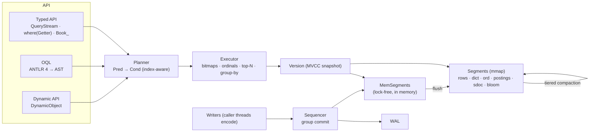

<p align="center">
  
</p>

<h1 align="center">Kookaburra</h1>

<p align="center"><b>Query Java objects like a database — bitmaps underneath, streams on top.</b></p>

<p align="center">
  <a href="https://openjdk.org/projects/jdk/17/"></a>
  <a href="LICENSE"></a>
  <a href="https://central.sonatype.com/namespace/com.github.paganini2008"></a>
  
  
  <a href="https://paganini2008.github.io/kookaburra/"></a>
</p>

Kookaburra is an **embedded object database for Java 17+**. You store plain annotated objects. Then you query them with a type-safe, chained API (`query(Book.class).where(Book::getYear).ge(1960).list()`) or with **OQL**, a JPQL-style query language. Filters, sorts and aggregates run on **RoaringBitmap** indexes over memory-mapped segment files, with a WAL, MVCC snapshots, optional **SNAPSHOT transactions** and crash recovery. **Kookaburra Studio** is a desktop admin tool for browsing, editing and querying any database.

<p align="center">
  
</p>

<p align="center">
  <a href="https://paganini2008.github.io/kookaburra/#tutorial"></a><br>
  🎬 <a href="https://paganini2008.github.io/kookaburra/#tutorial"><b>Watch the tutorial</b></a> (2:33, English subtitles) · <a href="https://paganini2008.github.io/kookaburra/assets/kookaburra-tutorial.mp4">MP4</a>
</p>

---

## Features

| | Feature | Problem it solves |
|---|---|---|
| 🧭 | **Type-safe chained queries from method references**: `query(Book.class).where(Book::getGenre).eq(SCIFI).orderBy(Book::getYear).desc().list()`, or a generated metamodel `Book_.price.lt(10.0)` | No string field names, refactoring-safe, no SQL / ORM mapping layer |
| ⚡ | **Bitmap & ordinal indexes** (Roaring postings, sorted dictionaries, value-sorted doc lists) | Filter, count, top-N and group on 10 M objects in milliseconds |
| 🔤 | **OQL**: JPQL-style `SELECT / UPDATE / DELETE`, SQL-92 core (expressions, `CASE`, `LIKE`, `DISTINCT`, `GROUP BY … HAVING`, aggregates, `ORDER BY` alias / position) | Text queries for tools, configs and ad-hoc analysis |
| 🧬 | **Inheritance & nested objects**: polymorphic queries via a `$type` bitmap, dot paths into embedded values at any depth, lists of embedded objects (`whereAny`, `MEMBER OF`), maps of embedded objects, references with `fetch` | Rich domain models without flattening |
| 🔁 | **Transactions (opt-in)**: `db.begin(Isolation.SNAPSHOT)`, read-your-writes, first-committer-wins (`ConflictException`), atomic `increment`, `inTransaction` with retries | Multi-object invariants (transfers, stock) without locks |
| 📦 | **Large values**: long texts and binaries (`byte[]`, e.g. images) up to tens of MiB per value, `Map<String, byte[]>` | Store documents and pictures next to their metadata |
| 🛡 | **Durable and consistent**: WAL with group commit, crash recovery, MVCC snapshots, cross-collection atomic `WriteBatch`, optimistic locking (`@Version`); deleted space reclaimed by compaction | Safe local persistence without an external server |
| 🧩 | **Self-describing schema & dynamic API** (`DynamicObject`) with schema evolution (layouts) | Open any database without its classes; add / remove fields freely |
| 🗜 | **Compact, zero-copy storage**: immutable mmap'd segments, LSM write path, tiered compaction, ~150 B / object | Small heap (6.5 MiB after reopening 10 M objects), fast restarts (1.6 ms) |
| 🖥 | **Kookaburra Studio** (JavaFX): several databases side by side, CRUD in transactions, nested-object inspector and element editor, image preview, OQL console with completion, schema & segments, JSON / JSONL / CSV export, themes | Inspect and fix data visually; one jar for Windows, Linux and macOS |

## Architecture



| Layer | Responsibility |
|---|---|
| API | typed fields from getters / metamodel, OQL, dynamic access; all compile to the same `Pred` / plan |
| Planner / Executor | pushes predicates to postings and ordinals, orders conjuncts by cost, evaluates residuals on rows |
| Write path | single sequencer thread (LevelDB-style): validate → WAL (fsync per group) → MemSegment → publish `visibleSeq` |
| Storage | immutable segment files (dictionary, bit-packed ordinals, Roaring postings, value-sorted docs, nulls, bloom), delete logs, commit files |

Full design: [docs/design.md](docs/design.md).

## Requirements

| Item | Version |
|---|---|
| Java | **17+** (JDK for building; JRE for running) |
| Runtime dependencies | RoaringBitmap 1.6.22, ANTLR 4.13.2 runtime, SLF4J API 2.0 (bring any backend) |
| Build | Maven 3.8+ |
| Studio | Java 17+ runtime; Windows x64, Linux x64 (GTK 3) or macOS Apple Silicon — JavaFX is bundled |

## Quick Start

**1. Add the dependency** (and the optional annotation processor for the `Book_` metamodel):

```xml
<dependency>
    <groupId>com.github.paganini2008</groupId>
    <artifactId>kookaburra-core</artifactId>
    <version>1.0.0-SNAPSHOT</version>
</dependency>
```
```xml
<!-- maven-compiler-plugin → configuration -->
<annotationProcessorPaths>
    <path>
        <groupId>com.github.paganini2008</groupId>
        <artifactId>kookaburra-processor</artifactId>
        <version>1.0.0-SNAPSHOT</version>
    </path>
</annotationProcessorPaths>
```

**2. Declare an entity:**

```java
@Entity
public class Book {
    @Id long oid;
    @Version long version;
    @Index String title;
    @Index String author;
    @Index Genre genre;
    @Index(IndexKind.ORDINAL) int year;
    double price;
    @Index List<String> tags;
    // constructors, getters …
}
```

**3. Store and query:**

```java
try (ObjectDB db = ObjectDB.open(Path.of("data"))) {
    db.batch()
      .insert(new Book("Dune", "Frank Herbert", Genre.SCIFI, 1965, 9.99, "classic", "desert"))
      .insert(new Book("Neuromancer", "William Gibson", Genre.SCIFI, 1984, 12.50, "cyberpunk"))
      .insert(new Book("Hyperion", "Dan Simmons", Genre.SCIFI, 1989, 14.20))
      .commit();

    List<Book> books = db.query(Book.class)
            .where(Book::getGenre).eq(Genre.SCIFI)
            .where(Book::getYear).ge(1960)
            .orderBy(Book::getYear).desc()
            .limit(2)
            .list();
    System.out.println(books.stream().map(Book::getTitle).toList());
}
```
```text
[Hyperion, Neuromancer]
```

**4. Look at it in Studio:**

```bash
mvn install -DskipTests                                  # library
mvn -f kookaburra-face/pom.xml -P dist package -DskipTests  # → bin/kookaburra-face.jar
java -jar bin/kookaburra-face.jar --data=data            # or double-click the jar
```

<p align="center">
  
</p>

| Studio feature | |
|---|---|
| Several databases side by side (disk + demo); transactions per database: Begin / Commit / Rollback, pending changes in the status |  |
| Nested objects: lists of embedded objects show as `[ 2 elements ]`, maps as `{ 3 entries }`; the Key / Value / Type inspector expands every level; double-click a reference to open its target |  |
| Element editor for lists of embedded objects and maps (add / remove / reorder, nested fields as dotted columns) |  |
| Binary fields: format, size, image preview, Load… / Save… / Clear; long texts in a text area |  |

The demo database (`--demo`) contains all of these: customers with a two-level address and a map of contacts, purchases with order lines (embedded list with nested prices and product references), product photos (PNG) and long notes.

## Examples

All outputs below are from a real run on six books (Dune, Neuromancer, Foundation, The Hobbit, Hyperion, The Big Sleep); the Quick Start, transaction and nested-object snippets are executed by `ReadmeExamplesTest`, in memory and on disk.

### Generated metamodel

| Input | Code | Output |
|---|---|---|
| books tagged `classic` under 10.00 | `db.query(Book.class).filter(Book_.tags.contains("classic")).filter(Book_.price.lt(10.0)).count()` | `2` |

### Group by and aggregates

```java
db.query(Book.class).groupBy(where(Book::getGenre))
  .agg(Q.count().as("books"), Q.avg(where(Book::getPrice)).as("avgPrice"))
  .sortedBy(Q.count().as("books").desc())
  .toList();
```
```text
SCIFI   books=4 avg=11.36
FANTASY books=1 avg=10.00
CRIME   books=1 avg=7.40
```

### OQL

```java
db.oql("SELECT b.author, b.year FROM Book b WHERE b.year < :y ORDER BY b.year")
  .param("y", 1950).rows();
db.oql("UPDATE Book b SET b.price = b.price * 0.9 WHERE b.genre = 'CRIME'").execute();
```
```text
J.R.R. Tolkien 1937
Raymond Chandler 1939
updated=1
```

### Update with optimistic locking

```java
Book dune = db.query(Book.class).where(Book::getTitle).eq("Dune").first().orElseThrow();
dune.setPrice(11.99);
db.update(dune);            // OptimisticLockException if someone updated it first
```

### Transactions (opt-in: `kookaburra.transactions=true`)

```java
try (Transaction tx = db.begin(Isolation.SNAPSHOT)) {
    Account a = tx.get(Account.class, from);
    tx.update(a.balance(a.getBalance() - 30));
    tx.increment(Account.class, to, "balance", 30);                    // atomic, never conflicts
    tx.query(Account.class).where(Account::getOwner).eq("ann").list();  // sees its own writes
    tx.commit();                                                        // ConflictException if `a` changed meanwhile
}                                                                       // not committed → rolled back
db.inTransaction(tx -> tx.increment(Account.class, to, "balance", 5));  // retried on conflicts
```

| Property | Behaviour |
|---|---|
| Isolation | SNAPSHOT (as Oracle / PostgreSQL REPEATABLE READ): one consistent snapshot, no dirty / non-repeatable reads, no phantoms |
| Conflicts | optimistic, first committer wins; the loser gets `ConflictException` and retries |
| Off (default) | every write commits on its own; `begin()` fails with a hint to set `kookaburra.transactions=true` |

Design: [docs/transaction-design.md](docs/transaction-design.md).

### Nested objects

```java
@Entity class Shipment { @Id long oid; String code; Route route; List<Item> items; Map<String, Place> stops; }
@Embeddable class Route { Place from; Place to; int legs; }
@Embeddable class Place { String city; String street; Geo geo; }
@Embeddable class Item  { String sku; int qty; Money price; }

db.oql("SELECT s.code FROM Shipment s WHERE s.route.to.city = 'Perth'").list();             // [S-1]
db.query(Shipment.class).whereAny(Shipment::getItems, Item::getSku).contains("pear").list(); // S-1
db.oql("SELECT s.code FROM Shipment s WHERE 'kiwi' MEMBER OF s.items.sku").list();          // [S-2]
```

Paths through lists of embedded objects mean "any element" (like JPQL `MEMBER OF` and MongoDB dotted paths) and are evaluated by scanning.

### Large values (texts, images)

```java
@Entity class Document { @Id long oid; @Index String title; String body; byte[] image; Map<String, byte[]> thumbnails; }

db.insert(new Document("scan", text, Files.readAllBytes(Path.of("scan.png"))));   // MiB-sized values are fine
```

Tested with 2 M-character Unicode texts and 5–16 MiB binaries through flush, compaction, transactions and reopen. In JSON / CSV exports binaries are Base64 (as Jackson writes `byte[]`).

### Dynamic access (no entity class on the class path)

```java
DynamicCollection books = db.dynamic("Book");
books.from().where("author").startsWith("J").list().get(0).get("title");   // "The Hobbit"
```

### Explain

```java
db.query(Book.class).where(Book::getGenre).eq(Genre.SCIFI)
  .where(Book::getYear).between(1950, 1970).explain();
```
```text
QUERY Book  snapshot=seq 3  segments=1 (seg#2)
FILTER
  AND
    genre = 'SCIFI'  [sorted docs card=3]
    year IN [1950, 1970]  [sorted docs card=6]
```

### Best practices

| Do | Why |
|---|---|
| `@Index` fields you filter, sort or group on; `ORDINAL` for high-cardinality ranges / sorts | unindexed predicates read rows (~80 ns / row) |
| Write in `WriteBatch`es; use `Durability.ASYNC` for bulk loads | one fsync per group; 485 k objects/s batched |
| Use a `Snapshot` for several reads that must agree | MVCC: one consistent point in time |
| Use transactions only where several objects must change together | autocommit writes skip the conflict bookkeeping |
| Prefer `increment` for counters | it never conflicts, even inside transactions |
| Keep one `ObjectDB` per directory per process | it is thread-safe and holds the directory lock |

## Configuration

All settings live in one file, [`kookaburra.properties`](kookaburra.properties): bundled defaults → file → `-Dkookaburra.*` → Studio CLI. In code, use `Config.load()` / `Config.defaults().withX(…)`.

| Property | Default | Description |
|---|---|---|
| `kookaburra.mem-segment-bytes` | `64MB` | in-memory segment size before it is flushed |
| `kookaburra.segment-max-bytes` | `512MB` | compaction output limit (≤ 1.5 GB) |
| `kookaburra.compaction-fan-in` | `8` | segments merged per tier |
| `kookaburra.compaction-garbage-ratio` | `0.3` | a segment with this share of deleted rows is rewritten on its own; fully deleted segments are dropped |
| `kookaburra.max-segments` | `64` | per collection; writers are throttled above it |
| `kookaburra.write-backlog` | `10` | pending flushes before back-pressure |
| `kookaburra.bloom-fpp` | `0.01` | OID bloom filter false-positive rate |
| `kookaburra.auto-postings-ratio` | `16` | `AUTO` index writes postings when rows / distinct ≥ ratio |
| `kookaburra.postings-or-max` | `64` | range / IN over ≤ this many postings ORs bitmaps |
| `kookaburra.durability` | `SYNC` | `SYNC` = fsync per commit group, `ASYNC` = page cache |
| `kookaburra.group-commit-micros` | `200` | wait to batch more commits into one fsync |
| `kookaburra.sequencer-max-group` | `512` | max requests per commit group |
| `kookaburra.flush-threads` | `2` | threads for flushes and compactions |
| `kookaburra.transactions` | `false` | enables `begin()` / `inTransaction()`; off = every write commits directly |
| `kookaburra.tx-timeout` / `tx-max-bytes` / `tx-retries` | `60s` / `100MB` / `3` | transaction limits and `inTransaction` retries |
| `kookaburra.tx-conflict-table-max` | `2000000` | conflict history entries (~32 B each) before the oldest transaction is aborted |
| `kookaburra.data` | `<jar dir>/data` | Studio: default database directory |
| `kookaburra.log-dir` / `kookaburra.log-level` | `<jar dir>/logs` / `INFO` | Studio: logback output |
| `kookaburra.theme` / `page-size` / `console-page-size` | `NEON` / `50` / `100` | Studio UI |

## Performance

**Environment**: Apple M2 Max (12 cores), 32 GB, internal SSD (fsync ≈ 4 ms), macOS, JDK 17.0.12, `-Xmx8g`. **Data**: 10,000,000 objects with indexed `name` (unique), `city` (50 values), `age` (ORDINAL) and `tags`, plus plain fields. Harness: `kookaburra-bench` (warm-up, p50 / p99, consistency checks). Full report: [docs/benchmark-10m.md](docs/benchmark-10m.md).

| Operation (10 M objects) | p50 |
|---|---|
| bulk insert, batches of 100 (`ASYNC`) | **632 k objects/s** |
| durable single inserts (`SYNC`), 16 / 128 threads | 3.7 k/s / **27.8 k/s** (group commit) |
| `get(oid)` | **0.75 µs** |
| `count()` where `city = ?` (bitmap) | **0.24 ms** |
| `city = ? AND age BETWEEN 30 AND 40 LIMIT 100` | **0.21 ms** |
| top-10 by `age DESC` over 2.3 M matches | **0.40 ms** |
| `GROUP BY city COUNT(*)` | **4.1 ms** |
| unique-key lookup via OQL (`name = ?`) | **0.11 ms** |
| OQL `GROUP BY city, COUNT, AVG(age) WHERE age > 40` | 246 ms |
| full scan with an unindexed predicate | 0.76 s |
| transactions: transfers (read 2, update 2), 16 threads | **135 k/s**, 0.022 retries / commit |
| atomic `increment` of one hot counter, 16 threads | **251 k/s**, no lost updates |
| OQL `DELETE` of all 10.6 M objects / disk after `compact()` | 1.16 M objects/s / **0 B** (fully reclaimed) |
| reopen / heap after reopen | 2.4 ms / 6.4 MiB |
| disk footprint | 148 B / object |

| Trade-off | Consequence |
|---|---|
| Durable single writes are bound by fsync | throughput ≈ concurrent writers ÷ fsync latency; batch or use `ASYNC` for bulk |
| Indexes cost space | ≈ 4 B / object per high-cardinality index (value-sorted docs) |
| Single-collection queries | no joins across collections (references + `fetch` / semi-join `in(...)` instead) |
| Transactions are SNAPSHOT, not SERIALIZABLE | write skew is possible, as in Oracle / PostgreSQL REPEATABLE READ; guard invariants with a shared write ([transaction design](docs/transaction-design.md)) |

## Documentation

| Guide | Link |
|---|---|
| Video tutorial | [Watch on the website](https://paganini2008.github.io/kookaburra/#tutorial) (2:33) · made by `docs/tools/make-tutorial.sh` |
| Getting Started | [Quick Start](#quick-start) |
| User Guide & Architecture | [docs/design.md](docs/design.md) — storage format, query execution, OQL grammar, concurrency, recovery |
| Transactions | [docs/transaction-design.md](docs/transaction-design.md) — SNAPSHOT + OCC, decisions T1–T12 |
| Examples | [Examples](#examples) · tests under `kookaburra-core/src/test` |
| Configuration | [Configuration](#configuration) · [`kookaburra.properties`](kookaburra.properties) |
| Benchmarks | [docs/benchmark-10m.md](docs/benchmark-10m.md) |
| Website | <https://paganini2008.github.io/kookaburra/> |

**FAQ**

| Question | Answer |
|---|---|
| Must entities implement `Serializable`? | No. Only field values of otherwise unsupported types fall back to Java serialization |
| Can I query without the entity classes? | Yes: `db.dynamic("Book")`, OQL, or Studio |
| Is there a server? | No, it is embedded: one process opens a directory |
| Which time zone? | UTC everywhere |

## Contributing & License

Issues and pull requests are welcome at <https://github.com/paganini2008/kookaburra>. Please run `mvn verify` before submitting. The build enforces **≥ 90 % line and instruction coverage** (JaCoCo) in every module, and the differential tests compare every query path against `java.util.stream`.

| Module | Build |
|---|---|
| `kookaburra-core`, `kookaburra-processor` | `mvn verify` |
| Studio | `mvn -f kookaburra-face/pom.xml verify` · `-P dist package` |
| Benchmark | `mvn -f kookaburra-bench/pom.xml package` · `java -jar kookaburra-bench/target/kookaburra-bench.jar --n=10000000` |

Licensed under the [Apache License 2.0](LICENSE). © 2026 Fred Feng ([paganini20080@gmail.com](mailto:paganini20080@gmail.com)).
