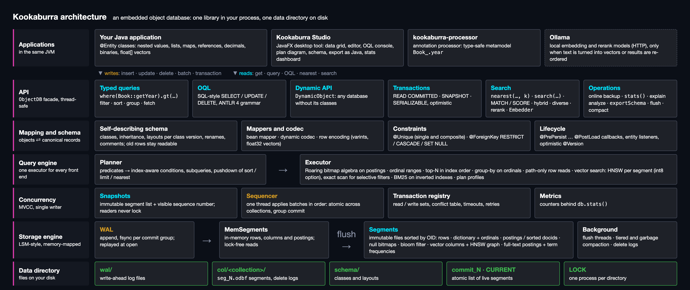
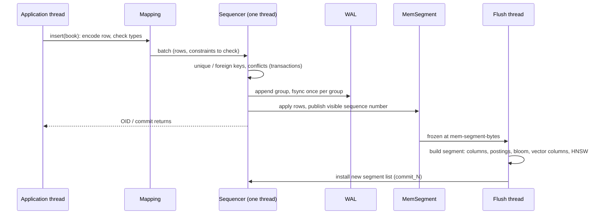
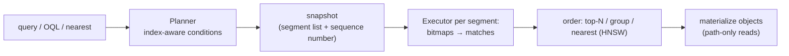

# Kookaburra: Architecture

| | |
|---|---|
| Status | living document, updated with the code |
| Audience | developers and contributors |
| Scope | the layers of the database and how a write and a read pass through them |
| Related | [design.md](design.md) (overall design) · [storage-design.md](storage-design.md) (files, write path, compaction) · [transaction-design.md](transaction-design.md) (transactions) · [developer-guide.md](developer-guide.md) |

Source: [`tools/diagrams/architecture.html`](tools/diagrams/architecture.html), rendered by `docs/tools/make-diagrams.sh`.

---

## 1. Layers

| Layer | Packages | Responsibility | Details |
|---|---|---|---|
| Applications | your code, `kookaburra-face`, `kookaburra-processor` | entity classes; Studio; generated metamodel (`Book_`) | [design.md §17](design.md#17-kookaburra-studio-standalone-ui) |
| API | `ObjectDB`, `query`, `oql`, `dynamic`, `embed` | typed queries, OQL, dynamic objects, transactions, vector search, backup, stats | [design.md §9](design.md#9-query-api), [§10.6](design.md#106-vector-search) |
| Mapping and schema | `mapping`, `field`, `annotation` | self-describing schema, layouts, object ⇄ canonical record, constraints, lifecycle callbacks | [design.md §3](design.md#3-data-model) |
| Query engine | `exec` | planner (predicates → index-aware conditions), executor (bitmaps, ordinals, top-N, group-by, vector search) | [design.md §10](design.md#10-query-execution) |
| Concurrency | `engine` (`Sequencer`, `Version`, `TxRegistry`, `Metrics`) | MVCC snapshots, single writer, group commit, optimistic transactions | [transaction-design.md](transaction-design.md) |
| Storage engine | `engine`, `segment`, `io` | WAL, in-memory segments, immutable memory-mapped segment files, compaction, recovery, backup | [storage-design.md](storage-design.md) |
| Data directory | files | `wal/`, `col/<collection>/seg_N.odbf`, `schema/`, `commit_N`, `CURRENT`, `LOCK` | [storage-design.md §3](storage-design.md#3-directory-layout) |

## 2. A write

## 3. A read

- Readers take no locks: a snapshot is an immutable list of segments plus a sequence number; rows newer than it are invisible.
- The same executor serves typed queries, OQL, the dynamic API and Studio.

## 4. Threads

| Thread | Count | Work |
|---|---|---|
| caller threads | any | encode rows, run queries |
| `kookaburra-sequencer` | 1 | applies write batches in order, WAL group commit, constraints |
| `kookaburra-flush-N` | `kookaburra.flush-threads` (2) | flush in-memory segments, merge segments, build HNSW graphs |
| `kookaburra-embed` | per request (Studio) | embedding requests to Ollama off the UI thread |
