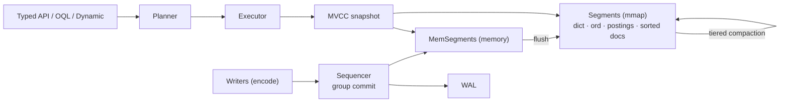

# Kookaburra: Query Java Objects with Streams, Accelerated by RoaringBitmap


## 1. Overview

**Kookaburra**: *Query Java objects like a database — bitmaps underneath, streams on top.*

Kookaburra is an **embedded object database for Java 17+**. You store plain annotated classes and query them with a type-safe chained API or JPQL-style **OQL**. Filters, sorts and aggregates run on **RoaringBitmap** indexes over memory-mapped segment files, with optional **snapshot-isolation transactions**, nested objects and large values (long texts, images), and the desktop tool **Kookaburra Studio** lets you look inside.


**Video tutorial (2:33, English subtitles)**:

<video controls preload="metadata" playsinline width="100%" poster="https://paganini2008.github.io/kookaburra/assets/kookaburra-tutorial-poster.jpg">
  <source src="https://paganini2008.github.io/kookaburra/assets/kookaburra-tutorial.mp4" type="video/mp4">
</video>

If the player does not show, [watch it on the project website](https://paganini2008.github.io/kookaburra/#tutorial) or [open the MP4](https://paganini2008.github.io/kookaburra/assets/kookaburra-tutorial.mp4).

## 2. What Problem Does It Solve

An application that keeps and queries its own objects usually ends up with an ORM and a relational database: mappings, schemas, SQL, sometimes a server. The alternative, a `List` plus `stream().filter()`, scans everything on every query and keeps all data in the heap.

Kookaburra combines the two. You **write queries like Java streams, and they execute like a database**: conditions are pushed down to bitmap and sorted-dictionary indexes, and data is persisted with crash recovery, all inside your process.

| Pain point | Kookaburra |
|---|---|
| Heavy ORM / SQL mapping | store annotated objects directly |
| `stream().filter()` scans everything | bitmap / ordinal indexes, milliseconds on 10 M objects |
| Field names in strings break on refactoring | `where(Book::getYear)` or the generated `Book_` |
| Several objects must change together (transfers, stock) | optional SNAPSHOT transactions, `ConflictException` on conflicts |
| Deeply nested domain models | embedded objects, lists and maps of them, all queryable by dotted paths |
| Binary stores you cannot inspect | Studio: several databases, CRUD in transactions, nested-object inspector, image preview, OQL, export |

## 3. Quick Start

```xml
<dependency>
    <groupId>com.github.paganini2008</groupId>
    <artifactId>kookaburra-core</artifactId>
    <version>1.0.0-SNAPSHOT</version>
</dependency>
```

```java
try (ObjectDB db = ObjectDB.open(Path.of("data"))) {
    db.batch()
      .insert(new Book("Dune", "Frank Herbert", Genre.SCIFI, 1965, 9.99, "classic", "desert"))
      .insert(new Book("Neuromancer", "William Gibson", Genre.SCIFI, 1984, 12.50, "cyberpunk"))
      .insert(new Book("Hyperion", "Dan Simmons", Genre.SCIFI, 1989, 14.20))
      .commit();

    List<Book> books = db.query(Book.class)
            .where(Book::getGenre).eq(Genre.SCIFI)
            .where(Book::getYear).ge(1960)
            .orderBy(Book::getYear).desc()
            .limit(2)
            .list();
    System.out.println(books.stream().map(Book::getTitle).toList());
}
```

```text
[Hyperion, Neuromancer]
```

Studio: `mvn -f kookaburra-face/pom.xml -P dist package`, then double-click `bin/kookaburra-face.jar`.

## 4. Requirements

| Item | Requirement |
|---|---|
| Java | 17+ |
| Runtime dependencies | RoaringBitmap 1.6.22, ANTLR 4.13.2 runtime, SLF4J API 2.0 |
| Build | Maven 3.8+ |
| Studio | Java 17+; one jar for Windows x64, Linux x64 and macOS Apple Silicon (JavaFX bundled) |

## 5. How It Works



| Layer | Role |
|---|---|
| Query APIs | typed fields, OQL and dynamic access compile to the same predicate plan |
| Executor | pushes conditions to Roaring postings and sorted ordinals, orders conjuncts by cost, walks indexes in order for top-N |
| Write path | one sequencer thread: validate → WAL (one fsync per group) → MemSegment → publish visible sequence |
| Storage | immutable segment files (dictionary, bit-packed ordinals, postings, value-sorted docs, nulls, bloom), tiered compaction |

## 6. Code Examples

**Example 1: group and aggregate**

- Input: six books (4 sci-fi, 1 fantasy, 1 crime)
- Execution:

```java
db.query(Book.class).groupBy(where(Book::getGenre))
  .agg(Q.count().as("books"), Q.avg(where(Book::getPrice)).as("avgPrice"))
  .sortedBy(Q.count().as("books").desc())
  .toList();
```

- Output:

```text
SCIFI   books=4 avg=11.36
FANTASY books=1 avg=10.00
CRIME   books=1 avg=7.40
```

**Example 2: OQL query and bulk update**

- Input: same books
- Execution:

```java
db.oql("SELECT b.author, b.year FROM Book b WHERE b.year < :y ORDER BY b.year").param("y", 1950).rows();
db.oql("UPDATE Book b SET b.price = b.price * 0.9 WHERE b.genre = 'CRIME'").execute();
```

- Output:

```text
J.R.R. Tolkien 1937
Raymond Chandler 1939
updated=1
```

**Example 3: generated metamodel**

- Execution: `db.query(Book.class).filter(Book_.tags.contains("classic")).filter(Book_.price.lt(10.0)).count()`
- Output: `2`

**Example 4: transactions (`kookaburra.transactions=true`)**

- Input: two accounts, ann = 100, bob = 0
- Execution:

```java
try (Transaction tx = db.begin(Isolation.SNAPSHOT)) {
    Account a = tx.get(Account.class, from);
    tx.update(a.balance(a.getBalance() - 30));
    tx.increment(Account.class, to, "balance", 30);   // atomic, never conflicts
    tx.commit();                                      // ConflictException if `a` changed meanwhile
}                                                     // not committed → rolled back
```

- Output: ann = 70, bob = 30; of two transactions that change the same object, the later commit fails with `ConflictException`

**Example 5: nested objects**

- Input: `Shipment` with `Route route` (two levels of embedding), `List<Item> items`, `Map<String, Place> stops`
- Execution:

```java
db.oql("SELECT s.code FROM Shipment s WHERE s.route.to.city = 'Perth'").list();
db.query(Shipment.class).whereAny(Shipment::getItems, Item::getSku).contains("pear").list();
db.oql("SELECT s.code FROM Shipment s WHERE 'kiwi' MEMBER OF s.items.sku").list();
```

- Output: `[S-1]`, `S-1`, `[S-2]` (a path through a list means "any element", as JPQL `MEMBER OF`)

**Example 6: long texts and images**

```java
db.insert(new Document("scan", text, Files.readAllBytes(Path.of("scan.png"))));
```

Tested with 2 M-character Unicode texts and 5–16 MiB binaries through flush, compaction, transactions and reopen; JSON / CSV exports carry binaries as Base64.

**Nested objects in Studio**: lists of embedded objects show as `[ 2 elements ]` in the grid, the inspector expands every level as a Key / Value / Type tree, element tables edit lists and maps, and image fields have a preview.


## 7. Configuration

One file: `kookaburra.properties`.

| Property | Default | Description |
|---|---|---|
| `kookaburra.mem-segment-bytes` | `64MB` | in-memory segment size before flush |
| `kookaburra.segment-max-bytes` | `512MB` | compaction output limit |
| `kookaburra.durability` | `SYNC` | `SYNC` fsyncs every commit group, `ASYNC` uses the page cache |
| `kookaburra.group-commit-micros` | `200` | wait to batch more commits into one fsync |
| `kookaburra.auto-postings-ratio` | `16` | `AUTO` writes postings when rows / distinct ≥ ratio |
| `kookaburra.compaction-garbage-ratio` | `0.3` | rewrite a segment on its own at this share of deleted rows; drop fully deleted segments |
| `kookaburra.transactions` | `false` | enables transactions; off = every write commits directly |
| `kookaburra.tx-timeout` / `tx-retries` | `60s` / `3` | transaction timeout; `inTransaction` retries on conflicts |
| `kookaburra.data` | `data/` next to the jar | Studio default database |
| `kookaburra.log-dir` / `log-level` | `logs/` next to the jar / `INFO` | Studio logging |

## 8. Performance / Comparison

**Environment**: Apple M2 Max (12 cores), 32 GB, internal SSD (fsync ≈ 4 ms), JDK 17, `-Xmx8g`; **10 M objects**; harness `kookaburra-bench` (warm-up, p50 / p99, consistency checks after every phase).

| Operation (10 M objects) | p50 |
|---|---|
| bulk insert, batches of 100 (`ASYNC`) | 632 k objects/s |
| durable single inserts (`SYNC`), 16 / 128 threads | 3.7 k/s / 27.8 k/s |
| `get(oid)` | 0.75 µs |
| bitmap equality count | 0.24 ms |
| equality + range + limit 100 | 0.21 ms |
| top-10 by an indexed column of 2.3 M matches | 0.40 ms |
| `GROUP BY city COUNT(*)` | 4.1 ms |
| unique-key lookup (OQL) | 0.11 ms |
| full scan with an unindexed predicate | 0.76 s |
| transactions: transfers (read 2, update 2), 16 threads | 135 k/s, 0.022 retries per commit |
| atomic `increment` of one hot counter, 16 threads | 251 k/s, no lost updates |
| OQL `DELETE` of all 10.6 M objects → disk after `compact()` | 1.16 M objects/s → 0 B |
| reopen / heap after reopen | 2.4 ms / 6.4 MiB |

**Before vs. after tuning**:

| Item | Before | After | How |
|---|---|---|---|
| GROUP BY count | 902 ms | 4.1 ms | `andCardinality` on postings, no row visited |
| top-10 sort | 187 ms | 0.40 ms | walk the index in value order, stop at N |
| unique-key lookup | 13 ms | 0.11 ms | value-sorted document lists |
| unindexed scan | did not finish | 0.76 s | decode only the needed field |
| disk after deleting everything | 1.5 GB kept | 0 B | garbage-driven compaction drops empty segments |

## 9. Limitations & Trade-offs

- Durable single writes are bound by fsync: throughput ≈ concurrent writers ÷ fsync latency. Batch or use `ASYNC` for bulk loads.
- Single-collection queries only, no joins (use references with `fetch`, or the semi-join `in(...)`).
- Transactions are SNAPSHOT (like Oracle / PostgreSQL REPEATABLE READ), not SERIALIZABLE: write skew is possible, so guard invariants with a shared write.
- Not a fit for: several processes writing one directory, the SQL / JDBC / BI ecosystem, terabyte-scale data.

## 10. Summary

1. Stream-style code, database-style execution: conditions run on bitmaps and sorted dictionaries.
2. Two type-safe ways to name fields, method references or a generated metamodel, and they can be mixed.
3. OQL covers the single-table SQL-92 core for tools and scripts.
4. WAL with group commit for writes, MVCC snapshots for reads, recovery after a crash.
5. Common queries take sub-millisecond to a few milliseconds on 10 M objects.
6. Memory-mapped segments: instant reopen and a tiny heap.
7. Optional SNAPSHOT transactions: read-your-writes, first committer wins, atomic increments.
8. Nested objects (embedded at any depth, lists and maps of them) and large values (texts, images).
9. Studio runs from one jar on Windows, Linux and macOS: several databases, CRUD in transactions, a nested-object inspector, OQL and export.
10. The shared test suites run in memory and on disk, with ≥ 90 % coverage and a 10 M-object stress run.
11. One configuration file whose defaults are the recommended settings.
