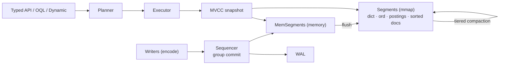

# Kookaburra: Query Java Objects with Streams, Accelerated by RoaringBitmap


## 1. Overview

**Kookaburra**: *Query Java objects like a database — bitmaps underneath, streams on top.*

Kookaburra is an **embedded object database for Java 17+**. You store plain annotated classes and query them with a type-safe, Stream-like API or JPQL-style **OQL**. Filters, sorts and aggregates run on **RoaringBitmap** indexes over memory-mapped segment files, and the desktop tool **Kookaburra Studio** lets you look inside.


## 2. What Problem Does It Solve

An application that keeps and queries its own objects usually ends up with an ORM and a relational database: mappings, schemas, SQL, sometimes a server. The alternative, a `List` plus `stream().filter()`, scans everything on every query and keeps all data in the heap.

Kookaburra combines the two. You **write queries like Java streams, and they execute like a database**: conditions are pushed down to bitmap and sorted-dictionary indexes, and data is persisted with crash recovery, all inside your process.

| Pain point | Kookaburra |
|---|---|
| Heavy ORM / SQL mapping | store annotated objects directly |
| `stream().filter()` scans everything | bitmap / ordinal indexes, milliseconds on 10 M objects |
| Field names in strings break on refactoring | `where(Book::getYear)` or the generated `Book_` |
| Binary stores you cannot inspect | Studio: browse, CRUD, OQL, export |

## 3. Quick Start

```xml
<dependency>
    <groupId>com.github.paganini2008</groupId>
    <artifactId>kookaburra-core</artifactId>
    <version>1.0.0-SNAPSHOT</version>
</dependency>
```

```java
try (ObjectDB db = ObjectDB.open(Path.of("data"))) {
    db.batch()
      .insert(new Book("Dune", "Frank Herbert", Genre.SCIFI, 1965, 9.99, "classic", "desert"))
      .insert(new Book("Neuromancer", "William Gibson", Genre.SCIFI, 1984, 12.50, "cyberpunk"))
      .insert(new Book("Hyperion", "Dan Simmons", Genre.SCIFI, 1989, 14.20))
      .commit();

    System.out.println(db.from(Book.class)
            .filter(where(Book::getGenre).eq(Genre.SCIFI))
            .filter(where(Book::getYear).ge(1960))
            .sorted(where(Book::getYear).desc())
            .limit(2)
            .map(where(Book::getTitle))
            .toList());
}
```

```text
[Hyperion, Neuromancer]
```

Studio: `mvn -f kookaburra-face/pom.xml -P dist package`, then double-click `bin/kookaburra-face.jar`.

## 4. Requirements

| Item | Requirement |
|---|---|
| Java | 17+ |
| Runtime dependencies | RoaringBitmap 1.6.22, ANTLR 4.13.2 runtime, SLF4J API 2.0 |
| Build | Maven 3.8+ |
| Studio | Java 17+; one jar for Windows x64, Linux x64 and macOS Apple Silicon (JavaFX bundled) |

## 5. How It Works



| Layer | Role |
|---|---|
| Query APIs | typed fields, OQL and dynamic access compile to the same predicate plan |
| Executor | pushes conditions to Roaring postings and sorted ordinals, orders conjuncts by cost, walks indexes in order for top-N |
| Write path | one sequencer thread: validate → WAL (one fsync per group) → MemSegment → publish visible sequence |
| Storage | immutable segment files (dictionary, bit-packed ordinals, postings, value-sorted docs, nulls, bloom), tiered compaction |

## 6. Code Examples

**Example 1: group and aggregate**

- Input: six books (4 sci-fi, 1 fantasy, 1 crime)
- Execution:

```java
db.from(Book.class).groupBy(where(Book::getGenre))
  .agg(Q.count().as("books"), Q.avg(where(Book::getPrice)).as("avgPrice"))
  .sortedBy(Q.count().as("books").desc())
  .toList();
```

- Output:

```text
SCIFI   books=4 avg=11.36
FANTASY books=1 avg=10.00
CRIME   books=1 avg=7.40
```

**Example 2: OQL query and bulk update**

- Input: same books
- Execution:

```java
db.oql("SELECT b.author, b.year FROM Book b WHERE b.year < :y ORDER BY b.year").param("y", 1950).rows();
db.oql("UPDATE Book b SET b.price = b.price * 0.9 WHERE b.genre = 'CRIME'").execute();
```

- Output:

```text
J.R.R. Tolkien 1937
Raymond Chandler 1939
updated=1
```

**Example 3: generated metamodel**

- Execution: `db.from(Book.class).filter(Book_.tags.contains("classic")).filter(Book_.price.lt(10.0)).count()`
- Output: `2`

## 7. Configuration

One file: `kookaburra.properties`.

| Property | Default | Description |
|---|---|---|
| `kookaburra.mem-segment-bytes` | `64MB` | in-memory segment size before flush |
| `kookaburra.segment-max-bytes` | `512MB` | compaction output limit |
| `kookaburra.durability` | `SYNC` | `SYNC` fsyncs every commit group, `ASYNC` uses the page cache |
| `kookaburra.group-commit-micros` | `200` | wait to batch more commits into one fsync |
| `kookaburra.auto-postings-ratio` | `16` | `AUTO` writes postings when rows / distinct ≥ ratio |
| `kookaburra.data` | `data/` next to the jar | Studio default database |
| `kookaburra.log-dir` / `log-level` | `logs/` next to the jar / `INFO` | Studio logging |

## 8. Performance / Comparison

**Environment**: Apple M2 Max (12 cores), 32 GB, internal SSD (fsync ≈ 4 ms), JDK 17, `-Xmx8g`; **10 M objects**; harness `kookaburra-bench` (warm-up, p50 / p99, consistency checks after every phase).

| Operation (10 M objects) | p50 |
|---|---|
| bulk insert, batches of 100 (`ASYNC`) | 485 k objects/s |
| durable single inserts (`SYNC`), 16 / 128 threads | 3.1 k/s / 19.7 k/s |
| `get(oid)` | 0.7 µs |
| bitmap equality count | 0.3 ms |
| equality + range + limit 100 | 0.2 ms |
| top-10 by an indexed column of 2.3 M matches | 0.6 ms |
| `GROUP BY city COUNT(*)` | 3.9 ms |
| unique-key lookup (OQL) | 0.11 ms |
| full scan with an unindexed predicate | 0.78 s |
| reopen / heap after reopen | 1.6 ms / 6.5 MiB |

**Before vs. after tuning**:

| Item | Before | After | How |
|---|---|---|---|
| GROUP BY count | 902 ms | 3.9 ms | `andCardinality` on postings, no row visited |
| top-10 sort | 187 ms | 0.6 ms | walk the index in value order, stop at N |
| unique-key lookup | 13 ms | 0.11 ms | value-sorted document lists |
| unindexed scan | did not finish | 0.78 s | decode only the needed field |

## 9. Limitations & Trade-offs

- Durable single writes are bound by fsync: throughput ≈ concurrent writers ÷ fsync latency. Batch or use `ASYNC` for bulk loads.
- Single-collection queries only, no joins (use references with `fetch`, or the semi-join `in(...)`).
- No interactive transactions. You get atomic batches, snapshots and optimistic locks instead.
- Not a fit for: several processes writing one directory, the SQL / JDBC / BI ecosystem, terabyte-scale data.

## 10. Summary

1. Stream-style code, database-style execution: conditions run on bitmaps and sorted dictionaries.
2. Two type-safe ways to name fields, method references or a generated metamodel, and they can be mixed.
3. OQL covers the single-table SQL-92 core for tools and scripts.
4. WAL with group commit for writes, MVCC snapshots for reads, recovery after a crash.
5. Common queries take sub-millisecond to a few milliseconds on 10 M objects.
6. Memory-mapped segments: instant reopen and a tiny heap.
7. Studio runs from one jar on Windows, Linux and macOS, with CRUD, OQL and export.
8. One configuration file whose defaults are the recommended settings.
