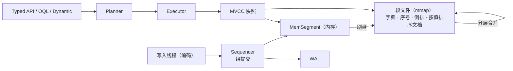

# Kookaburra：用 Stream 的写法查 Java 对象，底层用 RoaringBitmap 加速


## 1. 概述

**Kookaburra**：*Query Java objects like a database — bitmaps underneath, streams on top.*

Kookaburra 是面向 **Java 17+ 的嵌入式对象数据库**。普通的注解类直接存进去，就可以用类型安全的 Stream 风格 API 或类 JPQL 的 **OQL** 查询。过滤、排序、聚合跑在 **RoaringBitmap** 索引和内存映射的段文件上。另外配了一个桌面管理工具 **Kookaburra Studio**。


## 2. 解决什么问题

应用要把自己的对象存在本地并按条件查询时，常见的做法是 ORM + 关系库。这样要维护映射、建表、写 SQL，有时还得多跑一个服务进程。另一种做法是全放进 `List` 里用 `stream().filter()`：每次查询都全量扫描，数据也只能留在堆里。

Kookaburra 把这两者结合：**写法和 Java Stream 一样，执行像数据库一样**，条件下推到位图和有序字典索引，数据持久化在磁盘上并支持崩溃恢复。另外它不需要单独的服务进程。

| 痛点 | Kookaburra 的做法 |
|---|---|
| ORM / SQL 映射层太重 | 直接存注解对象，无需建表 |
| `stream().filter()` 全量扫描 | 位图 / 序号索引，在 1000 万对象上毫秒级 |
| 字符串字段名，重构后静默失效 | `where(Book::getYear)` 或生成的 `Book_` 元模型 |
| 二进制存储看不见、改不了 | Studio：浏览、增删改查、OQL、导出 |

## 3. 快速开始

```xml
<dependency>
    <groupId>com.github.paganini2008</groupId>
    <artifactId>kookaburra-core</artifactId>
    <version>1.0.0-SNAPSHOT</version>
</dependency>
```

```java
try (ObjectDB db = ObjectDB.open(Path.of("data"))) {
    db.batch()
      .insert(new Book("Dune", "Frank Herbert", Genre.SCIFI, 1965, 9.99, "classic", "desert"))
      .insert(new Book("Neuromancer", "William Gibson", Genre.SCIFI, 1984, 12.50, "cyberpunk"))
      .insert(new Book("Hyperion", "Dan Simmons", Genre.SCIFI, 1989, 14.20))
      .commit();

    System.out.println(db.from(Book.class)
            .filter(where(Book::getGenre).eq(Genre.SCIFI))
            .filter(where(Book::getYear).ge(1960))
            .sorted(where(Book::getYear).desc())
            .limit(2)
            .map(where(Book::getTitle))
            .toList());
}
```

```text
[Hyperion, Neuromancer]
```

用 Studio 查看：`mvn -f kookaburra-face/pom.xml -P dist package` → 双击 `bin/kookaburra-face.jar`。

## 4. 环境要求

| 项 | 要求 |
|---|---|
| Java | 17+ |
| 运行时依赖 | RoaringBitmap 1.6.22、ANTLR 4.13.2 runtime、SLF4J API 2.0 |
| 构建 | Maven 3.8+ |
| Studio | Java 17+；Windows x64 / Linux x64 / macOS Apple Silicon，一个 jar 通用（已内置 JavaFX） |

## 5. 工作原理



| 层 | 作用 |
|---|---|
| 查询 API | 类型化字段、OQL、动态访问最终都编译成同一种谓词计划 |
| 执行器 | 条件下推到倒排（Roaring）和有序序号；按代价排列合取项；top-N 按索引顺序遍历，凑够 N 条即停 |
| 写入 | 单一 sequencer 线程：校验 → WAL（每组一次 fsync）→ MemSegment → 发布可见序号 |
| 存储 | 不可变段文件：字典、位压缩序号、倒排位图、按值排序文档、空值位图、bloom；后台分层合并 |

## 6. 代码示例

**示例一：分组聚合**

- 输入：6 本书（4 本科幻、1 本奇幻、1 本推理）
- 执行：

```java
db.from(Book.class).groupBy(where(Book::getGenre))
  .agg(Q.count().as("books"), Q.avg(where(Book::getPrice)).as("avgPrice"))
  .sortedBy(Q.count().as("books").desc())
  .toList();
```

- 输出：

```text
SCIFI   books=4 avg=11.36
FANTASY books=1 avg=10.00
CRIME   books=1 avg=7.40
```

**示例二：OQL 查询与批量更新**

- 输入：同上
- 执行：

```java
db.oql("SELECT b.author, b.year FROM Book b WHERE b.year < :y ORDER BY b.year").param("y", 1950).rows();
db.oql("UPDATE Book b SET b.price = b.price * 0.9 WHERE b.genre = 'CRIME'").execute();
```

- 输出：

```text
J.R.R. Tolkien 1937
Raymond Chandler 1939
updated=1
```

**示例三：注解处理器生成的元模型**

- 执行：`db.from(Book.class).filter(Book_.tags.contains("classic")).filter(Book_.price.lt(10.0)).count()`
- 输出：`2`

## 7. 配置

所有配置都在一个 `kookaburra.properties` 文件里。

| 配置项 | 默认值 | 说明 |
|---|---|---|
| `kookaburra.mem-segment-bytes` | `64MB` | 内存段多大时刷盘 |
| `kookaburra.segment-max-bytes` | `512MB` | 合并后单个段的上限 |
| `kookaburra.durability` | `SYNC` | `SYNC` 每组提交 fsync；`ASYNC` 只写入页缓存 |
| `kookaburra.group-commit-micros` | `200` | 等待更多提交并入同一次 fsync 的时间 |
| `kookaburra.auto-postings-ratio` | `16` | AUTO 索引在"行数 / 不同值数 ≥ 该值"时写倒排 |
| `kookaburra.data` | jar 同级 `data/` | Studio 默认数据目录 |
| `kookaburra.log-dir` / `log-level` | jar 同级 `logs/` / `INFO` | Studio 日志 |

## 8. 性能

**环境**：Apple M2 Max（12 核）、32 GB、内置 SSD（fsync ≈ 4 ms）、JDK 17、`-Xmx8g`；**1000 万对象**；压测工具 `kookaburra-bench`（预热、p50 / p99、每个阶段后做一致性校验）。

| 操作（1000 万对象） | p50 |
|---|---|
| 批量写入（每批 100 条，ASYNC） | 48.5 万对象/秒 |
| 持久化单条写入（SYNC），16 / 128 线程 | 3.1k/s / 19.7k/s（组提交） |
| `get(oid)` | 0.7 µs |
| 位图等值计数 | 0.3 ms |
| 等值 + 范围 + limit 100 | 0.2 ms |
| 230 万命中中按索引列取前 10 | 0.6 ms |
| `GROUP BY city COUNT(*)` | 3.9 ms |
| 唯一键查找（OQL） | 0.11 ms |
| 未建索引条件的全量扫描 | 0.78 s |
| 重新打开 / 打开后堆占用 | 1.6 ms / 6.5 MiB |

**调优前后对比**：

| 项 | 调优前 | 调优后 | 做法 |
|---|---|---|---|
| GROUP BY 计数 | 902 ms | 3.9 ms | 直接用倒排做 `andCardinality`，不访问任何行 |
| top-10 排序 | 187 ms | 0.6 ms | 按索引顺序遍历，凑够 N 条即停 |
| 唯一键查找 | 13 ms | 0.11 ms | 新增按值排序的文档列表 |
| 未建索引的扫描 | 跑不完 | 0.78 s | 按路径只解码需要的字段 |

## 9. 局限与取舍

- 持久化单条写入受 fsync 延迟限制：吞吐 ≈ 并发数 ÷ fsync 延迟；大批量写入请用批量或 `ASYNC`。
- 只支持单集合查询，不做跨集合 JOIN（可用引用 + `fetch` / 半连接 `in(...)`）。
- 不支持交互式事务：提供原子批量写、快照读和乐观锁。
- 不适合：多进程同时写同一目录、需要 SQL 生态（BI 工具 / JDBC）的场景、TB 级数据。

## 10. 总结

1. Stream 的写法，数据库的执行方式：条件下推到位图和有序字典。
2. 方法引用和生成的元模型两种写法都类型安全，可以混用。
3. OQL 覆盖 SQL-92 的单表核心语义，适合工具和脚本。
4. 写入走 WAL + 组提交，读取走 MVCC 快照，崩溃后可恢复。
5. 在 1000 万对象上，常见查询都在亚毫秒到毫秒级。
6. mmap 段文件：打开快、堆占用小。
7. Studio 一个 jar 在三大平台都能双击运行，支持增删改查、OQL 和导出。
8. 只有一个配置文件，默认值即最佳实践。
