# Kookaburra: Embedded Object Database Design

> Status: **living document**, updated together with the code. See [§20 Changelog](#20-changelog).
>
> Related: [storage-design.md](storage-design.md) (segments, write path, compaction, recovery, backup) · [transaction-design.md](transaction-design.md) (transactions) · [developer-guide.md](developer-guide.md) (build, test, conventions)

---

## 1. Goals / Non-goals

| Goals | Non-goals (v1) |
|---|---|
| Pure-Java embedded object DB, **JDK 17+** | Full SQL, network server |
| **Positioning: single-collection (single-table) queries with SQL-92 core semantics**: `SELECT` (expressions, `DISTINCT`), `WHERE`, `GROUP BY`, `HAVING`, `ORDER BY`, aggregates (`COUNT [DISTINCT]`, `SUM`, `AVG`, `MIN`, `MAX`), `LIMIT`/`OFFSET` | Multi-table `JOIN`, sub-queries in `FROM`, `UNION`, window functions, DDL |
| Object CRUD | Distributed / replicated storage |
| Bitmap-accelerated queries on **Apache RoaringBitmap**; runtime deps: RoaringBitmap + ANTLR 4 runtime (OQL) | Joins other than reference navigation |
| Type-safe, Stream-like query API (Speedment-inspired) | Implementing `java.util.stream.Stream` itself (interop only, §9.7) |
| Write throughput via LSM write path; read/write balanced; high concurrency | Cross-process access to the same DB directory |
| Snapshot isolation, optimistic locking, atomic batches | BSI index (reserved, §5.3) |
| Polymorphic queries over class hierarchies | |
| **OQL**: JPQL-style object query language compiled to the same Plan (§9.9) | |
| **Dynamic access** without entity classes, from the stored schema (§9.8) | |
| **Kookaburra Studio**: standalone JavaFX admin app, CRUD + query console (§17) | |

---

## 2. Architecture

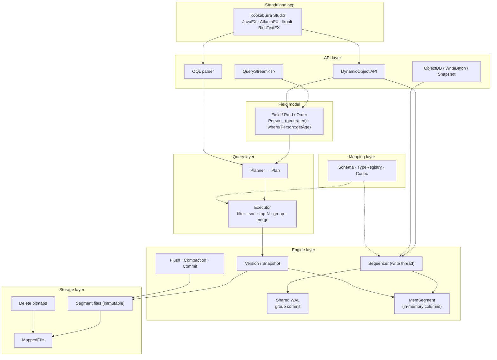

**Key idea:** every segment (on-disk *or* in-memory) exposes the same `SegmentView` interface → one executor for all.

---

## 3. Data Model

### 3.1 Collections & inheritance

- **Collection** = one root `@Entity` + all its `@Entity` subclasses (single-table inheritance).
- Each concrete class has a **class id**; every collection has a built-in `$type` column (dict + posting).
- `from(Animal.class)` → all rows; `from(Dog.class)` → `OR(post[$type=Dog], post[$type=Puppy])`.

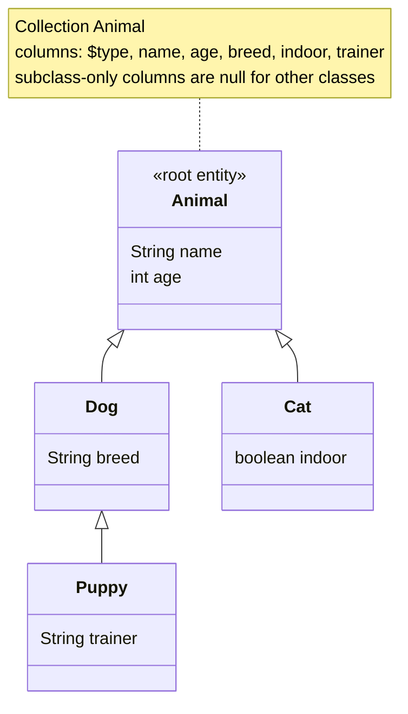

### 3.2 OID layout

```
 63 62            47 46                                           0
┌──┬───────────────┬──────────────────────────────────────────────┐
│0 │ classId (16)  │ per-class sequence (47)                       │
└──┴───────────────┴──────────────────────────────────────────────┘
```
- Always positive. Class id → concrete class → collection, so `get(Animal.class, oid)` needs no lookup to find the collection.
- Same-class objects cluster in OID order → `$type` postings become runs (compress well).

### 3.3 Entity mapping

```java
@Entity
public class Person {
    @Id      long oid;                          // assigned by DB
    @Version long version;                      // optimistic lock
    @Unique                   String email;     // unique constraint (implies an index)
    @Index                    String city;      // AUTO: BITMAP or ORDINAL per segment
    @Index                    BigDecimal salary;// exact decimal, numeric order
    @Index(ORDINAL)           int age;          // range / sort, no posting
                              String bio;       // row only
                              Address home;     // @Embeddable → paths home.city, home.zip
    @ForeignKey(onDelete = CASCADE)
    Ref<Company> employer;                      // stored as OID, lazy; checked reference
    @Index                    List<String> tags;// multi-valued
    @Transient                String cache;     // not persisted (same for `transient`)

    @PrePersist void created() { … }            // lifecycle callback (§3.7)
}

@Embeddable
public class Address {
    @Index String city;
           String zip;
}
```

| Java type | ValueType | Column key encoding | Notes |
|---|---|---|---|
| `boolean` / `Boolean` | BOOL | 1 byte | |
| `byte` `short` `char` `int` / boxed | INT32 | sortable 4 B | |
| `long` / `Long` | INT64 | sortable 8 B | |
| `float` `double` / boxed | FLOAT64 | sortable 8 B (§11) | |
| `BigDecimal` | DECIMAL | (scale, unscaled bytes), numeric order | exact; stored without trailing zeros (D49) |
| `String` | STRING | UTF-16 order (§11) | prefix-compressed dict |
| `enum` | ENUM | name; sort = declaration order | dict→ordinal permutation at query time |
| `LocalDate` | DATE | epochDay (8 B) | |
| `LocalDateTime` | DATETIME | (seconds, nanos) 16 B | |
| `Instant` | INSTANT | (seconds, nanos) 16 B | |
| `Ref<T>` | REF | OID (8 B) | not sortable |
| `List<S>` / `Set<S>` of scalar S | MULTI(S) | per element | |
| `@Embeddable` class | EMBEDDED | flattened paths | |
| `List` / `Set` of `@Embeddable` | EMBEDDED_LIST | n/a | row only |
| `Map<S1, S2>` of scalars | MAP | n/a | row only |
| `byte[]` | BYTES | n/a | row only |
| any other `Serializable` (incl. `Map<String,Object>`, `UUID`) | OBJECT | n/a | row only, Java serialization |

Not supported: `record` entities (immutable, no id back-fill), `final` persistent fields, entities without a no-arg constructor, fields hiding superclass fields. Null collection elements / map keys are rejected.

Values are **normalized** before comparison: `short` / `byte` / `char` → `Integer`, `float` → `Double`, `BigDecimal` → numerically canonical (`1.50` → `1.5`, `100` never `1E+2`).

### 3.4 Self-describing schema

The schema file alone must be enough to decode, query and edit every row (Studio and dynamic access have no entity classes).

```
schema_V
└─ collection Animal
   ├─ class Animal  id=1  parent=-           abstract=false
   ├─ class Dog     id=2  parent=Animal
   │   └─ field breed  STRING  index=AUTO  nullable
   ├─ fields (per class, in declaration order)
   │   name STRING AUTO · age INT32 (no index) · home EMBEDDED(Address) · tags MULTI(STRING) AUTO
   │   level ENUM(LOW, MEDIUM, HIGH)       ← constants in declaration order (= sort order)
   │   employer REF(Company)
   └─ embeddables: Address { city STRING AUTO, zip STRING (no index) }
```

### 3.5 Schema evolution

Each class keeps a list of **layouts** (field lists). A changed Java class appends a new layout; rows store `(classId, layoutId)` and are decoded by field name into the current class.

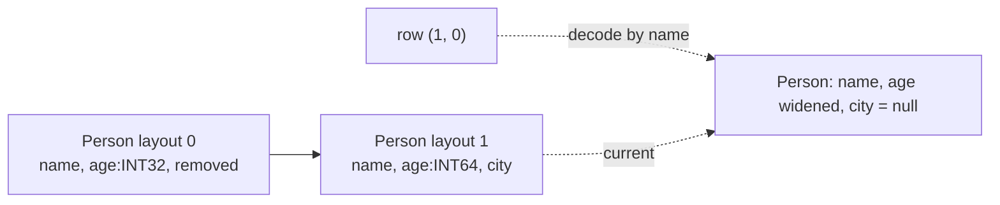

| Change | Handling |
|---|---|
| Add field | Old segments: column missing → reads as `null` / default |
| Remove field | Ignored on read; dropped at compaction |
| Widen `int → long` (INT32 → INT64, also inside collections / maps) | Widened on read |
| Enum: constants appended | OK; order = declaration order. Reordering / removing constants is rejected |
| Index kind added / changed | New layout; old segments simply lack the column (planner falls back to residual) |
| `@Unique` / `@ForeignKey` added | Stored data is checked first (like `ALTER TABLE ADD CONSTRAINT`): duplicates or dangling references fail the registration and the schema stays unchanged |
| Add subclass | New class id; old segments have no rows of it |
| Rename (`@Renamed("old")`) | Reserved |
| Any other type change | Rejected at open → explicit migration |

### 3.6 Constraints

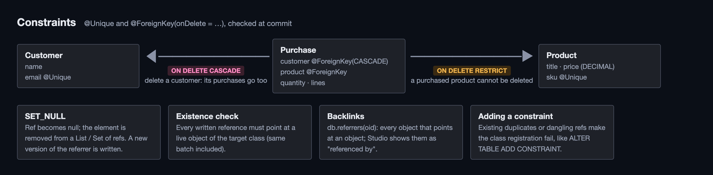

| Annotation | On | Rule | Violation |
|---|---|---|---|
| `@Unique` | scalar field (also inside `@Embeddable`, not in embedded lists) | no two live objects of the declaring class and its subclasses share a non-null value; nulls never conflict; decimals compare numerically | `ConstraintViolationException(UNIQUE)` |
| `@Unique(fields = {…}, name)` | entity class, repeatable | no two live objects share the **combination** of values; an object with a null in any of the fields is not compared (SQL, PostgreSQL default); paths may be dotted (`place.city`) and declared in superclasses; the first field is indexed when none is | as above, `field()` = the paths |
| `@ForeignKey(onDelete)` | `Ref<T>`, `List / Set<Ref<T>>` (also inside `@Embeddable`) | every non-null reference points at a live `T` (or subclass) | `ConstraintViolationException(FOREIGN_KEY)` |
| `onDelete = RESTRICT` (default) | target deleted | the delete fails while referrers exist | as above |
| `onDelete = CASCADE` | target deleted | referrers deleted in the same commit, recursively | none |
| `onDelete = SET_NULL` | target deleted | `Ref` cleared, collection element removed; referrer gets a new version | none |

- Composite constraints are stored per class (`ClassDef.uniques`, schema format 3) and checked with the same lookup on their first indexed path; candidates are compared on every path.
- Both imply `@Index(AUTO)`: checks are point lookups (index candidates confirmed with `find(oid, seq)`), cost follows the matches, not the collection size.
- Checked on the sequencer when the write commits (§6.5), against the latest state plus the batch's own writes: a batch may swap two unique values, insert a target and its referrer together, or delete a referrer and its target together. Inside a transaction the checks are deferred to `commit()` (like `DEFERRABLE INITIALLY DEFERRED`).
- Cascaded deletes and cleared references are appended to the batch: one WAL record, one sequence number, replayed as logged. They are storage-level (like SQL): no lifecycle callbacks.
- Backlinks: `db.referrers(oid)` / `tx.referrers(oid)` returns every object pointing at an OID through any reference path (`Ref`, collections of refs, refs inside embedded objects and lists); indexed paths use the index, the others a scan.
- Not retried by `inTransaction`: the same writes would fail again.

### 3.7 Lifecycle callbacks

| Event | Annotation / `EntityListener` method | When |
|---|---|---|
| PRE_PERSIST / PRE_UPDATE / PRE_REMOVE | `@PrePersist` `@PreUpdate` `@PreRemove` | on the caller thread when the write is issued (in a transaction: at `tx.insert / update / delete`); changes made here are stored; an exception cancels the write |
| POST_PERSIST / POST_UPDATE / POST_REMOVE | `@PostPersist` `@PostUpdate` `@PostRemove` | after the commit is durable (in a transaction: after `commit()`); nothing on rollback |
| POST_LOAD | `@PostLoad` | every object read as an entity (get, queries, OQL results) |

- Callback methods: no arguments, any visibility, inherited (superclass methods first, an override runs once). Listeners: `db.addListener(type, listener)`, matched with `isInstance`, run before the entity's own methods, in registration order.
- Skipped, like JPA: bulk OQL `UPDATE / DELETE`, deletes by OID, increments, `DynamicObject`s, FK cascades.

---

## 4. Directory Layout

Moved to [storage-design.md §3](storage-design.md#3-directory-layout).

- One directory per database, `LOCK`, `CURRENT` → `commit_N`, `schema/`, `wal/`, `col/<collection>/seg_N.odbf` + `.del` generations.
- Atomic file writes: `*.tmp`, fsync, rename, directory fsync.

---

## 5. Segment Format

Moved to [storage-design.md §4](storage-design.md#4-segment-format) (layout, encodings, index kinds, row encoding) and [§5](storage-design.md#5-where-roaringbitmap-is-used) (RoaringBitmap usage).

- Immutable file per segment, rows sorted by OID, docid = row number.
- Indexed fields: sorted dictionary, bit-packed ordinals, Roaring postings or sorted docids (`AUTO`).
- Rows: `RecordCodec`, path-only decoding.

---

## 6. Write Path

§6.1 to §6.4 moved to [storage-design.md §6](storage-design.md#6-write-path): flow, MemSegment, delete logs, flush and commit.

- One sequencer thread, WAL with group commit, MemSegment, background flush into segments.

### 6.5 Integrity checks


`Integrity.check(ops)` runs on the sequencer after version validation and before the WAL append; it returns the batch unchanged when the schema has no constraints.

1. **Final state** per touched OID: the batch's last record, or deleted (transactions also pass OIDs they inserted and deleted again: never stored, but treated as deleted for the batch's own references).
2. **Deletes** (worklist, so cascades recurse): for every foreign key whose target class covers the deleted object, find live referrers (index point lookup + the batch's own records); RESTRICT throws, CASCADE appends a delete, SET_NULL rewrites the referrer's record (its own op if the batch writes it, else a new update with version + 1).
3. **References**: every reference in a final record must point at an object that is live in the batch or in the latest state, of the target class.
4. **Unique**: per constraint, duplicates among the final records, then an index point lookup for each value excluding objects the batch itself changes.

Failure rejects the whole batch (nothing logged); appended ops are logged, applied and published with it, and recorded in the conflict table so concurrent transactions on those objects conflict.

---

## 7. MVCC: Versions & Snapshots

Moved to [storage-design.md §7](storage-design.md#7-versions-and-snapshots-mvcc).

- `Snapshot = (Version, visibleSeq)`, immutable `Version`, late-bound query snapshots.

---

## 8. Point Lookup

Moved to [storage-design.md §8](storage-design.md#8-point-lookup-getoid).

- MemSegments newest first (version chain), then segments (bloom, OID binary search, delete bitmap).

---

## 9. Query API

### 9.1 Field model (Speedment-inspired)

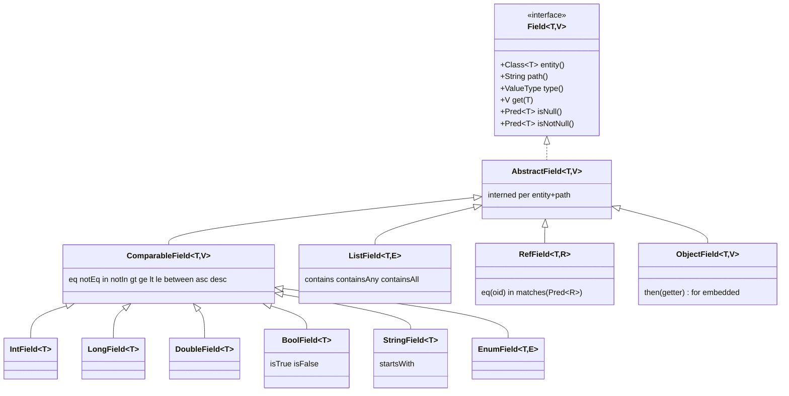

**Predicates** (`sealed interface Pred<T> extends java.util.function.Predicate<T>`):

```
Pred ── Eq · In · Range(lo, loInc, hi, hiInc) · IsNull · StartsWith · Contains(Any/All)
     ── InstanceOf(Class) · RefMatch(Pred) · RefIn(subquery)
     ── And · Or · Not · Residual(java.util.function.Predicate)
```
- `and / or / negate` overridden → stay inside `Pred` (metadata preserved).
- Every `Pred` is executable (`test(T)`): used for MemSegment fallback, residual evaluation and differential tests.

**Orders** (`Order<T> extends Comparator<T>`): `field.asc()`, `field.desc()`, `.nullsFirst()`, `.nullsLast()`; `thenComparing` / `reversed` overridden.

### 9.2 Two ways to get a field, freely mixed

| | Generated metamodel | Method reference |
|---|---|---|
| Syntax | `Person_.age.gt(30)` | `where(Person::getAge).gt(30)` |
| Needs | `kookaburra-processor` on annotation path | a getter (`getX` / `isX` / record accessor) |
| Embedded path | `Person_.home.city` | `where(Person::getHome).then(Address::getCity)` |
| Resolves to | same `Field` instance (registry keyed by `(class, path)`) | ← |

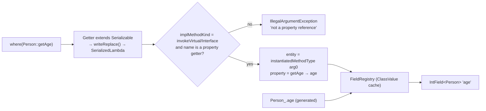

`where(...)` overloads (verified on JDK 17: exact method refs resolve by return type):
`IntGetter → IntField`, `LongGetter → LongField`, `DoubleGetter → DoubleField`, `BoolGetter → BoolField`, `StringGetter → StringField`, `ComparableGetter → ComparableField` (boxed, enum, dates; a boxed `Integer` property still yields the interned `IntField`), `CollectionGetter → ListField`, `RefGetter → RefField`, `Getter → ObjectField`.
Lambdas (`p -> p.getAge()`), bound references and non-persistent getters are rejected.

Generated metamodel naming: `Person` → `Person_`; nested `Outer.Inner` → `Outer_Inner_`; embedded `home` → nested class `Home_ extends EmbeddedPath` with instance fields (`Person_.home.city`). Recursive embeddables are a compile error.

### 9.3 QueryStream

**API style: chained everywhere** (D37). Conditions, sort keys and slices are method calls on the stream:

```java
List<Person> page = db.query(Person.class)
    .where(Person::getCity).eq("Sydney")          // indexed
    .where(Person::getAge).gt(30)
    .orderBy(Person::getAge).desc()
    .orderBy(Person::getName).asc()
    .skip(20).limit(10)
    .list();

List<DynamicObject> rows = db.dynamic("Person").from()            // dynamic: stored paths
    .where("home.city").eq("Perth").orderBy("age").desc().list();
```

| Chained call | Equivalent | Notes |
|---|---|---|
| `query(X.class)` | `from(X.class)` | on `ObjectDB`, `Transaction` |
| `.where(getter)` → `eq / notEq / in / gt / ge / lt / le / between / isNull / isNotNull / isTrue / isFalse / startsWith / contains` | `.filter(Q.where(getter).eq(...))` | conditions AND together; reference fields compare by OID; `.where("path")` for dynamic queries |
| `.orderBy(getter)` → `asc / desc / ascNullsFirst / descNullsLast` | `.sorted(Q.where(getter).desc(), ...)` | keys apply in call order |
| `.list()` | `.toList()` | |
| `.filter(or(a, b))`, `.filter(not(a))` | n/a | OR / NOT in the same chain |

Pipeline has a **fixed canonical order**; calls out of order throw `IllegalStateException`.

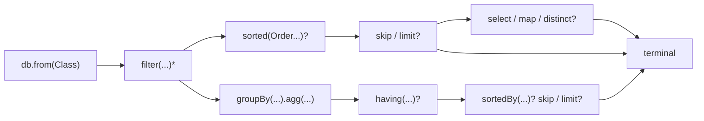

```java
import static com.github.kookaburra.query.Q.*;

List<Person> page = db.from(Person.class)
    .filter(Person_.city.eq("Sydney").and(where(Person::getAge).gt(30)))  // indexed
    .filter(p -> p.getBio() != null)                                      // residual
    .sorted(Person_.age.desc(), Person_.name.asc())
    .skip(20).limit(10)
    .toList();

long n          = db.from(Person.class).filter(Person_.tags.contains("vip")).count();
List<String> cs = db.from(Person.class).map(Person_.city).distinct().toList();
List<Tuple2<String,Integer>> t = db.from(Person.class).select(Person_.name, Person_.age).toList();
List<NameAge> r = db.from(Person.class).select(NameAge::new, Person_.name, Person_.age).toList();

List<Row> stats = db.from(Person.class)
    .filter(Person_.employer.matches(Company_.industry.eq("AI")))
    .groupBy(Person_.city)
    .agg(count(), avg(Person_.age), max(Person_.age))
    .having(count().gt(10))
    .sortedBy(count().desc())
    .toList();

List<Animal> dogs = db.from(Animal.class).filter(instanceOf(Dog.class)).toList();
String plan = db.from(Person.class).filter(...).explain();
```

### 9.4 SQL ↔ API ↔ execution

| SQL | API | Execution |
|---|---|---|
| `FROM Person` | `db.from(Person.class)` | snapshot; `$type` filter if subclass |
| `WHERE a = ? AND b > ?` | `filter(Person_.a.eq(..).and(Person_.b.gt(..)))` | dict search → post / ord range → AND |
| `WHERE <java code>` | `filter(p -> ...)` | residual: decode candidates |
| `ORDER BY a DESC, b` | `sorted(Person_.a.desc(), Person_.b.asc())` | per-segment ordinal sort → k-way merge by value |
| `LIMIT n OFFSET m` | `skip(m).limit(n)` | top-(m+n) per segment, merge, stop early |
| `SELECT a, b` | `select(Person_.a, Person_.b)` | read columns (ord → dict), no row decode |
| `SELECT DISTINCT a` | `map(Person_.a).distinct()` | ordinals whose post ∩ candidates ≠ ∅ |
| `COUNT(*)` | `count()` | cardinality |
| `EXISTS` | `exists()` / `first()` | stop at first non-empty segment |
| `MIN/MAX(a)` | `min(Person_.a)` / `max(...)` | first / last ordinal intersecting candidates |
| `SUM/AVG(a)` | `sum(Person_.a)` / `avg(...)` | scan ord over candidates (BSI later) |
| `GROUP BY a` + aggs | `groupBy(Person_.a).agg(...)` | per-ordinal arrays; count via `andCardinality` |
| `HAVING` | `having(count().gt(10))` | in-memory over groups |
| join via FK | `filter(Person_.employer.matches(pred))` | subquery → OID set → ref dict → OR posts |
| semi-join | `filter(Person_.employer.in(db.from(Company.class).filter(..)))` | same, subquery not materialized |
| eager join fetch | `fetch(Person_.employer)` | batch `getAll` of referenced OIDs |
| `UPDATE … WHERE` | `updateEach(p -> ...)` | one batch, optimistic lock per object |
| `DELETE … WHERE` | `deleteAll()` | candidates → delete log, no decode |

### 9.5 Terminals

`toList` · `first` · `count` · `exists` · `forEach` · `min` / `max` / `sum` (long / double / exact `BigDecimal`) / `avg` (double) · `cursor()` (`AutoCloseable`) · `stream()` · `explain()`.

Database-level: `referrers(oid)` / `referrers(Class, oid)` (backlinks, §3.6), `addListener` / `removeListener` (§3.7), `backup(Path)` (§15.2), `inTransaction(TxOptions, work)`.

### 9.6 Resources

- All terminals except `cursor()` / `stream()` release their snapshot before returning.
- `cursor()` / `stream()` hold the snapshot until closed or exhausted; a `Cleaner` is the safety net.

### 9.7 JDK Stream interop

`QueryStream.stream()` returns a `java.util.stream.Stream<T>` over the **pushed-down** result; further operations run in the JDK. `onClose` releases the snapshot.

### 9.8 Dynamic access (no entity classes)

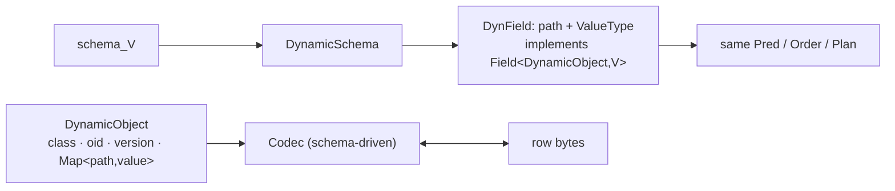

```java
DynamicCollection people = db.dynamic("Person");            // simple name if unique, else fully qualified
DynField age = people.field("age");
List<DynamicObject> rs = people.from().filter(age.gt(30)).sorted(age.desc()).limit(10).toList();

DynamicObject o = people.newObject().set("name", "Ann").set("home.city", "Perth").set("level", "HIGH");
long oid = people.insert(o);   o.set("age", 31);   people.update(o);   people.delete(o);
```

- `QueryStream` is generic over a **target** (stored class + how documents become results): typed entities, `DynamicObject`s, or OQL's mix (evaluate on `DynamicObject`, return entities).
- Values accepted by `DynField` / `set`: Java values or their canonical forms (enum names, OIDs for refs, ISO strings for dates); validated against the schema on write (`DynamicCodec`).

- `DynField` implements `Field<DynamicObject, V>` → `Pred`, `Order`, planner and executor are reused unchanged.
- Values are canonical (§3.3); embedded values are nested `Map`s; refs are `Ref`; enums are constant names validated against the schema.
- Typed and dynamic access may be used on the same database concurrently.

### 9.9 OQL (Object Query Language, JPQL-style)

Text queries for applications and Studio's console; parsed into the same `Plan` as `QueryStream`. Not SQL: it queries **objects**, navigates paths and references, and is polymorphic.

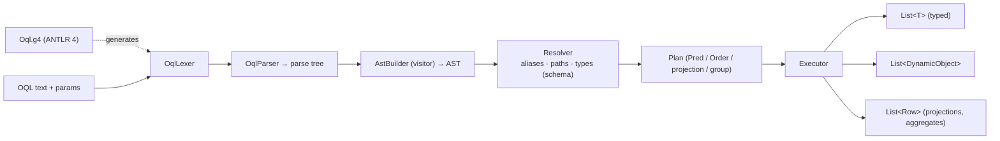

**Grammar (JPQL syntax, SQL-92 core semantics; normative version: `kookaburra-core/src/main/antlr4/.../Oql.g4`)**

```
statement   := select | update | delete
select      := SELECT [DISTINCT] selectList FROM Entity [[AS] alias]
               [WHERE expr] [GROUP BY expr {, expr} [HAVING expr]]
               [ORDER BY orderItem {, orderItem}] [LIMIT n] [OFFSET m]
selectList  := '*' | alias | NEW className '(' selItem {, selItem} ')' | selItem {, selItem}
selItem     := expr [[AS] name]
update      := UPDATE Entity [[AS] alias] SET path '=' expr {, path '=' expr} [WHERE expr]
delete      := DELETE FROM Entity [[AS] alias] [WHERE expr]
orderItem   := (expr | resultAlias | position) [ASC | DESC] [NULLS FIRST | NULLS LAST]

expr        := expr OR expr | expr AND expr | NOT expr
             | expr cmp expr | expr [NOT] BETWEEN expr AND expr | expr [NOT] IN '(' expr {, expr} ')'
             | expr [NOT] LIKE pattern [ESCAPE 'c'] | expr IS [NOT] NULL | path IS [NOT] EMPTY
             | expr [NOT] MEMBER [OF] path | TYPE '(' alias ')' [NOT] IN '(' Entity {, Entity} ')'
             | expr ('+' | '-' | '*' | '/' | '%' | '||') expr | '-' expr | '(' expr ')'
             | CASE WHEN expr THEN expr {WHEN expr THEN expr} [ELSE expr] END
             | fn '(' expr {, expr} ')' | agg | path | literal | :name | ?n
fn          := UPPER | LOWER | TRIM | LENGTH | SUBSTRING | ABS | MOD | COALESCE | NULLIF | SIZE
agg         := COUNT '(' '*' ')' | (COUNT | SUM | AVG | MIN | MAX) '(' [DISTINCT] expr ')'
cmp         := = | <> | != | < | <= | > | >=
literal     := number | 'string' | TRUE | FALSE | NULL | DATE 'yyyy-MM-dd'
             | TIMESTAMP 'yyyy-MM-dd HH:mm:ss[.n]' | INSTANT 'yyyy-MM-ddTHH:mm:ss[.n]Z' | EnumClass.CONSTANT
path        := [alias '.'] field {'.' field}   -- alias optional; implicit dereference through Ref and @Embeddable
```

| Clause | Semantics (SQL-92) |
|---|---|
| `WHERE` | rows where `expr` is TRUE (two-valued: comparisons with NULL are FALSE, §11) |
| `GROUP BY` | one row per distinct key tuple (NULL is a key); select items must be keys or aggregates |
| `HAVING` | filter on groups; may use aggregates and keys |
| aggregates | ignore NULL inputs; `COUNT(*)` counts rows; no non-NULL input → `COUNT` 0, others NULL (also in the typed `GroupStream`; `QueryStream.sum()` returns 0); `SUM(int)` → long, `AVG` → double |
| `DISTINCT` | on the full select list, before `ORDER BY` / `LIMIT` |
| `ORDER BY` | expression, select alias or 1-based position; default `ASC NULLS LAST` |
| expressions | evaluated on canonical values (no entity classes needed); `/` on integers is integer division; `||` concatenates strings |

**Implementation notes**

- Grammar is layered like SQL (`OR < AND < NOT < predicate < value expression < primary`), so `BETWEEN … AND …` / `LIKE … ESCAPE …` never swallow a following `AND` (a bug the OQL differential suite caught).
- Push-down: `path ⋈ constant` (either side), `BETWEEN`, `IN`, `LIKE 'prefix%'`, `IS [NOT] NULL`, `MEMBER OF`, `TYPE()`; paths through references become sub-queries (`DynRefMatch`). Everything else is evaluated per object (`RESIDUAL` in explain). Literals that do not fit the column type (e.g. `age > 30.5`) are evaluated, not coerced.
- `ORDER BY` of plain stored paths is pushed down (top-N); otherwise sorting happens in memory. Enum keys sort by declaration order everywhere.
- `GROUP BY` / aggregates on plain stored paths run on canonical values without materializing objects (**fast path**); any expression switches to per-object evaluation. Both are checked against each other in tests.
- `TYPE(a)` is exact (JPQL); `instanceOf` in the typed API includes subclasses.
- Unknown paths in any clause are errors (with line / column).

**Mapping to the plan**

| OQL | Plan |
|---|---|
| `SELECT p FROM Person p` | objects of Person + subclasses |
| `p.home.city = 'Perth'` | `Eq(home.city)` → column |
| `p.employer.industry = 'AI'` / `JOIN p.employer e WHERE e.industry = 'AI'` | `RefMatch(employer, industry = 'AI')` |
| `'vip' MEMBER OF p.tags` | `Contains(tags, vip)` |
| `p.tags IS EMPTY` | `IsNull(tags) OR size = 0` (residual for size) |
| `p.name LIKE 'Ann%'` | `StartsWith(name, 'Ann')`; other patterns (`%x%`, `_`, `ESCAPE`) → expression filter |
| `WHERE p.price * p.qty > 100`, `UPPER(p.name) = 'ANN'` | expression filter on canonical values (no index) |
| `SELECT p.name, p.price * p.qty AS total … ORDER BY total DESC` | computed projection + sort on computed key |
| `COUNT(DISTINCT p.city)` | distinct-set aggregate |
| `TYPE(a) IN (Dog, Cat)` | `InstanceOf` exact-class set (`$type` postings) |
| `SELECT NEW x.NameAge(p.name, p.age)` | projection + constructor |
| `SELECT p.city, COUNT(p) … GROUP BY p.city HAVING COUNT(p) > 10` | group / agg / having |
| `UPDATE … SET … WHERE` / `DELETE … WHERE` | `updateEach` / `deleteAll` in one batch |

**API**

```java
List<Person> ps = db.oql("SELECT p FROM Person p WHERE p.city = :city AND p.age > ?1 ORDER BY p.age DESC", Person.class)
                    .param("city", "Sydney").param(1, 30).limit(10).list();
List<Row> rows  = db.oql("SELECT p.city, COUNT(p) AS n FROM Person p GROUP BY p.city ORDER BY n DESC").rows();
long changed    = db.oql("UPDATE Person p SET p.active = FALSE WHERE p.age > 90").execute();
String plan     = db.oql("SELECT p FROM Person p WHERE 'vip' MEMBER OF p.tags").explain();
List<DynamicObject> any = db.oql("SELECT a FROM Animal a WHERE TYPE(a) = Dog").dynamic().list();   // no classes needed
```
Entity names: simple class name if unique in the schema, else fully qualified.

---

## 10. Query Execution

### 10.1 Plan

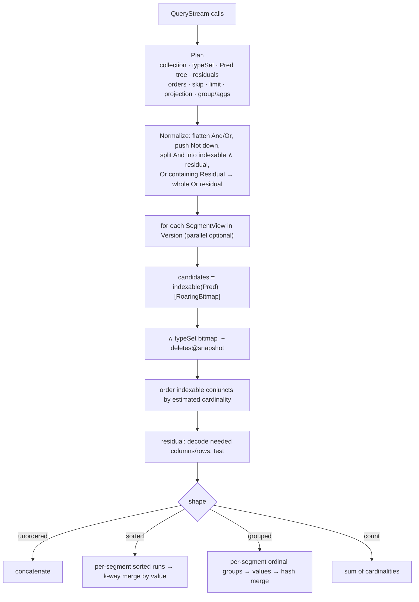

### 10.2 Predicate evaluation per index kind

| Pred | BITMAP | ORDINAL | MemSegment | no column |
|---|---|---|---|---|
| `Eq` | dict search → post | dict search → scan ord = k | key → post list | residual |
| `In` | OR of posts | scan ord ∈ set | OR of post lists | residual |
| `Range` | ord range `[lo,hi)`: OR posts if `hi−lo ≤ 64`, else scan ord | scan ord in range | scan values | residual |
| `StartsWith` | dict prefix → ord range | dict prefix → ord range | scan values | residual |
| `IsNull` | null bitmap | null bitmap | scan values | residual |
| `Contains` (MULTI) | post | scan multi | post list | residual |
| `InstanceOf` | `$type` posts | n/a | `$type` posts | n/a |
| `RefMatch` | subquery → OIDs → ref dict → posts | scan | scan | residual |
| `Not(x)` | `[0,N) − x` | same | same | residual |
| `Residual` | n/a | n/a | n/a | decode row, `test` |

Scans of `ord` are restricted to the current candidate bitmap when one exists.

### 10.3 Sort / top-N

- **Index order** (one sort key with post or sdoc, `limit` given): walk documents in value order (`ColumnIndex.forEachInOrder`), keep candidates, stop after `skip+limit` per segment. Used when `bound × N ≤ 4 × matches²` (else scanning the matches is cheaper); not when matching nulls sort first.
- Otherwise: read the key of every match into a bounded max-heap of `skip+limit`; a candidate not better than the heap top is rejected without allocation.
- Across segments: candidates of all segments meet in the same heap, compared by **value**; ties by (segment, docid).
- Unindexed sort key: values are read from the row with path-only decoding (other fields skipped, §5.4).

### 10.4 Group / aggregate

| Case | Per segment | Rows visited |
|---|---|---|
| one key with post, only `COUNT(*)` | `andCardinality(post[o], matches)` per value + nulls | **none** |
| one key with dict ordinals | states in an array indexed by ordinal; key decoded once per value | matches (no hashing) |
| several keys / no column | canonical key tuple → hash map | matches |

Cross-segment: ordinal → value, merge in hash map (`count` add, `sum` add, `avg` (sum,count), `min/max` compare, `count distinct` set union).

### 10.5 explain()

```
QUERY Person  snapshot=seq 1842  segments=5 (mem 2, disk 3)
FILTER
  AND
    city = 'Sydney'          [BITMAP post]        est 1.2%
    age > 30                 [ORDINAL scan]       est 38%
  RESIDUAL p -> ...          [decode rows]
SORT age DESC, name ASC      [ordinal runs, k-way merge]
LIMIT 20+10                  [top-N]
```

---

## 11. Semantics Contract

Index execution **must** equal `Pred.test` / `Order.compare` on objects. Enforced by differential tests.

| Topic | Rule |
|---|---|
| Default order | **Unordered** unless `sorted(...)`; `limit` without `sorted` = any n rows |
| Null in comparisons | `eq / gt / range / startsWith` on null → `false`; `isNull` explicit |
| Logic | Two-valued Java boolean: `not(age > 30)` matches `age == null` |
| Null in sort | `nullsLast` for `asc()`, `nullsFirst` for `desc()`; overridable |
| String order | `String.compareTo` (UTF-16 code units); dict sorted the same, **not** UTF-8 byte order |
| Double order / equality | `Double.compare`: `-0.0 < 0.0`, `NaN` greatest, `NaN eq NaN` true |
| Decimal order / equality | numeric (`BigDecimal.compareTo`): `1.50 = 1.5`; read back as `1.5`. OQL: an expression with a DECIMAL operand is exact (`0.1 + 0.2 = 0.3`), division to 34 digits; `SUM` / `AVG` of decimals are decimals (typed `avg()` returns double, like JPA) |
| Enum order | declaration order (`Enum.compareTo`) |
| Time zone | **UTC everywhere**: `LocalDateTime` is stored as UTC wall time, `Instant` is UTC; OQL `TIMESTAMP` / `INSTANT` literals are UTC; Studio displays UTC (labelled); the engine never uses `ZoneId.systemDefault()`. `ZonedDateTime` / `OffsetDateTime` / `java.util.Date` are not first-class types (store an `Instant`) |
| Multi-valued `contains` | any element matches |
| Path through an embedded list (`items.sku`) | multi-valued, "any element" (`contains`, `MEMBER OF`, `whereAny`); not indexed → scan |
| Embedded collection paths | element correlation **not** supported (two conditions may match different elements) |
| Polymorphism | `from(A)` includes all subclasses; subclass-only fields are null for others |

---

## 12. Concurrency

| Component | Thread safety |
|---|---|
| `ObjectDB` | thread-safe, one per directory per process |
| Writes | encoding on caller threads; one sequencer thread validates / logs / applies; WAL group commit |
| Reads | lock-free on `Version` + `visibleSeq` |
| Isolation | snapshot reads; single op / `WriteBatch` atomically visible; transactions: READ COMMITTED, SNAPSHOT, SERIALIZABLE (§12.1) |
| Conflicts | version mismatch → `OptimisticLockException` |
| `Snapshot`, `Cursor`, `WriteBatch`, `QueryStream` | not thread-safe |
| Back-pressure | too many segments / frozen memtables → writers throttled |

### 12.1 Transactions

Full design: **[transaction-design.md](transaction-design.md)** (implemented 2026-10-15).

| Aspect | Design |
|---|---|
| Switch | `kookaburra.transactions` (default `false` = autocommit only, no overhead) |
| Isolation | `READ_COMMITTED` (fresh snapshot per statement), `SNAPSHOT` (default, snapshot at `begin()`), `SERIALIZABLE` (snapshot + read validation at commit); default from `kookaburra.tx-isolation` |
| Concurrency control | optimistic: write set buffered; at commit the sequencer checks a conflict table (OID → last seq): first committer wins; stale `@Version` entities rejected at the call |
| Read-your-writes | private overlay `MemSegment` + masked snapshot views → every query / OQL / dynamic read sees the transaction's writes |
| Atomicity | one WAL record per commit; a failing call has no effect (statement-level) |
| Hot spots | `increment(Class, oid, field, delta)`: applied on the latest value at commit, never conflicts |
| SERIALIZABLE | read set = OIDs read by lookup + every query condition (`ReadView.queryViews`); at commit the before / after versions of commits since the snapshot (`ChangeLog`, kept only while SERIALIZABLE transactions are open) are tested against it; a match aborts. Read-only transactions never fail |
| API | `db.begin(Isolation.X)`, `tx.get / query / oql / dynamic / referrers / insert / update / delete / increment / commit / rollback`, `db.inTransaction([options,] work)`, `db.inTransactionResult([options,] fn)` |

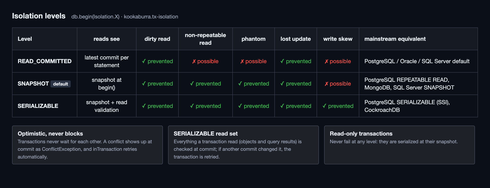

---|---|
| Atomic multi-object, multi-collection write | `WriteBatch`: one WAL record, all or nothing |
| Atomic visibility | global `visibleSeq`: a batch is seen entirely or not at all |
| Repeatable reads across queries | `Snapshot` (MVCC) |
| Lost-update protection | `@Version` optimistic lock → `OptimisticLockException` |
| Durability | WAL + fsync per commit group (`SYNC`) |
| Interactive transactions | `db.begin(...)` with three isolation levels (§12.1, [transaction-design.md](transaction-design.md)) |
| **Not provided** | savepoints / nested transactions (T13), cross-process access |

---

## 13. Compaction

Moved to [storage-design.md §10](storage-design.md#10-compaction).

- Size tiers (`compaction-fan-in`), garbage-driven rewrites (`compaction-garbage-ratio`), `compact()`, back-pressure.

---

## 14. File I/O

Moved to [storage-design.md §11](storage-design.md#11-file-io).

- `MappedFile` over memory-mapped files (heap in memory mode), little-endian.

## 15. Recovery

Moved to [storage-design.md §12](storage-design.md#12-recovery).

- Commit file, orphan cleanup, WAL replay from per-collection replay points, torn tail truncated.

### 15.1 Logging

| Module | Logging |
|---|---|
| `kookaburra-core` | **SLF4J API only** (2.0.x); the application picks the backend. No logging on the per-write / per-row paths |
| Studio | logback 1.5 → `kookaburra.log-dir` / `studio.log` (daily + 10 MB rolling, 14 days, 200 MB cap) + console; level `kookaburra.log-level` |
| Bench | slf4j-simple at WARN |

| Logger | Level | Event |
|---|---|---|
| `Database` | INFO | open (collections, segments, WAL records replayed, ms), close, compaction (inputs, rows, bytes, ms) |
| `Database` | DEBUG | flush (rows, bytes, ms) |
| `Database` | WARN | write back-pressure longer than 1 s |
| `Database` / `Sequencer` | ERROR | flush / compaction / sequencer failure (writes stop) |
| `WalFile` | WARN | torn / corrupt WAL tail truncated |


### 15.2 Online backup

Moved to [storage-design.md §13](storage-design.md#13-online-backup).

- `db.backup(target)`: one snapshot exported into fresh segments, writers not blocked, returns `BackupInfo`.

---

## 16. Configuration

One file, **`kookaburra.properties`** (repo root; copied next to the Studio jar by the `dist` build). Every tunable is defined there and nowhere else; defaults are the recommended settings.

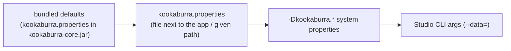
Later sources override earlier ones (`Settings.load`, `Config.load` / `Config.fromSettings`; `Config.withX(...)` in code).

| Key | Default | Used by | Meaning |
|---|---|---|---|
| `kookaburra.mem-segment-bytes` | `64MB` | core | MemSegment size before freeze → flush |
| `kookaburra.segment-max-bytes` | `512MB` | core | compaction output limit (capped at 1.5 GB) |
| `kookaburra.compaction-fan-in` | `8` | core | segments merged per tier |
| `kookaburra.compaction-garbage-ratio` | `0.3` | core | share of deleted rows at which a segment is rewritten on its own (§13) |
| `kookaburra.max-segments` | `64` | core | per collection; above it writers are throttled |
| `kookaburra.write-backlog` | `10` | core | frozen MemSegments waiting for flush before back-pressure |
| `kookaburra.flush-threads` | `2` | core | threads for flushes and compactions |
| `kookaburra.transactions` | `false` | core | enables multi-statement transactions (off = autocommit, no conflict history) |
| `kookaburra.tx-timeout` | `60s` | core | open transactions older than this are rolled back |
| `kookaburra.tx-max-bytes` | `100MB` | core | encoded bytes buffered by one transaction |
| `kookaburra.tx-retries` | `3` | core | retries of `inTransaction` on `ConflictException` |
| `kookaburra.tx-isolation` | `SNAPSHOT` | core | isolation of `begin()` / `inTransaction` without options: `READ_COMMITTED`, `SNAPSHOT`, `SERIALIZABLE` |
| `kookaburra.tx-conflict-table-max` | `2000000` | core | conflict-table (and SERIALIZABLE change-log) entries before the oldest open transaction is evicted |
| `kookaburra.bloom-fpp` | `0.01` | core | OID bloom filter false-positive rate per segment |
| `kookaburra.auto-postings-ratio` | `16` | core | AUTO index writes postings when rows / distinct ≥ ratio |
| `kookaburra.postings-or-max` | `64` | core | range / IN over at most this many postings ORs bitmaps, else scans ordinals |
| `kookaburra.durability` | `SYNC` | core | `SYNC` = fsync per commit group, `ASYNC` = OS page cache |
| `kookaburra.group-commit-micros` | `200` | core | sequencer waits this long to batch more commits (SYNC only) |
| `kookaburra.sequencer-max-group` | `512` | core | max write requests per group commit |
| `kookaburra.data` | _(empty → `<app dir>/data`)_ | Studio | default database directory |
| `kookaburra.theme` | `NEON` | Studio | initial theme (user choice is remembered) |
| `kookaburra.page-size` | `50` | Studio | Data grid rows per page |
| `kookaburra.console-page-size` | `100` | Studio | OQL console rows per page |
| `kookaburra.demo-customers` | `250` | Studio | size of the `--demo` database |
| `kookaburra.log-dir` | _(empty → `<app dir>/logs`)_ | Studio | log directory (relative paths: against the jar directory) |
| `kookaburra.log-level` | `INFO` | Studio | ERROR / WARN / INFO / DEBUG / TRACE |

Sizes accept `KB` / `MB` / `GB`.

### 16.1 Performance plan

| Principle | Where |
|---|---|
| Push work into bitmaps: filters, type filters, deletes, counts never touch rows | §10.2, `Executor` |
| Never decode rows for indexed predicates; MemSegments hold decoded `Record`s | §6.2 |
| Cheapest conjunct first; each next conjunct only scans the surviving candidates | `Executor.ordered` |
| Top-N with a bounded heap, early stop for unordered `limit` | §10.3 |
| Encoding on caller threads; one fsync per group of batches | §6.1 |
| Lock-free reads: immutable `Version`, append-only chunked arrays, volatile publication | §6.2, §7 |
| Zero-copy on-disk structures: `ImmutableRoaringBitmap` over mapped slices, O(1) bit-packed ordinals | §5 |

**Harness**: `kookaburra-bench` (D31): `java -Xmx8g -jar kookaburra-bench/target/kookaburra-bench.jar --n=10000000 --threads=16 --seconds=20`; warm-up + repeated runs (p50 / p99); consistency checked after every phase (count ≡ scan ≡ OQL); test data deleted afterwards. Full report: [`benchmark-10m.md`](benchmark-10m.md).

**Environment**: Apple M2 Max (12 cores), 32 GB, internal SSD (APFS, `force()` = `F_FULLFSYNC` ≈ 4 ms), macOS, JDK 17.0.12, `-Xmx8g`; 10 M objects (`Member`: indexed `name` (unique), `city` (50 values), `age` ORDINAL, `tags` list; plain `score`, `balance`, `active`, `note`), 18 segments after load, 4 after compaction.

| Benchmark (10 M objects, run of 2026-10-17) | Target | Before tuning | **Result** |
|---|---|---|---|
| bulk insert, batches of 100, `ASYNC`, 1 thread | ≥ 300 k/s | 468 k/s | **696 k/s** ✅ |
| single insert, `SYNC`, 16 / 128 threads | ≈ threads ÷ fsync latency | 3.1 k/s | **3.2 k/s / 21.2 k/s** ✅ (fsync 4 ms) |
| `get(oid)` MemSegment / segment (p50) | ≤ 2 µs / ≤ 10 µs | 0.75 / 0.92 µs | **0.58 / 1.08 µs** ✅ |
| `count()` with one BITMAP `eq` | ≤ 5 ms | 0.23 ms | **0.24 ms** ✅ |
| `eq` + `range` + `limit(100)` | ≤ 20 ms | 0.18 ms | **0.21 ms** ✅ |
| top-10 by an ORDINAL column, 2.3 M matches | ≤ 50 ms / 1 M | 187 ms | **0.39 ms** ✅ |
| `groupBy(city).agg(count)` | ≤ 100 ms | 902 ms | **4.0 ms** ✅ |
| point lookup on a unique indexed string (OQL) | n/a | 13 ms | **0.12 ms** |
| OQL `GROUP BY city, COUNT, AVG(age) WHERE age > 40` | n/a | 756 ms | **244 ms** |
| unindexed predicate, full scan of 10 M rows | n/a | did not finish (full row decode) | **0.81 s** |
| `compact()` 10 M objects (1.4 GB) | n/a | 17.7 s | **10.4 s** |
| transactions: transfers (read 2, update 2), 16 threads: SNAPSHOT / READ COMMITTED / SERIALIZABLE | ≥ 50 k/s | n/a | **136 / 142 / 140 k/s** ✅ (0.023 retries / commit) |
| `increment` of one hot counter, 16 threads | no lost updates | n/a | **265 k/s** ✅ |
| insert with `@Unique` vs without, batches of 100, in memory | ≥ 50 % of plain | n/a | **235 vs 258 k/s** ✅ |
| insert with a checked `@ForeignKey` / delete with ON DELETE CASCADE, batches of 100 | n/a | n/a | **225 k/s / 181 k/s** |
| online backup of 10.5 M objects (1.4 GB) | n/a | n/a | **25.4 s** (413 k objects/s), writers not blocked |
| OQL `DELETE` of all 10.5 M objects, then `compact()` | space reclaimed | 1.5 GB left (4 segments) | **1.32 M/s, 0 B left** ✅ (D44) |
| reopen (no WAL to replay) / heap after reopen | n/a | n/a | **2.0 ms / 6.5 MiB** (mmap) |
| disk footprint | n/a | 136 B / object | **148 B / object** (+ sdoc lists) |

**Problems found and fixed** (M11):

| Symptom | Cause | Fix |
|---|---|---|
| unindexed filter on 10 M rows never finished | every row fully decoded (all strings allocated) to read one field | path-only decoding (§5.4) |
| `GROUP BY` 900 ms | per row: map lookup, `new String` key, `Arrays.asList`, hashing | ordinal-indexed states; `COUNT(*)` from postings (§10.4) |
| top-N 187 ms | key read + 2 allocations + heap push / pop per match | index-order walk with early stop; allocation-free rejects (§10.3) |
| unique-key lookup 13 ms | AUTO index without postings scanned 10 M ordinals | value-sorted doc lists (D32) |
| flush / merge memory | a RoaringBitmap per distinct value built even when postings were not written | build postings only when written |
| deleting all 10 M objects left 1.5 GB on disk | size-tiered merging never picked lone / oversized segments | garbage-driven compaction, `flush()` / `compact()` wait for running work (D44) |
| 200 k inserts with `@Unique` took minutes (quadratic) | each check ran the generic executor, which builds the live bitmap of the whole memtable | index point lookup confirmed with `find(oid, seq)` (§3.6) |

**Known limits** (documented, not bugs): durable single writes are bound by fsync latency × concurrency; sorting / filtering on unindexed fields reads rows (≈ 80 ns / row); a flush / merge buffers the whole segment in heap (streaming writer: backlog); mixed read p99 (~150 ms) is dominated by sorts on the unindexed `score`.

---

## 17. Kookaburra Studio (standalone UI)

Independent desktop application: module / jar **`kookaburra-face`** (own launcher); opens any database directory through the dynamic API: no entity classes needed.

| Concern | Choice |
|---|---|
| Runtime | JDK 17, JavaFX 21 LTS |
| Theme | AtlantaFX 2.0.1 (last line on JDK 17; 2.1 needs 21, 3.x needs 25): default **Kookaburra Neon** (Dracula + `neon.css`); switchable to Dracula, Nord, Primer, Cupertino (dark / light), saved in user preferences |
| Icons | Ikonli 12.4.0 (Material Design 2 pack) |
| Editors | RichTextFX 0.11.7 `CodeArea`: OQL console, JSON object editor, explain / log viewer |
| Packaging | separate Maven project; dev run `mvn -f kookaburra-face/pom.xml javafx:run`; **distribution** `mvn -f kookaburra-face/pom.xml -P dist package` → `bin/kookaburra-face.jar` (fat jar, JavaFX natives of the build OS) + `studio.sh` / `studio.cmd` + `kookaburra.properties` |
| Data directory | `--data=<dir>` > `kookaburra.data` (relative to the jar) > `<dir of the jar>/data`; `--demo` = in-memory sample database; both may be combined (two databases in the navigator) |
| Input safety | editor values are type-checked before the dialog closes (field-qualified message, input kept); the Data filter is a condition only (wrapped in parentheses: no `LIMIT` / `ORDER BY`); `EXPLAIN UPDATE / DELETE` only shows the plan; opening a non-empty directory that is not a database asks first; errors name the directory and the reason |
| Platforms | one jar for **Windows x64, Linux x64, macOS Apple Silicon** (JavaFX natives of all three; `.dll` / `.so` / `.dylib` do not collide); Intel Mac / Linux ARM: `-Djavafx.mac=mac` / `-Djavafx.linux=linux-aarch64`. Needs a Java 17+ runtime; starts with a double-click (`Launcher`, `StudioApplication`). Verified: macOS aarch64 (double-click), Linux x86_64 (Docker + Xvfb) |
| Logging | logback, see §15.1 |
| Start-up | splash (logo, Studio + core version, loading bar) for ≥ 1.2 s while the main window is built, then fades out |
| UI tests | TestFX 4.0.18 + Monocle 17.0.10, headless (software rendering); `StudioNestedTest` / `StudioMultiDbTest` run in memory and on disk; `TutorialRecorder` (not in the regular run; `-P tutorial`) records Studio clicks and code slides and renders the tutorial video with `TutorialVideo` (mouse cursor, cross-fades, subtitles, music, poster); screenshots → `target/screenshots`, published copies in `docs/assets/studio-*.png`; boundary suite `StudioEdgeCaseTest`; `-P visible` replays it on the real display with pauses |

### 17.1 Layout

```
┌───────────────────────────────────────────────────────────────────────────────┐
│ ☰ Open DB   ⟳ Refresh   ＋ New   ✎ Edit   🗑 Delete   ▶ Run (Ctrl+Enter)        │  toolbar
├──────────────────┬────────────────────────────────────────────────────────────┤
│ Collections      │ [ Data ] [ Query ] [ Schema ]                              │
│ ▾ Person   12,034│ ┌────────────────────────────────────────────────────────┐ │
│ ▾ Animal    3,210│ │ filter: city = 'Sydney' AND age > 30      [Apply] [⟳]  │ │
│    ├ Dog    1,800│ ├──┬──────┬───────┬────────┬─────┬───────────────────────┤ │
│    └ Cat    1,410│ │ #│ oid  │ $type │ name   │ age │ home.city …           │ │  TableView
│ ▸ Company     512│ │ …    │       │        │     │  (sortable headers →     │ │  (virtualized,
│                  │ │      │       │        │     │   ORDER BY push-down)    │ │   paged)
│                  │ ├──────┴───────┴────────┴─────┴──────────────────────────┤ │
│                  │ │ ◀ 1 2 3 … ▶   50 / page          12,034 rows · 4 ms    │ │
│                  │ └────────────────────────────────────────────────────────┘ │
├──────────────────┴────────────────────────────────────────────────────────────┤
│ Object editor (drawer):  [ Form ] [ JSON ]   Save · Cancel · version 7        │
└───────────────────────────────────────────────────────────────────────────────┘
```

### 17.2 Visual style: dark / neon

`studio.css` holds layout and derives its `-k-*` tokens from the active AtlantaFX theme; `neon.css` (default theme) sets the palette below.

| Token | Value | Use |
|---|---|---|
| `-k-bg-0` | `#0B0E14` | window background |
| `-k-bg-1` | `#11151F` | panels, sidebars |
| `-k-bg-2` | `#1A2030` | cards, table header, editors |
| `-k-border` | `#26304A` | 1 px separators |
| `-k-fg` | `#E6EDF7` | primary text |
| `-k-fg-muted` | `#7A8BA8` | secondary text, gutters |
| `-k-accent` | `#00E5FF` (neon cyan) | focus ring, selection, primary buttons, active tab underline |
| `-k-accent-2` | `#FF2BD6` (neon magenta) | OQL keywords, highlights, badges |
| `-k-ok` / `-k-warn` / `-k-err` | `#39FF88` / `#FFC14D` / `#FF4D6D` | status, toasts, conflict dialogs |

| Element | Treatment |
|---|---|
| Focus / hover | `dropshadow(gaussian, -k-accent, 12, 0.35, 0, 0)` glow; 120 ms fade |
| Tabs, buttons | flat, 6 px radius, accent underline / outline; icons Ikonli MDI2 in `-k-fg-muted`, accent on hover |
| Table | zebra `-k-bg-1` / `-k-bg-2`; selected row = accent at 18 % alpha + left 2 px accent bar |
| Code (OQL / JSON) | JetBrains Mono (bundled, OFL) 13 px; keywords magenta, strings `#39FF88`, numbers `#FFC14D`, paths cyan, comments muted italic; current line `#1A2030` |
| Status bar | row count · elapsed ms · snapshot seq, monospace, accent dot pulses while a query runs |
| Splash / empty states | logo + subtle cyan→magenta gradient line |

### 17.3 Features

| Tab / area | Feature |
|---|---|
| Toolbar | open / demo / close / refresh; **Flush** writes the current database's memtables to segment files now (an open transaction is not included: its changes are private until commit); **Backup** (online backup of the current database into a chosen folder: used as is when empty, else a time-stamped `<name>-backup-yyyyMMdd-HHmmss` sub-folder; status shows objects, segments, snapshot seq); new / edit / delete; run; transaction buttons; themes; About |
| Navigator (sidebar) | **several databases at once**: tree database → classes (hierarchy, live object counts); close button per database; a directory already open is focused, not reopened; same-named databases get unique labels (`demo`, `demo (2)`); selecting a class opens it in Data and Schema |
| Transactions | toolbar **Begin / Commit / Rollback** per database (no cross-database transactions); Begin is a split button whose menu picks READ COMMITTED / SNAPSHOT / SERIALIZABLE (default `kookaburra.tx-isolation`); create / edit / delete / console DML go into the open transaction; status `TX #id · SERIALIZABLE · N pending changes`; `ConflictException` → dialog; Studio opens databases with `kookaburra.transactions=true`, timeout 30 min; closing a database or the window with pending changes asks first; the console's `BEGIN` / `COMMIT` / `ROLLBACK` drive the same transaction (D48) |
| About | product, version (filtered from the POM), GitHub link, author, e-mail, license, core / JavaFX / Java versions |
| Data | paged grid with `#` row numbers; embedded objects flattened into dotted columns, lists of embedded objects / maps summarised as `[ 2 elements ]` / `{ 3 entries }`, long texts cut at 200 characters, binaries as `PNG · 1.1 KiB` (full value in the tooltip); **inspector** on the right: Key / Value / Type tree of the selected object (embedded objects, list elements `[i]`, map keys; lists ≤ 10 elements expanded), double-click a reference = open its target (dangling references reported); **← referenced by** node: backlinks looked up when expanded (`referrers`), double-click opens one;  column header click = server-side sort; quick filter box = OQL `WHERE` fragment; reload button keeps filter / sort / page; **export** of all matches (filter + sort, every page) as JSON / JSONL (one object per line, recommended for large exports) / CSV (RFC 4180, refs as OIDs), fetched in chunks of 5 000; double-click a row = edit |
| Object editor: Form | widgets per `ValueType` (text, checkbox, date picker, enum combo, OID for references); embedded objects = titled nested sections (any depth, dotted paths); **lists of embedded objects and maps = element tables** (one row per element / entry, map key column, nested fields as dotted columns, add / remove / move up / down; duplicate or empty keys and bad values are reported); **binaries**: format + size, image preview (PNG / JPEG / GIF / BMP), Load… / Save… / Clear; **long or multi-line texts** in a text area (⤢ expands short ones); values nested deeper than an element table (a list inside a list element) are kept and edited in the JSON tab |
| Object editor: JSON | RichTextFX JSON with highlighting + validation against schema; binaries as Base64, those over 64 KiB as a placeholder that keeps the stored bytes (megabytes of Base64 would stall the editor) |
| CRUD | create / update (optimistic lock: conflict dialog with reload / overwrite) / delete (multi-select = one batch); constraint violations (`@Unique`, `ON DELETE RESTRICT`, missing FK target) → "Constraint violated" dialog, nothing stored; cascades show in the refreshed counts; decimals edited as exact text (`BigDecimal`) |
| Query | OQL console: highlighting from `OqlLexer` tokens, Ctrl+Space completion (classes after FROM / JOIN / UPDATE, `alias.` paths, keywords), Ctrl / ⌘ + Enter runs; results paged (100 / 500 / 1000; statements with their own LIMIT / OFFSET are not re-paged) with `#` row numbers; whole-object results (`SELECT x`) expand to one column per property; `EXPLAIN` view; history; **scripts**: statements separated by `;` (outside strings and comments) run in order, stop at the first error (`statement 2 of 3: …`), the last one's result is shown and paged; **transaction commands** `BEGIN [TRANSACTION \| WORK] [ISOLATION LEVEL READ COMMITTED \| REPEATABLE READ \| SNAPSHOT \| SERIALIZABLE]` (REPEATABLE READ = SNAPSHOT, as in PostgreSQL), `START TRANSACTION`, `COMMIT`, `ROLLBACK` (highlighted and completed as keywords); **export** of the statement's whole result (JSON / JSONL / CSV, read in chunks of 5 000) |
| Schema | **left**: metadata of the selected class: full name, class id, parent, collection, subclasses, `@Id` / `@Version`, layouts, count; field table (path, type, index, declared in, **constraint**: `UNIQUE`, `FK → Customer · CASCADE`; scrolls as one panel, tooltips for clipped text). **right**: segments of every collection (memory / disk, documents, live, garbage %, size) + layout history |

### 17.4 Threading

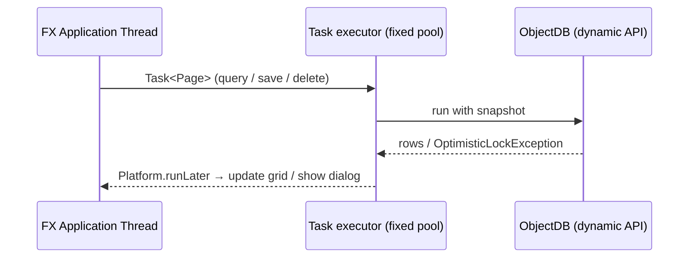
DB calls never run on the FX thread; long queries are cancellable.

---

## 18. Project Layout & Roadmap

### 18.1 Modules

```
kookaburra/
├─ docs/                         GitHub Pages: index.html (landing page), design.html (renders design.md), design.md,
│                                 benchmark-10m.md, storage-design.md, transaction-design.md, developer-guide.md, blogger/ (zh, en, medium), assets/ (logo, screenshots, diagrams), .nojekyll
├─ README.md                     English overview: features, quick start, examples, configuration, performance
├─ kookaburra.properties         the single settings file (bundled into kookaburra-core as defaults)
├─ bin/                          Studio distribution (built, not versioned): kookaburra-face.jar, scripts, logs/, data/
├─ pom.xml                       (parent: core + processor only; JDK 17, RoaringBitmap 1.6.22, ANTLR 4.13.2;
│                                 groupId com.github.paganini2008, packages com.github.kookaburra; `release` profile → Maven Central)
├─ kookaburra-core/              com.github.kookaburra
│   ├─ annotation/               @Entity @Embeddable @Id @Version @Index @Transient IndexKind
│   ├─ field/                    Field hierarchy, Getter types, Fields (registry), Property, EmbeddedPath
│   ├─ query/                    Pred, Order, Q, QueryStream, Plan, Planner, Agg, Tuple*, explain
│   ├─ dynamic/                  DynamicObject, DynamicCollection, DynField
│   ├─ oql/                      AstBuilder (visitor), resolver, OQL → Plan; grammar in src/main/antlr4 (Oql.g4)
│   ├─ mapping/                  Schema, TypeRegistry, ValueType, Codec, KeyEncoding
│   ├─ exec/                     SegmentView, Executor, merge, group
│   ├─ engine/                   ObjectDB impl, Writer, Wal, MemSegment, DeleteLog, Version, Commit, Compactor
│   ├─ segment/                  SegmentWriter/Reader, Dict, PackedInts, Bloom
│   └─ io/                       MappedFile, ByteSink / ByteSource
├─ kookaburra-processor/         annotation processor → Person_
├─ kookaburra-bench/             load / stress harness (§16.1): separate Maven project, fat jar, smoke-tested (coverage ≥ 90 %), deletes its data after a run
└─ kookaburra-face/              Kookaburra Studio: standalone JavaFX app: **separate Maven project** (own pom, not a
                                  module of the parent), depends on the published kookaburra-core; built / released on its own
```

### 18.2 Milestones

| # | Milestone | Done when | Status |
|---|---|---|---|
| M0 | Maven skeleton, JaCoCo gate | `mvn verify` green, coverage ≥ 90 % | ✅ |
| M1 | Field model, `Pred` / `Order`, `where(Getter)`, annotation processor | unit tests: resolution, mixing, `test()` semantics, JDK-comparator equivalence | ✅ |
| M2 | Schema (self-describing, layouts), TypeRegistry (inheritance, class ids), Record + RecordCodec, SchemaIO | round-trip tests incl. subclasses, embedded, collections, evolution | ✅ |
| M3 | MemSegment + Executor + QueryStream (in-memory DB, non-durable) | **differential tests** vs `List.stream()` on random data/queries | ✅ |
| M4 | Segment writer/reader, MappedFile, flush memtable → segment | same differential suite on disk segments | ✅ |
| M5 | WAL, commit, recovery | crash/replay tests | ✅ |
| M6 | Updates/deletes, DeleteLog, Version/Snapshot MVCC, WriteBatch (cross-collection) | concurrency + snapshot tests | ✅ |
| M7 | Compaction, throttling | merge correctness + concurrent delete remap | ✅ |
| M8 | Refs (`matches` / `in` / `fetch`), `updateEach` / `deleteAll`, `cursor` / `stream` | integration tests | ✅ |
| M9 | Dynamic access + OQL (SQL-92 core: expressions, functions, CASE, LIKE, DISTINCT, GROUP BY / HAVING, aggregates incl. COUNT DISTINCT, ORDER BY alias/position) | OQL ≡ typed API on the differential suite; SQL-92 semantics tests | ✅ |
| M10 | Kookaburra Studio (starts after M6) | CRUD, query console, JSON editor, explain on a sample DB | ✅ |
| M11 | Performance: ordinal fast paths, tuning against §16.1 targets with the stress harness | targets met or gaps documented | ✅ |
| M12 | Transactions ([transaction-design.md](transaction-design.md)): SNAPSHOT + OCC, read-your-writes, increments; chained query API | anomaly / conflict / differential / concurrency tests, coverage ≥ 90 % | ✅ |

### 18.3 Backlog

- [ ] BSI index kind (numeric range / sum / top-K): own 64-bit BSI over `ImmutableRoaringBitmap` (library `bsi` module is 32-bit value or 64-bit-docid only)
- [ ] JDK 22+ `MemorySegment` MR-JAR
- [ ] Global ordinal cache for frequent group-by
- [ ] Column overlay for hot single-field updates
- [ ] Streaming segment writer (peak heap of flush / merge = segment size today)
- [ ] Transactions roadmap ([transaction-design.md](transaction-design.md) §2): per-transaction durability, transaction metrics; optional extensions only (no Spring / JPA integration planned; no savepoints: T13)
- [ ] Studio `jpackage` installers with a bundled runtime
- [ ] `@Renamed`, element-correlated embedded collections

---

## 19. Decision Log

| # | Decision | Why |
|---|---|---|
| D1 | Own query API, not `implements Stream` | Opaque lambdas can't be pushed down; full `Stream` contract adds little; interop via `.stream()` |
| D2 | Borrow Speedment's field/predicate design, no dependency | Speedment last release 2020 and SQL-bound; JPAstreamer is LGPL and JPA-bound |
| D3 | Fields via generated `Person_` **and** `where(Person::getX)`, mixable | Processor = type-safe paths; method refs = zero setup; both resolve via one registry |
| D4 | Single-table inheritance per root + `$type` bitmap | Polymorphic queries = one bitmap op; null bitmaps make sparse columns cheap |
| D5 | Unordered by default | No global OID merge needed; matches SQL |
| D6 | MemSegment keeps columns, not just rows | Avoid decoding the whole memtable on every query |
| D7 | Delete log + snapshot length instead of per-update `.del` | No file I/O per update; consistent snapshots |
| D8 | Global `visibleSeq` | Atomic visibility of cross-collection batches |
| D9 | BSI deferred | Scope v1; format/enum slot reserved |
| D10 | RoaringBitmap 1.6.22 | Latest release older than 2 weeks at project start |
| D11 | Canonical pipeline order: filter → sort → skip/limit → project, or filter → group → having → sort → skip/limit | SQL-like, unambiguous push-down; post-processing via `.stream()` |
| D12 | `@Embeddable` on the value class instead of `@Embedded` on the field | One declaration per type; processor and runtime classify identically |
| D13 | `BoolField` is comparable; `RefField` is not | Booleans sort naturally; refs have no meaningful order (avoids `where` overload ambiguity) |
| D14 | Self-describing schema + dynamic API (`DynamicObject`, `DynField`) | Studio must open any DB without entity classes; reuses Pred/Plan unchanged |
| D15 | OQL = JPQL-style object query language (select / update / delete), compiled to Plan | Text queries for apps and Studio; familiar to JPA users; one planner for all front-ends |
| D16 | Studio is a separate standalone app on JDK 17 (AtlantaFX 2.0.1) | Keeps core dependency-free; whole stack runs on JDK 17 |
| D17 | Studio is dark-only, neon accent (Dracula base + `studio.css`) | User-requested "dark & cool" look; one theme to polish |
| D18 | Packages `com.github.kookaburra`; Maven groupId `com.github.paganini2008` (verified Central namespace) | User decision |
| D19 | Single sequencer thread instead of writer-per-collection | Atomic cross-collection batches without 2PC; monotonic `visibleSeq`; encoding stays parallel on callers |
| D20 | Per-class layouts + canonical `Record` | Old rows readable after changes; one form for typed, dynamic, indexing and OQL |
| D21 | JaCoCo gate: line & instruction coverage ≥ 90 % per module | User requirement; `mvn verify` fails below |
| D22 | OQL parser generated by **ANTLR 4.13.2** (`Oql.g4`) + visitor → AST → Plan | User choice: mature, grammar is the spec, easy to extend; runtime has no transitive deps. Generated code excluded from the coverage gate |
| D23 | UTC as the only time zone | Deterministic results across machines; no hidden dependency on the host zone |
| D24 | Positioning: single-collection queries with SQL-92 core semantics; no multi-table joins | User decision; keeps the bitmap engine focused on one collection per query |
| D25 | UI module / jar named `kookaburra-face` (product name: Kookaburra Studio), a separate Maven project, not part of the library build or its Central release | User decision |
| D26 | Commit records a WAL replay point per collection | Collections share one WAL but flush independently; a single point would replay already-flushed rows |
| D27 | WAL rotated at every commit | Files fully covered by segments can be deleted without scanning |
| D28 | Studio themes via AtlantaFX + token stylesheet | User request: switchable themes without duplicating styles |
| D29 | All settings in one `kookaburra.properties` (bundled defaults + file + `-D`) | User request: one place for every parameter, defaults = best practice |
| D30 | Class metadata lives in the Schema tab, not a sidebar panel | It duplicated the schema tree; one place for logical (class) and physical (segments) structure |
| D31 | Stress harness (`kookaburra-bench`) instead of JMH | End-to-end numbers incl. disk, fsync, compaction, concurrency and consistency checks; percentiles from warmed repeated runs |
| D32 | Value-sorted document lists (`sdoc`, 4 B / document) for single-valued indexed columns without postings | Benchmark: point lookup on a high-cardinality index took 13 ms (ordinal scan of 10 M); top-N by an indexed column read every match. With sdoc: 0.1 ms and 0.3 ms |
| D33 | No interactive transactions in v1 (§12.1) | User decision: atomic batches + optimistic lock + snapshots cover the embedded use cases; full transactions would touch the executor, indexes and MVCC |
| D34 | Logging: SLF4J API in the library, logback in Studio | Library must not impose a backend; Studio needs files next to the jar |
| D35 | One Studio jar for Windows, Linux and macOS | User request; native library names differ per OS, so they coexist |
| D36 | License Apache-2.0 | User decision; matches dependencies (RoaringBitmap, AtlantaFX, Ikonli: Apache-2.0; ANTLR: BSD; JavaFX: GPL+CE) |
| D37 | One chained API style (`query().where().eq().orderBy().desc().list()`), `from / filter / toList` kept as equivalents | user decision: uniform fluent style across the database APIs |
| D38 | Transactions: SNAPSHOT + OCC + redo-only, opt-in switch; details T1–T12 in [transaction-design.md](transaction-design.md) | enterprise-mainstream (FoundationDB / RocksDB optimistic / Oracle & PostgreSQL snapshot semantics) and fits the single sequencer |
| D39 | OIDs allocated at insert by per-class atomic counters (not in the sequencer) | final OIDs inside transactions; gaps after rollbacks like database sequences |
| D40 | Flush / compaction on a fixed thread pool (`kookaburra.flush-threads`) | several collections flush in parallel |
| D41 | Segment data files use the `.odbf` extension (`seg_<id>.odbf`); `.seg` files of older databases are renamed on open | user decision: recognisable data files |
| D42 | Paths through embedded lists are multi-valued with "any element" semantics, unindexed | matches JPQL `MEMBER OF` / MongoDB dotted paths; indexing element paths deferred |
| D43 | Studio holds several databases; transactions are per database | user decision; cross-database atomicity would need 2PC (non-goal) |
| D44 | Garbage-driven compaction: drop fully deleted segments, rewrite a segment alone at `compaction-garbage-ratio`; `flush()` / `compact()` wait for work already running | 10 M benchmark: after deleting everything, 4 segments (1.5 GB) stayed on disk because size-tiered merging never picked them |
| D45 | Nested values in Studio follow document-database tools (MongoDB Compass, Studio 3T): summaries in the grid, Key / Value / Type tree, element tables in the form | user request: mainstream presentation |
| D46 | Binaries in JSON / CSV are Base64 (Jackson's `byte[]` default, MongoDB Extended JSON `$binary.base64`); the editor shows large ones as a placeholder | lossless exports; a usable editor |
| D47 | The shared core suites run twice: in memory and on disk (`disk-suite` surefire execution, `TestDbs`) | user requirement: the file-based database is the product, the in-memory one a convenience |
| D48 | Studio console: `;` scripts and SQL-style `BEGIN / COMMIT / ROLLBACK` as console commands, not OQL grammar; toolbar Flush | PostgreSQL / DBeaver console habits; OQL stays a query language (transaction-design T14) |
| D49 | `BigDecimal` = DECIMAL, canonical without trailing zeros (`1.50` stored and read as `1.5`) | numeric equality everywhere (hash maps in grouping, DISTINCT, memtable postings) like `compareTo`; SQL DECIMAL / MongoDB Decimal128 compare numerically too; display with `setScale` |
| D50 | `@Unique` / `@ForeignKey` checked on the sequencer at commit, as index point lookups; ON DELETE actions appended to the same batch | one writer = no race between check and write; deferred like `DEFERRABLE INITIALLY DEFERRED`; cascades atomic and replayable from the WAL |
| D51 | SERIALIZABLE by optimistic read validation (read set of OIDs and query conditions vs before / after versions of later commits) | no locks or blocking (fits the single-writer OCC engine), no false positives from unrelated rows; FoundationDB / CockroachDB style; read-only transactions never abort |
| D52 | READ COMMITTED = fresh snapshot per statement, conflicts relative to the statement that read the object | PostgreSQL / Oracle default semantics; long transactions abort less |
| D53 | Lifecycle callbacks with JPA semantics: PRE at the call, POST after the durable commit, skipped for bulk OQL / by-OID / dynamic writes | familiar to JPA users; no callback runs for a write that never commits |
| D54 | Online backup = export of one snapshot into fresh compacted segments (not a file copy) | consistent without pausing writers, works for in-memory databases, the copy is compact and immediately openable |
| D55 | Composite unique constraints as repeatable class-level `@Unique(fields = …)`; nulls exempt | JPA `@Table(uniqueConstraints = …)` shape, SQL null semantics; one annotation for both forms |

## 20. Changelog

| Date | Change |
|---|---|
| 2026-10-17 | Storage design split into [storage-design.md](storage-design.md) (§4, §5, §6.1 to §6.4, §7, §8, §13, §14, §15, §15.2 now link there); [developer-guide.md](developer-guide.md) added |
| 2026-10-17 | Tutorial video as one run: `mvn -f kookaburra-face/pom.xml test -P tutorial` records and renders (`TutorialRecorder` + `TutorialVideo`, ffmpeg); visible mouse cursor with click rings; Studio first, then the API; covers constraints, isolation levels, backlinks and backup; `docs/tools/make-tutorial.sh` removed |
| 2026-10-17 | Composite unique constraints: class-level repeatable `@Unique(fields = …, name = …)` (§3.6, D55), schema format 3, Studio constraint column |
| 2026-10-17 | `BigDecimal` (DECIMAL, D49); `@Unique` and `@ForeignKey` with RESTRICT / CASCADE / SET_NULL and backlinks `referrers` (§3.6, §6.5, D50); READ COMMITTED and SERIALIZABLE (§12.1, D51, D52), `kookaburra.tx-isolation`, `inTransaction(TxOptions, …)`; lifecycle callbacks and `EntityListener` (§3.7, D53); online backup (§15.2, D54); schema file format 2; Studio: isolation menu, Backup, backlinks, constraint column, decimals; demo with unique e-mail / SKU, foreign keys and decimal prices; bench phases Integrity and backup |
| 2026-10-16 | Studio: console scripts (`;`) and `BEGIN` / `START TRANSACTION` / `COMMIT` / `ROLLBACK` (D48, transaction-design T14), toolbar **Flush**; `bin/data` re-seeded with the nested demo; savepoints dropped from the roadmap (T13) |
| 2026-10-15 | Tutorial video (2:33, English subtitles, original synthesised BGM): `TutorialRecorder` drives Studio and renders frames, `docs/tools/make-tutorial.sh` (ffmpeg: crossfades, libass subtitles, loudnorm) → `docs/assets/kookaburra-tutorial.mp4`, played on the website; 10 M benchmark re-run (§16.1) |
| 2026-10-15 | Garbage-driven compaction and waiting `flush()` / `compact()` (D44, §13); Studio nested-object UI: grid summaries, inspector, element tables, binary fields with preview, long texts (D45, §17.3); binaries as Base64 in JSON / CSV with an editor placeholder (D46); demo data with nested objects, photos and long notes; LOB tests (texts to 3 M characters, binaries to 16 MiB); core suites also on disk (D47) |
| 2026-10-15 | Studio: transactions (Begin / Commit / Rollback, conflict dialog), several databases in one window (D43), `--data` + `--demo` together; `.odbf` segment files (D41); nested objects: `Map<String, Embeddable>`, element paths through embedded lists (D42), keywords as OQL path segments; bench Transactions + Delete phases; memory + disk variants of transaction / nested / Studio tests |
| 2026-10-15 | M12: transactions per [transaction-design.md](transaction-design.md) (opt-in `kookaburra.transactions`), atomic `increment`, OIDs at insert, flush thread pool; chained query API (`query / where / orderBy / list`, dynamic `where("path")`); Studio: export of console results (JSON / JSONL / CSV) |
| 2026-10-13 | Draft [transaction-design.md](transaction-design.md): PostgreSQL-aligned isolation levels (RC / RR / SERIALIZABLE), read-your-writes overlay, optimistic commit validation, savepoints, error codes: for review, no code yet |
| 2026-10-11 | Boundary testing of Studio: fixed `EXPLAIN DELETE` executing (core `execute()` now refuses EXPLAIN), `LIMIT 0` returning a row, empty last page after deletes, stale tree counts after console DML, editor closing on type errors, filter accepting `LIMIT`; readable OQL syntax errors (unterminated strings named, long expected-token sets cut); malformed dates reported per field; license Apache-2.0 confirmed (D36) |
| 2026-10-11 | M11 performance pass from the 10 M benchmark: path-only row decoding, ordinal / postings group-by, index-order top-N, sdoc lists (§5, §10.3, §10.4); SLF4J logging (§15.1); transactions scope (§12.1); Studio: export JSON / JSONL / CSV, Schema tab merges metadata, cross-platform jar, logback, `StudioApplication` |
| 2026-10-11 | M10 done. Single `kookaburra.properties` (§16); Studio fat jar (`-P dist` → `bin/`), default data dir next to the jar; Schema tab merges class metadata + segments; `#` row numbers; Data reload button |
| 2026-10-11 | Initial English design (supersedes `object-db-storage-design.md`) |
| 2026-10-11 | M0/M1 done. Synced with code: `@Embeddable`/`@Transient`, field hierarchy (`ObjectField`, `CollectionGetter`), value normalization, metamodel naming |
| 2026-10-11 | `docs/index.html` GitHub Pages viewer for this document; full `.gitignore` |
| 2026-10-11 | Renamed package / groupId `io.kookaburra` → `com.github.kookaburra` |
| 2026-10-11 | Studio: themes, About, metadata panel, paged console results, property columns for object results; class `final` only on value types; no inline fully-qualified names |
| 2026-10-11 | M9 done: dynamic access (`DynamicObject`, `DynField`, `DynamicCollection`), OQL (ANTLR grammar, AST, push-down, fast-path grouping, SELECT NEW, UPDATE / DELETE, EXPLAIN); version 1.0.0-SNAPSHOT |
| 2026-10-11 | Maven Central readiness: groupId `com.github.paganini2008`, POM metadata (url, Apache-2.0, developer, scm, issues), `release` profile (sources, javadoc with custom header tags, GPG, central-publishing-maven-plugin, autoPublish off); UI excluded from library build |
| 2026-10-11 | M7–M8 done: tiered compaction with late-delete remapping, caller-side back-pressure, `compact()`, `get(oid)`, `Ref.resolve`, `fetch`, semi-join `in(QueryStream)`, `updateEach`, `deleteAll` |
| 2026-10-11 | M4–M6 done: segment files, flush pipeline, Storage (memory / disk), WAL with per-commit rotation, commit files with per-collection replay points, crash recovery, segment delete logs |
| 2026-10-11 | M3 done: in-memory DB (sequencer, MemSegment, executor, QueryStream / Projection / GroupStream with HAVING and COUNT DISTINCT), differential suite |
| 2026-10-11 | M2 done; single sequencer write path (§6.1); layouts (§3.5); JaCoCo ≥ 90 % gate |
| 2026-10-11 | Positioning: single-collection SQL-92 core semantics; OQL expressions / functions / CASE / LIKE / COUNT DISTINCT / ORDER BY alias & position |
| 2026-10-11 | OQL parser: ANTLR 4 instead of hand-written (D22) |
| 2026-10-11 | Text query language redesigned as JPQL-style OQL (§9.9, was "KQL"), part of the core API |
| 2026-10-11 | Added Studio (§17), dynamic access (§9.8), OQL (§9.9), self-describing schema (§3.4); milestones M9/M10; dark/neon style spec (§17.2) |
