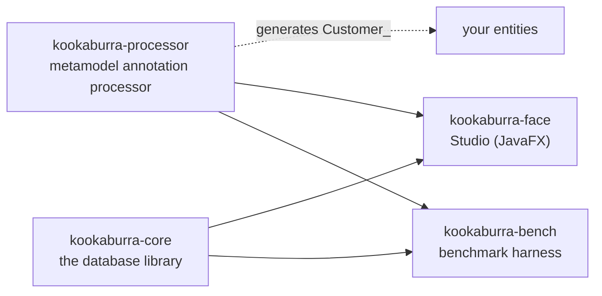
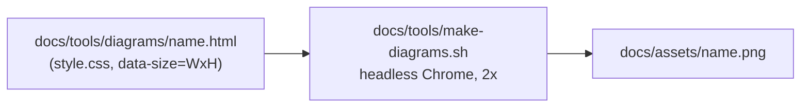

# Kookaburra: Developer Guide

| | |
|---|---|
| Part A | **Using Kookaburra**: every API with code, for application developers |
| Part B | **Contributing**: build, tests, conventions, docs tooling, for people changing Kookaburra |
| Needs | JDK 17+, Maven 3.9+ (Gradle works too); optional: Ollama for text embeddings and reranking |
| More | [README](../README.md) · [website](https://paganini2008.github.io/kookaburra/) · [architecture.md](architecture.md) · [design.md](design.md) |

---

# Part A. Using Kookaburra

- The snippets run in `ReadmeExamplesTest` and `DeveloperGuideExamplesTest`, in memory and on disk.
- Entities in the snippets are short; add getters as usual.

## A1. Set up

```xml
<dependency>
    <groupId>com.github.paganini2008</groupId>
    <artifactId>kookaburra-core</artifactId>
    <version>1.0.0-SNAPSHOT</version>
</dependency>
```
```groovy
implementation 'com.github.paganini2008:kookaburra-core:1.0.0-SNAPSHOT'
annotationProcessor 'com.github.paganini2008:kookaburra-processor:1.0.0-SNAPSHOT'   // optional: Book_ metamodel
```

```java
ObjectDB db = ObjectDB.open(Path.of("data"));                    // on disk; creates the directory
ObjectDB mem = ObjectDB.inMemory();                              // tests, caches
ObjectDB tuned = ObjectDB.open(Path.of("data"), Config.load()     // kookaburra.properties
        .withDurability(Durability.ASYNC)
        .withTransactions(true));
db.close();                                                      // or try-with-resources
```

| Rule | |
|---|---|
| one `ObjectDB` per directory per process | it is thread-safe and holds the directory lock |
| `Config.load()` | bundled defaults → `kookaburra.properties` → `-Dkookaburra.*` |

## A2. Entities

```java
@Entity
@Comment("A book in the shop")
public class Book {
    @Id long oid;                                   // assigned by insert
    @Version long version;                          // optional: optimistic locking
    @Index String title;
    @Index Genre genre;                             // enums
    @Index(IndexKind.ORDINAL) int year;             // ranges and sorts on many values
    @Unique String isbn;
    @Comment("Price in AUD") BigDecimal price;      // exact decimals
    @Index List<String> tags;                       // multi-value index
    Address shop;                                   // @Embeddable, any depth
    Map<String, Address> branches;
    byte[] cover;                                   // binaries, MiB-sized values
    LocalDate published;
    @Transient String cached;                       // not stored

    public Book() { }                               // a no-arg constructor
}

@Embeddable
public class Address { @Index String city; String street; }
```

| Field type | Notes |
|---|---|
| `int`, `long`, `double`, `boolean`, wrappers | `short`, `byte`, `char`, `float` widen |
| `String`, `BigDecimal`, enums | `BigDecimal` compared by value (`19.90` = `19.9`) |
| `LocalDate`, `LocalDateTime`, `Instant` | stored in UTC |
| `Ref<T>` | reference to another entity |
| `List`, `Set`, `Map` | of scalars or of `@Embeddable` |
| `byte[]`, `float[]` | binaries; `float[]` with `@Vector` for vector search |
| other `Serializable` | stored as bytes, not queryable |

### Inheritance

```java
@Entity public class Product { @Id long oid; @Index String title; }
@Entity public class Gadget extends Product { int watts; }

db.query(Product.class).list();      // products and gadgets
db.query(Gadget.class).list();       // gadgets only
```

## A3. Write

```java
long id = db.insert(new Book("Dune", Genre.SCIFI, 1965));   // returns the oid
Book dune = db.get(Book.class, id);
dune.setPrice(new BigDecimal("11.99"));
db.update(dune);                                            // OptimisticLockException if changed meanwhile
db.increment(Book.class, id, "stock", 5);                   // atomic counter, never conflicts
db.delete(Book.class, id);

db.batch()                                                  // one atomic commit
  .insert(new Book("Neuromancer", Genre.SCIFI, 1984))
  .insert(new Book("Hyperion", Genre.SCIFI, 1989))
  .commit();

WriteBatch bulk = db.batch().durability(Durability.ASYNC);  // bulk load: one disk flush per batch
events.forEach(bulk::insert);
bulk.commit();
```

### Callbacks and listeners

```java
@Entity
public class Order {
    @Id long oid;
    Instant created;
    @PrePersist void stamp() { created = Instant.now(); }
}

db.addListener(Order.class, new EntityListener<Order>() {
    @Override public void postPersist(Order o) { audit.log(o); }
});
```

## A4. Query with the Java API

```java
List<Book> books = db.query(Book.class)
        .where(Book::getGenre).eq(Genre.SCIFI)
        .where(Book::getYear).between(1960, 1990)
        .where(Book::getTitle).startsWith("H")
        .orderBy(Book::getYear).desc()
        .limit(10)
        .list();

long n = db.query(Book.class).where(Book::getTags).contains("classic").count();
Optional<Book> first = db.query(Book.class).where(Book::getIsbn).eq("978-0441").first();
```

| Operators | |
|---|---|
| compare | `eq`, `notEq`, `gt`, `ge`, `lt`, `le`, `between`, `in` |
| text | `startsWith`, `contains`, `matches` (full-text) |
| null | `isNull`, `isNotNull` |
| lists | `contains`, `containsAny` |
| paging | `limit`, `skip` |

### Generated metamodel (annotation processor)

```java
db.query(Book.class)
  .filter(Book_.tags.contains("classic"))
  .filter(Book_.price.lt(10.0))
  .count();
```

### Aggregates

```java
db.query(Book.class).groupBy(where(Book::getGenre))
  .agg(Q.count().as("books"), Q.avg(where(Book::getPrice)).as("avgPrice"))
  .sortedBy(Q.count().as("books").desc())
  .toList();

BigDecimal total = db.query(Order.class).sum(where(Order::getTotal));   // exact
```
```text
SCIFI   books=4 avg=11.36
FANTASY books=1 avg=10.00
```

### Nested objects

```java
db.query(Shipment.class).whereAny(Shipment::getItems, Item::getSku).contains("pear").list();

db.query(Shipment.class)                                 // one element meets every condition
  .whereElement(Shipment::getItems, e -> e
      .where(Item::getSku).eq("A")
      .where(Item::getQty).gt(5))
  .list();
```

### Snapshots and references

```java
try (Snapshot s = db.snapshot()) {                       // several reads, one moment
    long books = s.from(Book.class).count();
    List<Book> recent = s.from(Book.class).where(Book::getYear).ge(2000).list();
}
List<Order> orders = db.referrers(Order.class, customerId);   // who points at this object
```

## A5. Query with OQL

```java
db.oql("SELECT b.author, b.year FROM Book b WHERE b.year < :y ORDER BY b.year")
  .param("y", 1950).rows();

List<Book> list = db.oql("SELECT b FROM Book b WHERE b.genre = 'SCIFI'", Book.class).list();

db.oql("UPDATE Book b SET b.price = b.price * 0.9 WHERE b.genre = 'CRIME'").execute();
db.oql("DELETE FROM Book b WHERE b.year < 1900").execute();
```
```sql
SELECT b.genre, COUNT(*) AS books, AVG(b.price) AS avg_price
FROM Book b
WHERE b.title LIKE 'H%' OR b.year BETWEEN 1960 AND 1990
GROUP BY b.genre
HAVING COUNT(*) > 1
ORDER BY books DESC;

SELECT s.code FROM Shipment s WHERE 'kiwi' MEMBER OF s.items.sku;
SELECT s FROM Shipment s JOIN s.items i WHERE i.sku = 'A' AND i.qty > 5;
SELECT b.title, CASE WHEN b.price > 10 THEN 'high' ELSE 'low' END AS band FROM Book b;
```

| Clause | Supported |
|---|---|
| statements | `SELECT`, `UPDATE … SET`, `DELETE`, `EXPLAIN [ANALYZE]` |
| expressions | arithmetic, `CASE`, `LIKE`, `IN`, `BETWEEN`, `IS NULL`, `MEMBER OF`, `TYPE(x)` |
| grouping | `COUNT`, `SUM`, `AVG`, `MIN`, `MAX`, `DISTINCT`, `GROUP BY … HAVING` |
| search | `MATCH`, `SCORE`, `HIGHLIGHT`, `cosine_distance`, `l2_distance`, `inner_product`, `embed` |

## A6. Full-text search

```java
@Entity
public class Article {
    @Id long oid;
    @FullText String body;                                  // english: stems, stop words
    @FullText(analyzer = "standard") String notes;          // any language, as written
}

db.query(Article.class).where(Article::getBody).matches("bread oven").list();        // every word
db.query(Article.class).where(Article::getBody).matchesAny("bread cake").list();     // any word
db.query(Article.class).where(Article::getBody).matches("\"fresh bread\"").list();   // phrase
db.query(Article.class).where(Article::getBody).matches("bak*").list();              // prefix
db.query(Article.class).search(Article::getBody, "baking bread", 10).list();         // BM25

String html = TextQuery.parse("bread").highlight(article.getBody());                // <em>bread</em>
Analyzers.register("lower", text -> List.of(text.toLowerCase().split("\\W+")));     // your analyzer
```
```sql
SELECT a.title, HIGHLIGHT(a.body, 'bread'), SCORE(a.body, 'baking bread') AS score
FROM Article a WHERE MATCH(a.body, 'bak*') ORDER BY score DESC LIMIT 10;
```

## A7. Vector search

```java
@Entity
public class Doc {
    @Id long oid;
    @Index String lang;
    @FullText String body;
    @Vector(dim = 384) float[] embedding;                                   // cosine
    @Vector(dim = 384, distance = VectorDistance.L2,
            quantization = VectorQuantization.INT8) float[] small;          // a quarter of the memory
}

db.query(Doc.class)
  .where(Doc::getLang).eq("en")                       // filters first
  .nearest(Doc::getEmbedding, queryVector, 10)        // HNSW
  .list();

db.query(Doc.class).nearest(Doc::getEmbedding, "bake bread at home", 10).list();   // Ollama embeds the text

db.query(Doc.class)
  .nearest(Doc::getEmbedding, "bake bread at home", 10)
  .numCandidates(200)                                 // look wider
  .hybrid(Doc::getBody)                               // + words (RRF)
  .diverse()                                          // fewer near-duplicates (MMR)
  .rerank(Doc::getBody)                               // a local model re-orders
  .list();

db.query(Doc.class).nearest(Doc::getEmbedding, queryVector, 10).exact().list();   // no index
```
```sql
SELECT d.title, cosine_distance(d.embedding, embed('bake bread at home')) AS dist
FROM Doc d WHERE d.lang = 'en' ORDER BY dist LIMIT 10;
```
```properties
kookaburra.embedder=ollama
kookaburra.embedder-model=nomic-embed-text
kookaburra.reranker-model=qwen3:4b
kookaburra.vector-ef-search=100
```

## A8. Transactions

```properties
kookaburra.transactions=true
kookaburra.tx-isolation=SNAPSHOT
```
```java
try (Transaction tx = db.begin(Isolation.SNAPSHOT)) {
    Account a = tx.get(Account.class, from);
    tx.update(a.balance(a.getBalance() - 30));
    tx.increment(Account.class, to, "balance", 30);
    tx.commit();                                       // ConflictException if `a` changed meanwhile
}                                                      // not committed: rolled back

db.inTransaction(tx -> tx.increment(Account.class, to, "balance", 5));   // retried on conflict

int seats = db.inTransactionResult(TxOptions.defaults()
        .isolation(Isolation.SERIALIZABLE)
        .durability(Durability.SYNC), tx -> book(tx, flight));
```

| Level | Prevents |
|---|---|
| `READ_COMMITTED` | dirty reads, lost updates |
| `SNAPSHOT` (default) | plus non-repeatable reads and phantoms |
| `SERIALIZABLE` | plus write skew |

## A9. Constraints

```java
@Entity
@Unique(fields = {"tenant", "code"}, name = "tenant_code")
public class Order {
    @Id long oid;
    String tenant;
    String code;
    @Unique String number;
    @ForeignKey(onDelete = OnDelete.CASCADE) Ref<Customer> customer;
    @ForeignKey(onDelete = OnDelete.SET_NULL) Ref<Agent> agent;
    @ForeignKey List<Ref<Product>> products;              // RESTRICT: products in use cannot be deleted
}

try {
    db.insert(duplicate);
} catch (ConstraintViolationException e) {
    System.out.println(e.getMessage());   // duplicate value 'A-1' for unique Order.number
}
```

## A10. Schema

```java
@Entity @Renamed("com.example.Client")               // the class was called Client
public class Customer {
    @Id long oid;
    @Renamed("fullName") String name;                 // the field was called fullName
    String phone;                                     // new field: null in old objects
}

Schema s = db.schema();                                       // every stored class and layout
SchemaExport java = db.exportSchema((String) null);           // the schema as Java source
java.files().forEach(f -> System.out.println(f.path()));
java.warnings().forEach(System.out::println);
db.exportSchema(Path.of("src/main/java"), "com.acme.model");  // write it (classes get @Renamed)

DynamicCollection books = db.dynamic("Book");                 // no entity class needed
DynamicObject b = books.from().where("author").startsWith("J").first().orElseThrow();
books.update(b.set("price", new BigDecimal("8.50")));
```

| Change | Allowed |
|---|---|
| add / remove a field | yes |
| `int` → `long`, append enum constants | yes |
| rename a field or class | with `@Renamed` |
| change `@Comment` | yes, no new schema version |
| `String` → `int` | no: `SchemaException` |

## A11. Plans, statistics, backup

```java
System.out.println(db.query(Person.class)
        .where(Person::getCity).eq("Perth")
        .orderBy(Person::getAge).desc().limit(10)
        .explainAnalyze());                                // rows in → out, time per step

QueryPlan plan = db.oql("EXPLAIN SELECT p FROM Person p WHERE p.city = 'Perth'").plan();

DatabaseStats s = db.stats();
s.objects();
s.transactions().total().conflicts();
s.constraints().uniqueViolations();

BackupInfo info = db.backup(Path.of("backups/2026-11-06"));    // writers keep going
try (ObjectDB copy = ObjectDB.open(info.path())) { }           // restore = open

db.flush();       // memory → files now
db.compact();     // merge files, drop deleted objects
```

## A12. Best practices

| Do | Why |
|---|---|
| `@Index` what you filter, sort and group on | otherwise every object is read; `explain()` shows `[scan]` |
| write in batches; `Durability.ASYNC` for bulk loads | one disk flush per batch |
| `@Unique` / `@ForeignKey` instead of checks in code | check and write are one atomic step |
| transactions only where several objects change together | autocommit writes are cheaper |
| `SERIALIZABLE` when a decision depends on other rows | prevents write skew |
| `increment` for counters | never conflicts |
| `db.backup(dir)`, not a file copy | a live directory copy may be inconsistent |

---

# Part B. Contributing

## B1. Modules



| Module | Maven project | What it is | Output |
|---|---|---|---|
| `kookaburra-core` | root `pom.xml` | engine, mapping, segments, query API, OQL, transactions | library jar |
| `kookaburra-processor` | root `pom.xml` | `@Entity` → `Customer_` metamodel classes | library jar |
| `kookaburra-face` | own `pom.xml` (not in the root build) | Studio desktop UI | `bin/kookaburra-face.jar` |
| `kookaburra-bench` | own `pom.xml` (not in the root build) | 10 M benchmark | `kookaburra-bench.jar` + Markdown report |

Studio and bench depend on the installed core: run `mvn install` at the root after changing core.

### B1.1 Repository layout

```
kookaburra/
├─ pom.xml, kookaburra.properties     root build (core + processor), the one configuration file
├─ kookaburra-core/src/main/java/com/github/kookaburra/
│  ├─ annotation/   @Entity, @Index, @Unique, @ForeignKey, lifecycle annotations
│  ├─ mapping/      ClassDef, FieldDef, Schema, SchemaIO, RecordCodec, ValueType, TypeRegistry
│  ├─ segment/      SegmentWriter, SegmentColumn, Keys, PackedInts, Bloom, SegmentDeletes
│  ├─ engine/       Database, Sequencer, MemSegment, WAL, Commit, Storage, Integrity, TxRegistry, Backup
│  ├─ exec/         Executor, ReadView, Aggregator, ColumnIndex
│  ├─ query/ field/ QueryStream, Pred, metamodel fields
│  ├─ oql/          ANTLR grammar, Ast, Engine, Eval
│  ├─ dynamic/      DynamicObject, DynamicCollection, DynField
│  └─ io/           MappedFile
├─ kookaburra-face/   Studio: face/model (Session, Json, Display), face/view (MainView, DataView, ...)
├─ kookaburra-bench/  Bench, Shop, Stats
├─ bin/               Studio dist: jar, studio.sh / studio.cmd, kookaburra.properties, demo data
├─ docs/              design docs, website (index.html), blogger/, assets/, tools/
└─ change_logs/       one file per day: YYYY-MM-DD.md
```

---

## B2. Build

| Task | Command |
|---|---|
| Core + processor: build, test, coverage gate | `mvn verify` |
| Install core for Studio / bench | `mvn install` |
| One test class | `mvn test -pl kookaburra-core -Dtest=DecimalTest` |
| Studio: build and test (headless) | `mvn -f kookaburra-face/pom.xml verify` |
| Studio: fat jar into `bin/` | `mvn -f kookaburra-face/pom.xml -P dist package -DskipTests` |
| Studio: run | `bin/studio.sh` or `java -jar bin/kookaburra-face.jar --data=data` (`--demo` for sample data) |
| Bench: build | `mvn -f kookaburra-bench/pom.xml package` |
| Bench: run | `java -Xmx8g -jar kookaburra-bench/target/kookaburra-bench.jar --n=10000000` |

- Offline builds: add `-o`. The local Maven repository on the main dev machine is `/usr/local/work/m2_repo`.
- Bench options: `--n`, `--dir` (default `target/bench-db`), `--threads` (16), `--seconds` (10), `--iterations` (30), `--out` (default `target/bench-results.md`), `--keep`. The last 10 M report is in [benchmark-10m.md](benchmark-10m.md).

---

## B3. Code conventions

| Rule | Example / note |
|---|---|
| Package | `com.github.kookaburra.*` |
| Class header Javadoc | `@Author: Fred Feng` · `@Date: dd/mm/yyyy` · `@Version 1.0.0` |
| No inline fully-qualified names | import instead; only for real clashes (`java.awt.Color` next to JavaFX `Color`) |
| `final` only when needed | on value types and fields that must be immutable, not as decoration |
| Configuration | one file, `kookaburra.properties`; new keys get a default there, a `Config` component and a `with*` method |
| Time | UTC everywhere (storage, logs, Studio display) |
| Logging | core uses only the SLF4J API, never on per-row / per-write paths |
| Comments | short, say why; reference the design section (`storage-design §6.2`, `design §3.6`) |
| Errors | public exceptions in `com.github.kookaburra` (e.g. `ConstraintViolationException`, `ConflictException`) |

```java
/**
 * In-memory segment (memtable, storage-design §6.2): append-only rows with sequence numbers.
 *
 * @Author: Fred Feng
 * @Date: 17/10/2026
 * @Version 1.0.0
 */
```

---

## B4. Testing

### B4.1 Rules

- **Coverage ≥ 90 %** (JaCoCo, line and instruction) in every module; `verify` fails below it.
- **Every feature is tested in memory and on disk.** Memory tests alone miss segment encoding, WAL replay and reopening.
- Differential tests compare every query path with `java.util.stream` on the same data.

### B4.2 Memory and disk

| Way | How | Used for |
|---|---|---|
| `disk-suite` | second surefire execution in `kookaburra-core/pom.xml` with `-Dkookaburra.test.storage=disk`; `TestDbs.create()` then returns a disk database | the shared suites (Database, Query, OQL, Differential, Transaction, ...) |
| `*DiskTest` subclass | override `create()` (open on a `@TempDir`) and `checkpoint()` (flush, compact, close, reopen) | feature suites: Decimal, Constraint, Lifecycle, Isolation, Backup |
| Studio | tests run against both an in-memory and a `--data` database | `StudioUiTest`, `StudioMultiDbTest`, `StudioIntegrityTest`, ... |

```java
class DecimalDiskTest extends DecimalTest {
    @TempDir Path dir;
    @Override protected ObjectDB create() { return ObjectDB.open(dir.resolve("db"), config()); }
    @Override protected void checkpoint() { db.flush(); db.compact(); db.close(); db = ObjectDB.open(dir.resolve("db"), config()); }
}
```

Adding a feature: write `XxxTest` with `create()` / `checkpoint()` hooks, call `checkpoint()` between steps, add `XxxDiskTest`.

### B4.3 Studio UI tests

| Mode | Command |
|---|---|
| headless (default, Monocle software rendering) | `mvn -f kookaburra-face/pom.xml test` |
| watch on the real screen | `mvn -f kookaburra-face/pom.xml -P visible test -Dtest=StudioEdgeCaseTest` |
| screenshots for review | `Shots.save(scene, name)` → `kookaburra-face/target/screenshots/` |

---

## B5. Docs

### B5.1 Two audiences

| | Public docs | Developer docs |
|---|---|---|
| Files | `README.md`, `docs/index.html` (website), `docs/blogger/*.md` | `docs/design.md`, `storage-design.md`, `transaction-design.md`, this guide |
| Reader | application developers using the library | people changing the engine |
| Content | features, API examples, Studio, results | internals: segments, bitmaps, WAL, MVCC, decisions |
| Internals named? | **no** (only the runtime dependency list) | yes |
| Style | keep the existing structure, tables and images, not prose | bullets, tables, mermaid, images, comparisons |

- No em dashes in any doc, change log or UI text.
- Images in blogger posts use absolute GitHub Pages URLs; the repo docs use `assets/...`.
- `design.md` changes together with the code (sections, decision log, changelog row).
- Every working day gets `change_logs/YYYY-MM-DD.md` (Chinese).

### B5.2 Diagrams



- Edit the HTML, run `docs/tools/make-diagrams.sh`, check the PNG. `CHROME=...` overrides the Chrome path.

### B5.3 Tutorial video

```
mvn -f kookaburra-face/pom.xml test -P tutorial
```

| Step | Class |
|---|---|
| drive Studio, capture frames and click positions, render code slides | `TutorialRecorder` |
| cursor overlay, crossfades, subtitles (libass), music (`OfficeBgm`), poster | `TutorialVideo` |
| output | `docs/assets/kookaburra-tutorial.mp4` + `kookaburra-tutorial-poster.jpg` |

- ffmpeg is found via `FFMPEG`, Homebrew or `PATH`.
- The test asserts the length (≤ 3 min) and that subtitles contain no em dash. If the length changes, update it in README, website and blogs.

### B5.4 Releasing Studio (GitHub Actions)

| Step | What happens |
|---|---|
| push a tag `v1.2.3` | `.github/workflows/studio-release.yml` starts |
| test | core + processor `install`, Studio `verify` (headless) on Ubuntu |
| package | Windows (msi for releases, zip), Linux (deb, tar.gz, jar), macOS arm64 and x64 (dmg) with `kookaburra-face/src/packaging/package.sh` |
| release | GitHub Release `v1.2.3`, marked latest, `SHA256SUMS.txt`; `releases/latest/download/<file>` now serves it |

- Try a package locally on your OS: build the jar with `mvn -f kookaburra-face/pom.xml -P dist package -DskipTests -Ddist.dir=$PWD/kookaburra-face/target/dist`, then `bash kookaburra-face/src/packaging/package.sh 1.0.0 macos-arm64` (output in `kookaburra-face/target/release`).
- Release vs snapshot: `v1.2.3` is a release (Windows msi + zip); `v1.2.3-rc1` is a snapshot, like `-SNAPSHOT` in the pom (Windows zip only, published as a pre-release, latest unchanged); "Run workflow" by hand is a snapshot as workflow artifacts only. Locally the third argument of `package.sh` is `release` or `snapshot` (default).
- The same tags publish the library (job `maven`): kookaburra-parent, kookaburra-core and kookaburra-processor.

| Tag | Version in the poms | Goes to |
|---|---|---|
| `v1.2.3` | `1.2.3` | Maven Central (published automatically) |
| `v1.2.3-rc1`, `rc2` … | `1.2.3-SNAPSHOT` | Central snapshot repository |
| anything else | | the job fails, nothing is published |

- Versions in the poms are maintained by hand. Secrets: `CENTRAL_USERNAME`, `CENTRAL_TOKEN`, `GPG_PRIVATE_KEY`, `GPG_PASSPHRASE`.
- By hand: `mvn -P release clean deploy` uploads and validates; publish it in the Central Portal (or add `-Dcentral.autoPublish=true`).

---

## B6. Where to change what

| Change | Code | Tests | Docs |
|---|---|---|---|
| new value type | `ValueType`, `RecordCodec`, `Keys`, `JavaTypes`, processor | `XxxTest` + `XxxDiskTest` | README types table, design §3.3, storage-design §4 |
| new annotation / constraint | `annotation/`, `JavaTypes`, `Schema`, `Integrity` | same | design §3.6, §6.5 |
| query operator | `Pred`, `Executor`, `oql/` | differential suites | design §9, §10 |
| storage format | `segment/`, `SchemaIO` (keep old formats readable) | disk tests, legacy-format test | storage-design, decision log |
| config key | `kookaburra.properties`, `bin/kookaburra.properties`, `Config` | `SettingsTest` | design §16 |
| Studio feature | `face/model`, `face/view` | `ModelTest`, Studio UI tests | design §17.3, screenshots |
