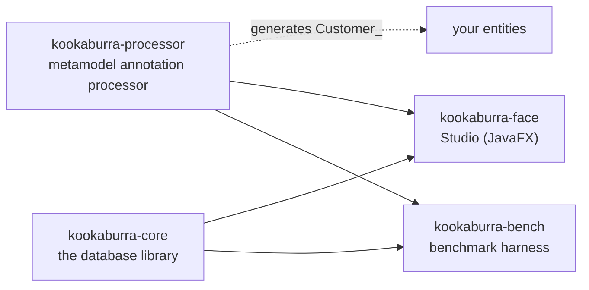
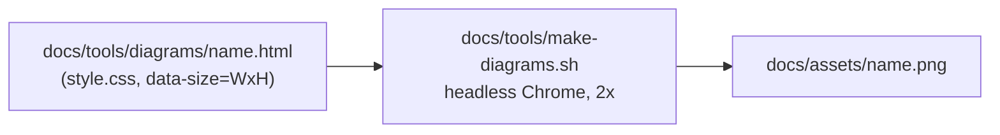

# Kookaburra: Developer Guide

| | |
|---|---|
| Audience | developers changing Kookaburra itself (core, processor, Studio, bench, docs) |
| Needs | JDK 17+, Maven 3.9+; Chrome for diagrams; ffmpeg (libx264, libass) for the tutorial video |
| Design docs | [design.md](design.md) (overall) · [storage-design.md](storage-design.md) (storage) · [transaction-design.md](transaction-design.md) (transactions) |

---

## 1. Modules



| Module | Maven project | What it is | Output |
|---|---|---|---|
| `kookaburra-core` | root `pom.xml` | engine, mapping, segments, query API, OQL, transactions | library jar |
| `kookaburra-processor` | root `pom.xml` | `@Entity` → `Customer_` metamodel classes | library jar |
| `kookaburra-face` | own `pom.xml` (not in the root build) | Studio desktop UI | `bin/kookaburra-face.jar` |
| `kookaburra-bench` | own `pom.xml` (not in the root build) | 10 M benchmark | `kookaburra-bench.jar` + Markdown report |

Studio and bench depend on the installed core: run `mvn install` at the root after changing core.

### 1.1 Repository layout

```
kookaburra/
├─ pom.xml, kookaburra.properties     root build (core + processor), the one configuration file
├─ kookaburra-core/src/main/java/com/github/kookaburra/
│  ├─ annotation/   @Entity, @Index, @Unique, @ForeignKey, lifecycle annotations
│  ├─ mapping/      ClassDef, FieldDef, Schema, SchemaIO, RecordCodec, ValueType, TypeRegistry
│  ├─ segment/      SegmentWriter, SegmentColumn, Keys, PackedInts, Bloom, SegmentDeletes
│  ├─ engine/       Database, Sequencer, MemSegment, WAL, Commit, Storage, Integrity, TxRegistry, Backup
│  ├─ exec/         Executor, ReadView, Aggregator, ColumnIndex
│  ├─ query/ field/ QueryStream, Pred, metamodel fields
│  ├─ oql/          ANTLR grammar, Ast, Engine, Eval
│  ├─ dynamic/      DynamicObject, DynamicCollection, DynField
│  └─ io/           MappedFile
├─ kookaburra-face/   Studio: face/model (Session, Json, Display), face/view (MainView, DataView, ...)
├─ kookaburra-bench/  Bench, Shop, Stats
├─ bin/               Studio dist: jar, studio.sh / studio.cmd, kookaburra.properties, demo data
├─ docs/              design docs, website (index.html), blogger/, assets/, tools/
└─ change_logs/       one file per day: YYYY-MM-DD.md
```

---

## 2. Build

| Task | Command |
|---|---|
| Core + processor: build, test, coverage gate | `mvn verify` |
| Install core for Studio / bench | `mvn install` |
| One test class | `mvn test -pl kookaburra-core -Dtest=DecimalTest` |
| Studio: build and test (headless) | `mvn -f kookaburra-face/pom.xml verify` |
| Studio: fat jar into `bin/` | `mvn -f kookaburra-face/pom.xml -P dist package -DskipTests` |
| Studio: run | `bin/studio.sh` or `java -jar bin/kookaburra-face.jar --data=data` (`--demo` for sample data) |
| Bench: build | `mvn -f kookaburra-bench/pom.xml package` |
| Bench: run | `java -Xmx8g -jar kookaburra-bench/target/kookaburra-bench.jar --n=10000000` |

- Offline builds: add `-o`. The local Maven repository on the main dev machine is `/usr/local/work/m2_repo`.
- Bench options: `--n`, `--dir` (default `target/bench-db`), `--threads` (16), `--seconds` (10), `--iterations` (30), `--out` (default `target/bench-results.md`), `--keep`. The last 10 M report is in [benchmark-10m.md](benchmark-10m.md).

---

## 3. Code conventions

| Rule | Example / note |
|---|---|
| Package | `com.github.kookaburra.*` |
| Class header Javadoc | `@Author: Fred Feng` · `@Date: dd/mm/yyyy` · `@Version 1.0.0` |
| No inline fully-qualified names | import instead; only for real clashes (`java.awt.Color` next to JavaFX `Color`) |
| `final` only when needed | on value types and fields that must be immutable, not as decoration |
| Configuration | one file, `kookaburra.properties`; new keys get a default there, a `Config` component and a `with*` method |
| Time | UTC everywhere (storage, logs, Studio display) |
| Logging | core uses only the SLF4J API, never on per-row / per-write paths |
| Comments | short, say why; reference the design section (`storage-design §6.2`, `design §3.6`) |
| Errors | public exceptions in `com.github.kookaburra` (e.g. `ConstraintViolationException`, `ConflictException`) |

```java
/**
 * In-memory segment (memtable, storage-design §6.2): append-only rows with sequence numbers.
 *
 * @Author: Fred Feng
 * @Date: 17/10/2026
 * @Version 1.0.0
 */
```

---

## 4. Testing

### 4.1 Rules

- **Coverage ≥ 90 %** (JaCoCo, line and instruction) in every module; `verify` fails below it.
- **Every feature is tested in memory and on disk.** Memory tests alone miss segment encoding, WAL replay and reopening.
- Differential tests compare every query path with `java.util.stream` on the same data.

### 4.2 Memory and disk

| Way | How | Used for |
|---|---|---|
| `disk-suite` | second surefire execution in `kookaburra-core/pom.xml` with `-Dkookaburra.test.storage=disk`; `TestDbs.create()` then returns a disk database | the shared suites (Database, Query, OQL, Differential, Transaction, ...) |
| `*DiskTest` subclass | override `create()` (open on a `@TempDir`) and `checkpoint()` (flush, compact, close, reopen) | feature suites: Decimal, Constraint, Lifecycle, Isolation, Backup |
| Studio | tests run against both an in-memory and a `--data` database | `StudioUiTest`, `StudioMultiDbTest`, `StudioIntegrityTest`, ... |

```java
class DecimalDiskTest extends DecimalTest {
    @TempDir Path dir;
    @Override protected ObjectDB create() { return ObjectDB.open(dir.resolve("db"), config()); }
    @Override protected void checkpoint() { db.flush(); db.compact(); db.close(); db = ObjectDB.open(dir.resolve("db"), config()); }
}
```

Adding a feature: write `XxxTest` with `create()` / `checkpoint()` hooks, call `checkpoint()` between steps, add `XxxDiskTest`.

### 4.3 Studio UI tests

| Mode | Command |
|---|---|
| headless (default, Monocle software rendering) | `mvn -f kookaburra-face/pom.xml test` |
| watch on the real screen | `mvn -f kookaburra-face/pom.xml -P visible test -Dtest=StudioEdgeCaseTest` |
| screenshots for review | `Shots.save(scene, name)` → `kookaburra-face/target/screenshots/` |

---

## 5. Docs

### 5.1 Two audiences

| | Public docs | Developer docs |
|---|---|---|
| Files | `README.md`, `docs/index.html` (website), `docs/blogger/*.md` | `docs/design.md`, `storage-design.md`, `transaction-design.md`, this guide |
| Reader | application developers using the library | people changing the engine |
| Content | features, API examples, Studio, results | internals: segments, bitmaps, WAL, MVCC, decisions |
| Internals named? | **no** (only the runtime dependency list) | yes |
| Style | keep the existing structure, tables and images, not prose | bullets, tables, mermaid, images, comparisons |

- No em dashes in any doc, change log or UI text.
- Images in blogger posts use absolute GitHub Pages URLs; the repo docs use `assets/...`.
- `design.md` changes together with the code (sections, decision log, changelog row).
- Every working day gets `change_logs/YYYY-MM-DD.md` (Chinese).

### 5.2 Diagrams



- Edit the HTML, run `docs/tools/make-diagrams.sh`, check the PNG. `CHROME=...` overrides the Chrome path.

### 5.3 Tutorial video

```
mvn -f kookaburra-face/pom.xml test -P tutorial
```

| Step | Class |
|---|---|
| drive Studio, capture frames and click positions, render code slides | `TutorialRecorder` |
| cursor overlay, crossfades, subtitles (libass), music (`OfficeBgm`), poster | `TutorialVideo` |
| output | `docs/assets/kookaburra-tutorial.mp4` + `kookaburra-tutorial-poster.jpg` |

- ffmpeg is found via `FFMPEG`, Homebrew or `PATH`.
- The test asserts the length (≤ 3 min) and that subtitles contain no em dash. If the length changes, update it in README, website and blogs.

---

## 6. Where to change what

| Change | Code | Tests | Docs |
|---|---|---|---|
| new value type | `ValueType`, `RecordCodec`, `Keys`, `JavaTypes`, processor | `XxxTest` + `XxxDiskTest` | README types table, design §3.3, storage-design §4 |
| new annotation / constraint | `annotation/`, `JavaTypes`, `Schema`, `Integrity` | same | design §3.6, §6.5 |
| query operator | `Pred`, `Executor`, `oql/` | differential suites | design §9, §10 |
| storage format | `segment/`, `SchemaIO` (keep old formats readable) | disk tests, legacy-format test | storage-design, decision log |
| config key | `kookaburra.properties`, `bin/kookaburra.properties`, `Config` | `SettingsTest` | design §16 |
| Studio feature | `face/model`, `face/view` | `ModelTest`, Studio UI tests | design §17.3, screenshots |
