# Kookaburra Storage: Design

| | |
|---|---|
| Status | **Implemented**; living document, updated with the code |
| Audience | developers working on `kookaburra-core` (engine, segments, recovery) |
| Scope | how objects are stored, written, read, merged, recovered and backed up |
| Related | [design.md](design.md) (overall design), [transaction-design.md](transaction-design.md) (transactions) |

---

## 1. In one picture

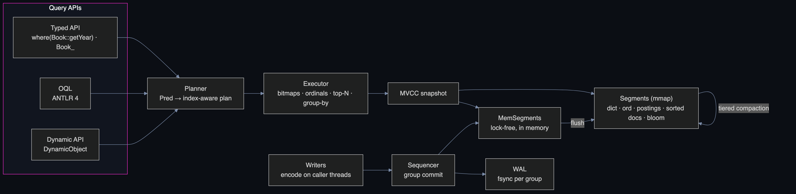

- **Rows are the primary storage**: every object is one encoded row in an immutable segment file.
- **Indexed fields get a column** next to the rows: sorted dictionary, value numbers per row, Roaring bitmaps.
- **Queries are set operations on row numbers** (docids); rows are decoded only for the final results.
- **Writes go LSM-style**: WAL, in-memory segment, flush to a new file, background merge.

| Question | Answer |
|---|---|
| Where is an object? | one row in one segment of its collection (newest version wins) |
| What is a segment? | one file `seg_N.odbf`, rows sorted by OID, never modified after writing |
| What does RoaringBitmap hold? | sets of docids: value postings, nulls, classes, deletes, query results |
| How is a change written? | WAL append (fsync per group) → in-memory segment → later flushed to a new file |
| How does a delete work? | the old row is marked in a delete log; merges drop it |
| What do readers see? | an immutable `Version` (list of segments) at a sequence number: a snapshot |

---

## 2. Compared with other engines

| | Kookaburra | B-tree RDBMS (PostgreSQL, MySQL) | Lucene / Elasticsearch | RocksDB / LevelDB | Pinot / Druid |
|---|---|---|---|---|---|
| Unit of storage | immutable segment (rows + columns) | 8 / 16 KB pages, updated in place | immutable segment | SST file (sorted key/value) | immutable segment (columns) |
| Index | dictionary + bit-packed ordinals + Roaring postings | B-tree per index | inverted index (postings) | none beyond the key | dictionary + bitmap / sorted |
| Update | new row version + delete mark | in place (+ MVCC versions) | new doc + delete bitmap | new key version | segment rewrite |
| Write path | WAL → memtable → flush → merge | WAL → buffer pool → checkpoint | translog → buffer → refresh → merge | WAL → memtable → flush → compaction | batch / realtime ingest |
| Strong at | multi-condition filters, counts, group-by, top-N on objects | point reads and row updates, joins | full-text search | key/value writes | analytics on events |
| Weak at | many tiny updates to the same rows, joins | wide scans and group-by without indexes | transactions | queries beyond the key | updates |

Kookaburra borrows the segment and merge model from Lucene, the write path from LevelDB / RocksDB and the column encoding from Pinot / Druid, with object rows as the primary data.

---

## 3. Directory layout

```
db/
├─ LOCK                          single-process lock (FileChannel.tryLock)
├─ CURRENT                       → commit_N
├─ commit_N                      per collection: segments + delete generations, WAL replay point; OID counters
├─ schema/schema_V               classes, fields, layouts, constraints (format KKBSCH03; 01 and 02 still read)
├─ wal/wal_<firstSeq>.log        write-ahead log, one shared file at a time, rotated at each commit
└─ col/<collection>/
   ├─ seg_<id>.odbf              immutable segment (≤ 1.5 GB)
   └─ seg_<id>_<gen>.del         delete bitmap of a segment, generation <gen>
```

- One directory = one database; one process at a time (`LOCK`).
- **A commit file is the truth**: files it does not reference are orphans and are deleted on open.
- Every file is written to `*.tmp`, fsync'ed, renamed atomically, then the directory is fsync'ed.
- `MemoryStorage` implements the same `Storage` interface with heap byte arrays (nothing persisted).

---

## 4. Segment format

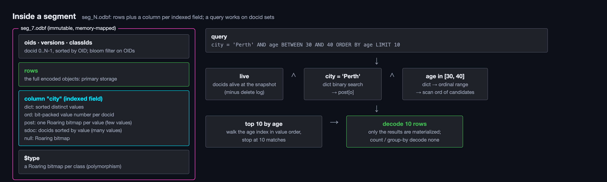

### 4.1 Layout

One segment = one file = rows of one collection, **sorted by OID**, docid = `0..N-1`. Little-endian, sections 8-byte aligned, CRC32C on the footer.

```
seg_<id>.odbf
┌────────────────────────────────────────────────────────────┐
│ header      magic "KKBSEG01" · format · pad                │
├────────────────────────────────────────────────────────────┤
│ oids long[N] (sorted) · versions long[N] · classIds int[N] │
├────────────────────────────────────────────────────────────┤
│ row offsets long[N+1] · rows (RecordCodec bytes)           │  ← primary storage
├────────────────────────────────────────────────────────────┤
│ bloom (OIDs) · $type: Roaring per class id                 │
├────────────────────────────────────────────────────────────┤
│ column <path> × K                                          │
│   dict  sorted distinct values                             │
│   ord   bit-packed (ordinal + 1, 0 = null)   single-valued │
│   multi offsets + ordinals                   multi-valued  │
│   post  Roaring per ordinal                  few values    │
│   sdoc  docids sorted by value               many values   │
│   null  Roaring                                            │
├────────────────────────────────────────────────────────────┤
│ footer: N, OID min / max, offsets, per column metadata     │
│ trailer: footerOffset · crc32c(footer) · magic             │
└────────────────────────────────────────────────────────────┘
```

### 4.2 Encodings

| Structure | Encoding | Access |
|---|---|---|
| dict LONG | sorted `long`: BOOL 0/1, INT, sortable FLOAT64 bits, epochDay, enum index, OID | binary search |
| dict FIXED128 | `(epochSecond UTC, nano)` (DATETIME, INSTANT) | binary search |
| dict STRING | offsets + UTF-8, `String.compareTo` order | binary search |
| dict DECIMAL | offsets + `zigzag(scale) · unscaled bytes`, `BigDecimal.compareTo` order | binary search |
| ord | `bitsFor(card)` bits per docid | O(1) |
| post | `ImmutableRoaringBitmap`s over the mapped file + offset table | zero-copy slice |
| sdoc | `start[ord] … start[ord+1]` into docids sorted by value | O(1) slice per value or range |
| null | one `ImmutableRoaringBitmap` | zero-copy |

- **Core property**: the dictionary is sorted, so ordinal order = value order. Range, sort and group-by become integer comparisons on ordinals.
- Postings vs sdoc is decided per segment by `AUTO`: postings when `card ≤ N / 16` (few distinct values), sorted docids otherwise.

### 4.3 Index kinds (`@Index(kind)`)

| Kind | dict | ord | post | sdoc | Best for |
|---|:-:|:-:|:-:|:-:|---|
| `AUTO` (default) | ✓ | ✓ | if few values | else | let each segment decide |
| `BITMAP` | ✓ | ✓ | ✓ | | eq / in / group-count on few values |
| `ORDINAL` | ✓ | ✓ | | ✓ | point lookup, range, sort on many values |
| `BSI` | | | | | reserved: numeric range / sum / top-K |

Fields without `@Index` have no column: conditions on them read the row (path-only, see 4.4). `@Unique` and `@ForeignKey` imply `AUTO`.

### 4.4 Row encoding

```
row   := varint classId · varint layoutId · nullBits · value*
value := BOOL 1 B | INT zig-zag varint | FLOAT64 8 B | STRING varint-len UTF-8 | DECIMAL zig-zag scale · unscaled bytes
       | ENUM varint index | DATE zig-zag epochDay | DATETIME/INSTANT zig-zag seconds · varint nanos | REF varint OID
       | MULTI / EMBEDDED_LIST count · element* | EMBEDDED nullBits · value* | MAP count · (key · present · value)*
       | BYTES / OBJECT varint-len bytes
```

- `layoutId` lets old rows stay readable after a class changes (schema evolution, [design.md §3.5](design.md)).
- **Path-only decoding** (`RecordCodec.readPath`): reading one field skips the preceding ones in place; nothing is allocated for them. An unindexed scan of 10 M rows takes about 0.8 s.

---

## 5. Where RoaringBitmap is used

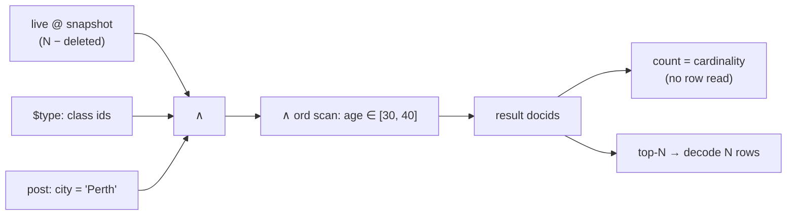

| Where | Bitmap type | Holds |
|---|---|---|
| postings, nulls, `$type` | `ImmutableRoaringBitmap` over the mapped file | docids per value / null / class |
| `.del` files, delete logs | serialized `RoaringBitmap` | deleted or superseded docids |
| query intermediates | `RoaringBitmap` | candidates; `and`, `or`, `andNot`, `andCardinality` |
| flush / merge | `RoaringBitmap` | postings being built, `runOptimize()` before write |

- `GROUP BY city COUNT(*)` = `andCardinality(post[v], matches)` per value: **no row is read** (4 ms on 10 M objects).
- Run containers make "all rows" and contiguous ranges almost free.

---

## 6. Write path

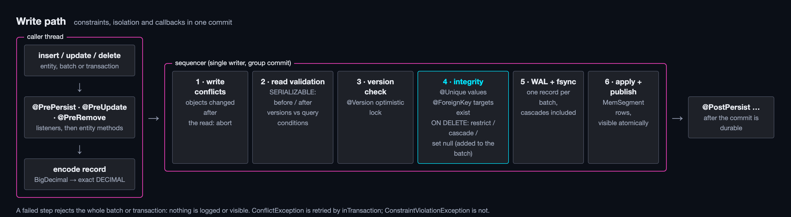

### 6.1 Flow

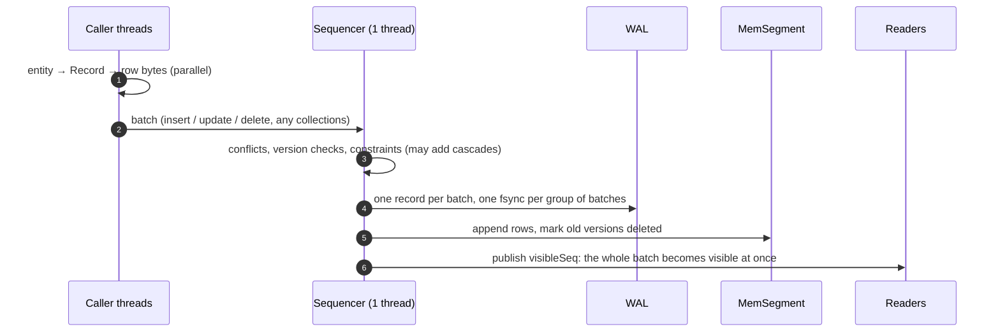

- **One writer thread** (LevelDB style): no locks on the data structures, a total order of commits, simple conflict and constraint checks.
- **Group commit**: batches that arrive together share one fsync (`group-commit-micros`).
- A failing batch fails alone: nothing of it is logged or visible.
- `Durability.ASYNC`: the caller returns before the fsync (faster, last moments may be lost on power failure).

### 6.2 MemSegment (memtable)

- Append-only arrays (OIDs, seqs, versions, rows, records) + a version chain per OID (`prevRow`).
- Postings per indexed path as append-only int lists: indexed filters never decode rows.
- Readers see `[0, size)`; a row is visible at snapshot `s` iff `seq ≤ s < deletedSeq`.
- Frozen at `mem-segment-bytes` (64 MB) and flushed by a background thread; a new active MemSegment takes over.

### 6.3 Updates and deletes on segments

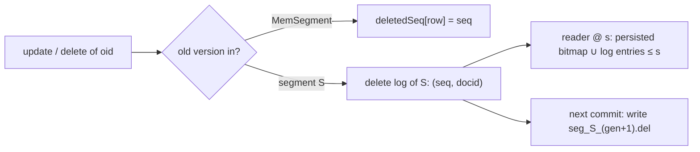

- No I/O per update: delete logs live in memory and are persisted with the next commit.
- An update = delete mark on the old row + a new row in the MemSegment.

### 6.4 Flush and commit

```mermaid
sequenceDiagram
    participant S as Sequencer
    participant F as Flush thread
    participant D as Disk
    S->>S: MemSegment ≥ 64 MB → frozen
    F->>F: rows live at the freeze point, sorted by OID → SegmentWriter
    F->>D: seg_N.odbf (tmp, fsync, rename), then memory-map it
    F->>S: install
    S->>S: carry over later deletes; replace the MemSegment by the segment (new Version)
    S->>D: .del generations, commit_N+1, CURRENT; rotate WAL; delete unreferenced files
```

- `commit_N` stores per collection the **WAL replay point**: rows still only in MemSegments are replayed from the WAL after a crash.
- `ObjectDB.flush()` freezes every active MemSegment and waits until all are installed.

---

## 7. Versions and snapshots (MVCC)

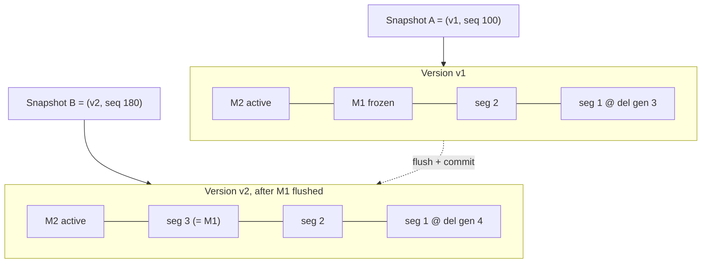

- `Version` = immutable list of segment views per collection (like LevelDB's `Version`); replaced, never modified.
- `Snapshot = (Version, visibleSeq)`: taking one is two volatile reads, no lock.
- A query takes its snapshot when its terminal operation starts; an explicit `Snapshot` pins one for several reads.
- Transactions read through the same snapshots plus a private overlay ([transaction-design.md](transaction-design.md)).

---

## 8. Point lookup: `get(oid)`

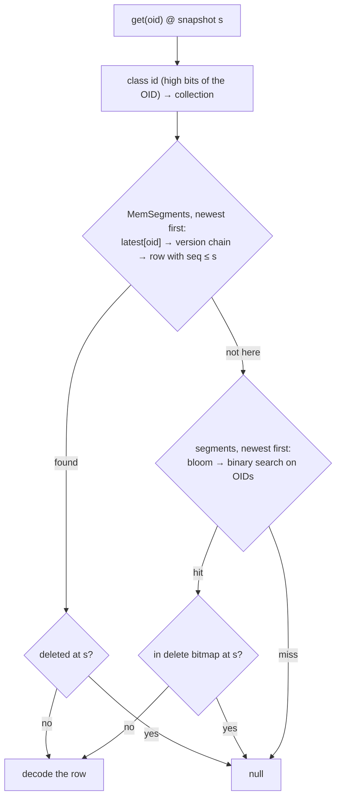

- 0.6 µs from a MemSegment, about 1 µs from a segment (10 M objects): the bloom filter skips most segments.

---

## 9. How storage answers a query

| Condition | With postings | With sorted docids / ordinals | MemSegment | No column |
|---|---|---|---|---|
| `=` / `IN` | dict search → bitmap (OR) | dict search → slice / ord scan | posting lists | row scan |
| range | ordinal range → OR bitmaps (few) or ord scan | ordinal range → slice | value scan | row scan |
| `startsWith` | dict prefix → ordinal range | same | value scan | row scan |
| `IS NULL` | null bitmap | null bitmap | null list | row scan |
| sort + limit | walk the index in value order, stop at N | same | heap | heap over decoded keys |
| group + count | `andCardinality` per value | count per ordinal | hash map | hash map |

- Conditions are ordered by cost: the cheapest one narrows the candidates first.
- Results from several segments are merged by value (top-N heap, k-way merge, hash merge for groups).
- Planner and executor details: [design.md §10](design.md).

---

## 10. Compaction

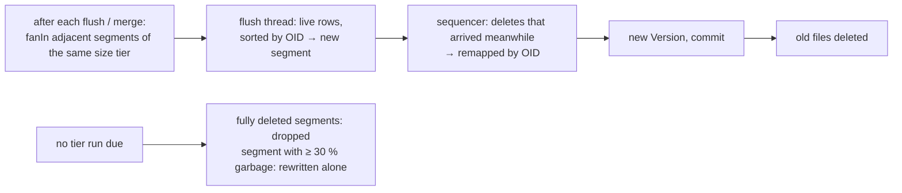

| Trigger | Action | Like |
|---|---|---|
| `fanIn` (8) segments in one size tier | merge them | RocksDB universal / Lucene tiered |
| a segment without live rows | drop it, no rewrite | |
| `deleted / rows ≥ compaction-garbage-ratio` (0.3) | rewrite that segment alone | Lucene `deletesPctAllowed`, RocksDB deletion-triggered |
| `ObjectDB.compact()` | flush, wait for running work, merge everything idle | `forceMerge` |

- Merges rebuild columns from the current schema: a newly added `@Index` covers old data after a merge.
- **Back-pressure**: writers wait (at most 30 s) while too many frozen MemSegments and merges are pending.
- Limits: a segment ≤ 1.5 GB (one `MappedByteBuffer` on JDK 17); a flush or merge builds the file in heap (streaming writer: backlog).
- Result on 10 M objects: deleting everything leaves **0 B** on disk after `compact()`.

---

## 11. File I/O

| | |
|---|---|
| Access | `MappedFile`: `getLong / getInt / slice / bytes` on a memory-mapped file (heap `byte[]` in memory mode) |
| JDK 17 to 21 | `MappedByteBuffer` per file; unmapped with `Unsafe.invokeCleaner`, else by GC |
| JDK 22+ | `MemorySegment` + `Arena` (backlog, multi-release jar) |
| Caching | the OS page cache; the heap holds only footers and offset tables (6.5 MiB after reopening 10 M objects) |
| Byte order | little-endian everywhere |

---

## 12. Recovery

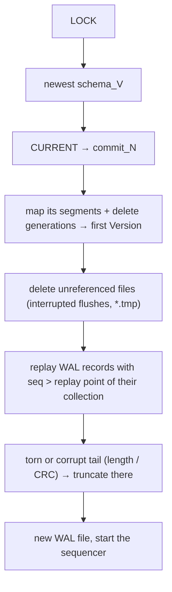

- WAL record: `len · crc32c · seq · ops` with ops `INSERT oid row | UPDATE oid version row | DELETE oid applied`; cascades of constraints are logged as ops too.
- Replay applies the logged outcome (OIDs, versions): no re-validation, deterministic.
- Reopen without WAL to replay: about 2 ms for 10 M objects (only footers are read).

---

## 13. Online backup

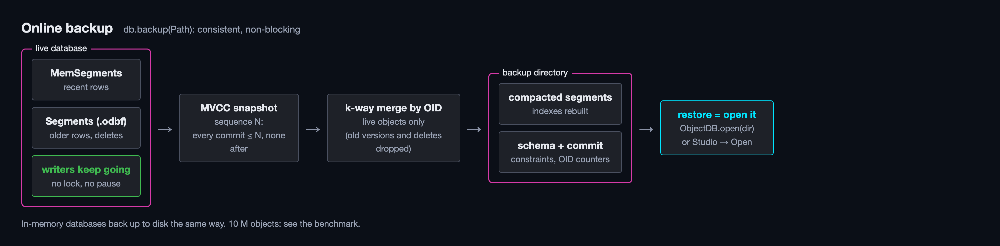

- `db.backup(target)`: take a snapshot, then per collection merge all views by OID (segments are already sorted, MemSegment rows are sorted first) and write fresh segments of about `2 × mem-segment-bytes`, plus schema and a commit.
- Writers are not blocked; old versions and deleted rows are not copied.
- The copy is a normal database directory: restore = open it.
- 10.5 M objects (1.4 GB): 25.4 s.

| | File copy of a live directory | `db.backup` |
|---|---|---|
| Consistent | no (files change while copying) | yes, one snapshot |
| Writers | must stop | keep running |
| Size | includes old versions and garbage | live data only, compacted |
| In-memory database | impossible | written to disk |

---

## 14. Configuration (storage keys)

| Key | Default | Effect |
|---|---|---|
| `kookaburra.mem-segment-bytes` | `64MB` | MemSegment size before it is flushed |
| `kookaburra.segment-max-bytes` | `512MB` | largest merged segment (≤ 1.5 GB) |
| `kookaburra.compaction-fan-in` | `8` | segments merged per tier |
| `kookaburra.compaction-garbage-ratio` | `0.3` | share of deleted rows that triggers a rewrite |
| `kookaburra.max-segments` / `write-backlog` | `64` / `10` | back-pressure thresholds |
| `kookaburra.flush-threads` | `2` | threads for flushes and merges |
| `kookaburra.auto-postings-ratio` | `16` | `AUTO` writes postings when rows / distinct ≥ ratio |
| `kookaburra.postings-or-max` | `64` | ranges OR at most this many postings, else scan ordinals |
| `kookaburra.bloom-fpp` | `0.01` | OID bloom filter false-positive rate |
| `kookaburra.durability` / `group-commit-micros` / `sequencer-max-group` | `SYNC` / `200` / `512` | fsync policy and group commit |

---

## 15. Decisions

| # | Decision | Why |
|---|---|---|
| S1 | Rows are the primary storage, columns only for indexed fields | objects are read whole; indexes only where queries need them |
| S2 | Immutable segments + delete logs instead of in-place updates | lock-free readers, simple recovery, cheap snapshots |
| S3 | One sequencer thread for all writes | total commit order, no data-structure locks, group commit |
| S4 | Sorted dictionary + bit-packed ordinals per indexed field | value order = ordinal order: ranges, sorts and groups on integers |
| S5 | Roaring postings only for few distinct values, sorted docids otherwise (`AUTO`) | bitmaps per value are small and fast when values repeat; sorted docids are 4 B per row when they do not |
| S6 | Memory-mapped files, little-endian, zero-copy bitmaps | the OS page cache does the caching; tiny heap |
| S7 | Garbage-driven compaction besides size tiers | deleted space is reclaimed even for lone or oversized segments (design D44) |
| S8 | Backup = snapshot export into fresh segments | consistent without pausing writers (design D54) |

More decisions with history: [design.md §19](design.md).
