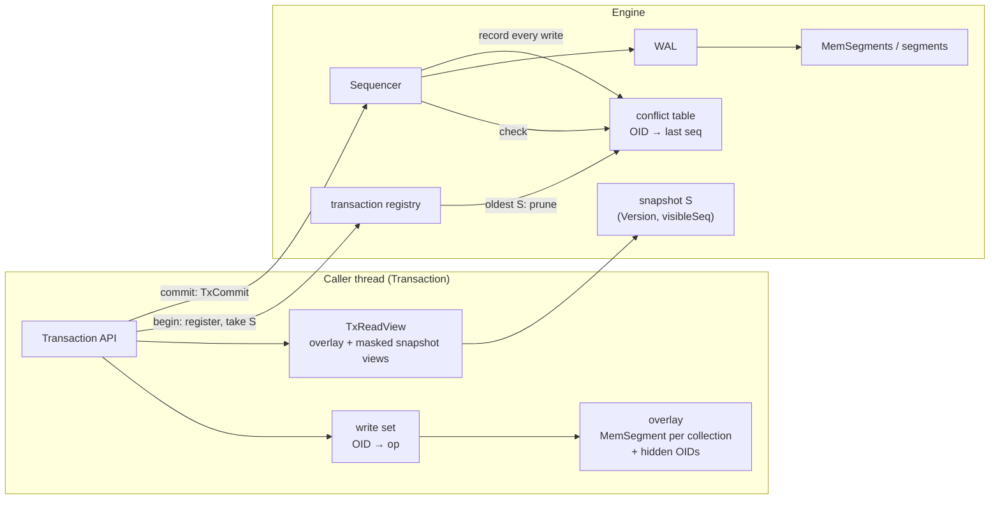
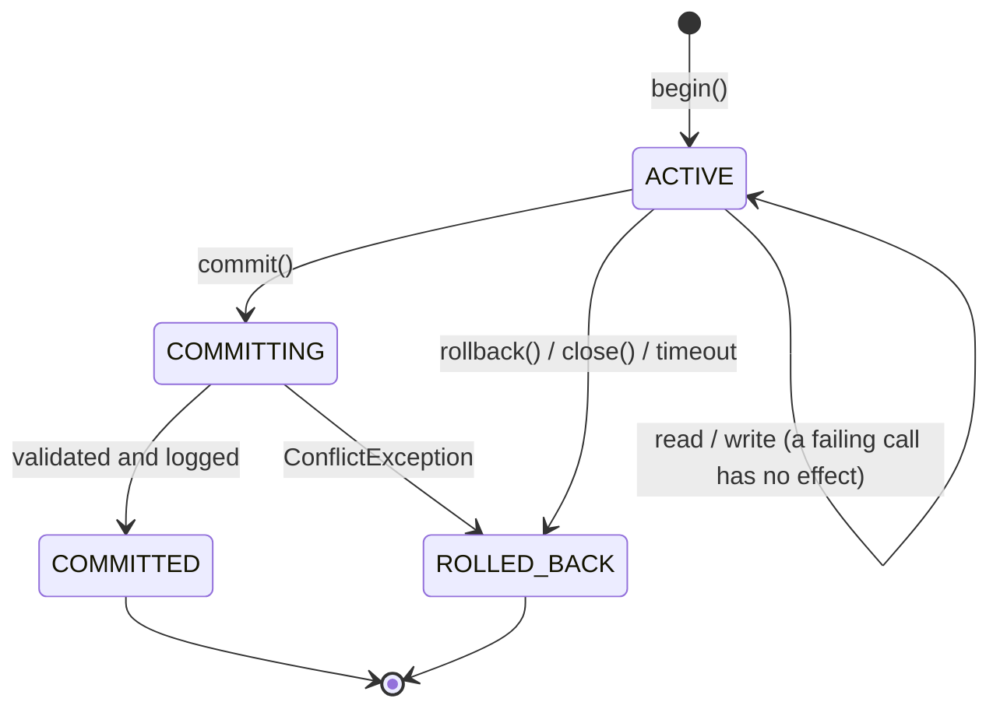
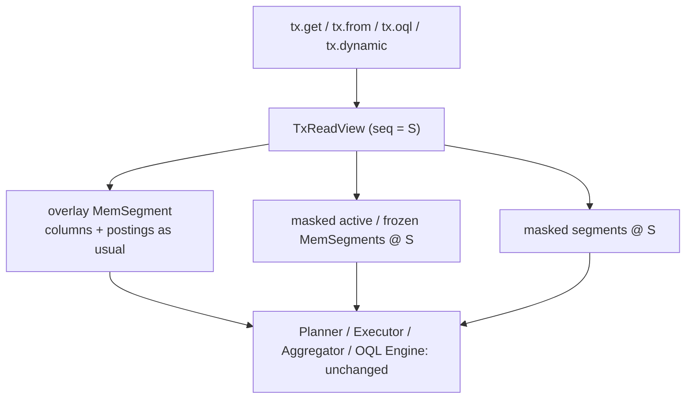
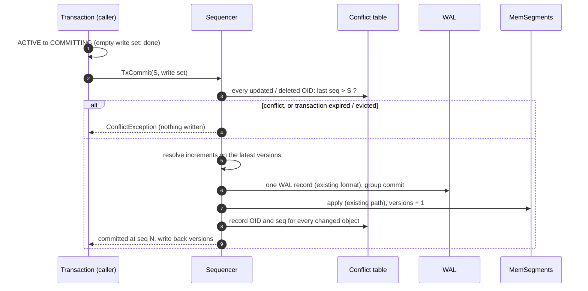

# Kookaburra Transactions: Design

| | |
|---|---|
| Status | **Implemented** (2026-10-15; READ COMMITTED, SERIALIZABLE and deferred constraints 2026-10-17) |
| Date | 2026-10-15 |
| Model | MVCC snapshots + optimistic concurrency control (OCC) + redo-only WAL; three isolation levels |
| Builds on | [design.md](design.md) §6 write path, §7 MVCC, §12 concurrency, §15 recovery |
| Supersedes | design.md §12.1 "Transactions (scope of v1)"; the 2026-10-13 PostgreSQL-style draft |

---

## 1. Summary

| Aspect | Decision |
|---|---|
| Switch | **off by default**: `kookaburra.transactions=false` → every write commits directly (autocommit, like JDBC's default) and the write path keeps no conflict history; `true` enables `begin()` / `inTransaction()` |
| Reads | from a snapshot `S` taken at `begin()`; lock-free; see the transaction's own writes |
| Writes | buffered in a private write set; nothing shared changes before commit |
| Commit | one request to the existing single-threaded **sequencer**: conflict check → one WAL record (group commit) → apply → publish |
| Conflicts | first committer wins: a write to an object that another transaction committed after `S` aborts the commit; stale entities (`@Version`) are rejected at the call |
| Recovery | redo-only: aborted transactions never reach the WAL; no undo |
| Hot spots | atomic `increment` executed on the latest value at commit, never conflicts with other increments |
| Isolation | `READ_COMMITTED` (snapshot per statement), `SNAPSHOT` (default; = Oracle "serializable", PostgreSQL REPEATABLE READ, SQL Server SNAPSHOT), `SERIALIZABLE` (snapshot + read validation at commit); default `kookaburra.tx-isolation` |
| Constraints | `@Unique` / `@ForeignKey` checked at commit on the sequencer (deferred), cascades in the same commit (design.md §3.6, §6.5) |

---

## 2. Goals, non-goals, roadmap

| Goals (this delivery) | Non-goals | Roadmap (later deliveries) |
|---|---|---|
| Multi-statement, multi-collection ACID transactions | distributed / XA transactions | per-transaction durability |
| Snapshot isolation with read-your-own-writes in `get`, queries, OQL, dynamic API | transactions larger than memory; savepoints (T13) | |
| Optimistic conflict detection, automatic retry helper | blocking row locks / deadlock handling (atomic `increment` covers hot spots) | transaction metrics |
| Atomic `increment` for counters | transactional DDL (class registration is immediate) | |
| READ COMMITTED, SNAPSHOT, SERIALIZABLE | Spring / JPA integration (optional extensions, not planned) | |
| Deferred `@Unique` / `@ForeignKey` checks with ON DELETE actions | | |
| Timeouts, size limits, bounded memory | | |
| Zero cost for code that does not use transactions (and none at all while the switch is off) | | |

---

## 3. Mainstream alignment

| Decision | Same approach in | Notes |
|---|---|---|
| MVCC snapshot reads, no read locks | Oracle, PostgreSQL, SQL Server (RCSI / SNAPSHOT), MySQL InnoDB, MongoDB (WiredTiger) | universal |
| Snapshot isolation as the transaction level | Oracle "SERIALIZABLE", PostgreSQL REPEATABLE READ, SQL Server SNAPSHOT, MongoDB multi-document transactions, RocksDB / Badger | write skew possible, documented (§5) |
| First-committer-wins on write-write conflicts | PostgreSQL RR (`40001`), SQL Server SNAPSHOT (update conflict 3960), Oracle (ORA-08177), MongoDB (`WriteConflict`, `TransientTransactionError`) | |
| Optimistic validation at commit by a single sequencer | **FoundationDB** (resolver), **RocksDB `OptimisticTransactionDB`** (sequence-number conflict check), Badger, SQL Server Hekaton | |
| Private write set with read-your-own-writes | RocksDB `WriteBatchWithIndex`, FoundationDB, Badger | |
| Redo-only log, no undo | FoundationDB, Hekaton, RocksDB optimistic | possible because writes are buffered |
| Retry helper with back-off | MongoDB `withTransaction`, CockroachDB / Spanner client retry loops, FoundationDB `db.run`, Spring `@Retryable` | |
| Atomic increment that never conflicts | FoundationDB atomic ops, Redis `INCR`, DynamoDB `ADD` update expression | |
| Entity version check (`@Version`) | JPA / Hibernate optimistic locking | keeps existing semantics |
| Non-transactional identifiers (gaps after rollback) | PostgreSQL sequences, MySQL `AUTO_INCREMENT`, Oracle sequences | |
| Idle / long transaction timeout | PostgreSQL `idle_in_transaction_session_timeout`, FoundationDB 5 s limit, MongoDB `transactionLifetimeLimitSeconds` (60 s) | |

---

## 4. Concepts

| Concept | Meaning | Exists today |
|---|---|---|
| commit sequence `seq` | global, monotonic; one per committed transaction / batch / autocommit write | ✅ `Sequencer.lastSeq` |
| `visibleSeq` | highest published `seq`; new snapshots start here | ✅ |
| snapshot `S` | `(Version, visibleSeq)` at `begin()` | ✅ `ReadView` |
| write set | private: OID → insert / update / delete / increment | new |
| overlay | private `MemSegment` per collection holding the write set's rows, plus the set of OIDs it hides in the snapshot | new |
| conflict table | sequencer-owned: OID → `seq` of its last committed change, kept only for `seq` > oldest active snapshot | new |
| transaction registry | active transactions and their snapshots (for pruning and timeouts) | new |

---

## 5. Isolation levels


| Anomaly | `READ_COMMITTED` | `SNAPSHOT` | `SERIALIZABLE` |
|---|:-:|:-:|:-:|
| Dirty read | ✅ prevented | ✅ prevented | ✅ prevented |
| Non-repeatable read | ❌ possible | ✅ prevented | ✅ prevented |
| Phantom read | ❌ possible | ✅ prevented (queries read the snapshot) | ✅ prevented |
| Lost update | ✅ prevented (conflict table + `@Version`) | ✅ prevented | ✅ prevented |
| Write skew | ❌ possible | ❌ possible: two transactions read overlapping data and write **different** objects | ✅ prevented (read validation) |

| Level | Reads | Commit check |
|---|---|---|
| `READ_COMMITTED` | each statement (get, query, OQL, dynamic, referrers, write) opens a fresh snapshot, plus own writes | written objects must be unchanged since the statement that read them (`since` per write-set entry) |
| `SNAPSHOT` | the snapshot `S` of `begin()`, plus own writes | written objects unchanged since `S` |
| `SERIALIZABLE` | as SNAPSHOT, and every read is recorded (§11.3) | as SNAPSHOT, plus nothing it read changed since `S` |

Read-only transactions never fail at any level: they are serialized at their snapshot. SERIALIZABLE aborts are `ConflictException`s and are retried by `inTransaction`.

---

## 6. API

```properties
kookaburra.transactions=true        # off by default: every write commits directly
```

```java
// explicit transaction; close() rolls back an uncommitted one
try (Transaction tx = db.begin(Isolation.SNAPSHOT)) {
    Person p = tx.get(Person.class, oid);
    p.setAge(31);
    tx.update(p);
    tx.insert(order);
    List<Order> orders = tx.query(Order.class)
            .where(Order::getOwner).eq(oid)
            .list();                                 // includes the uncommitted order
    tx.commit();                                     // ConflictException if someone committed p after the snapshot
}

// retry helper: re-runs the body on ConflictException (default kookaburra.tx-retries)
db.inTransaction(tx -> {
    Account a = tx.get(Account.class, id);
    a.setBalance(a.getBalance() - 100);
    tx.update(a);
});
long total = db.inTransactionResult(tx -> tx.from(Account.class).sum(where(Account::getBalance)), 5);

// counters: no conflicts between increments
db.inTransaction(tx -> tx.increment(Page.class, pageId, "views", 1));
db.increment(Page.class, pageId, "views", 1);        // autocommit

// autocommit (unchanged): each call is its own transaction
db.insert(person);
```

| Type | Members |
|---|---|
| `ObjectDB` (new members) | `Transaction begin()`, `begin(Isolation)`, `begin(TxOptions)`, `inTransaction(TxWork)`, `inTransaction(TxWork, int retries)`, `<R> R inTransactionResult(TxFunction<R>)`, `<R> R inTransactionResult(TxFunction<R>, int retries)` (separate name: `tx -> tx.insert(x)` would be ambiguous between the two forms; jOOQ uses `transaction` / `transactionResult` for the same reason), `increment(Class<?>, long oid, String field, Number delta)` |
| `Transaction` reads | `get(Class, oid)`, `get(oid)`, `getAll(Class, oids)`, `query(Class)` / `from(Class)`, `oql(text)`, `oql(text, Class)`, `dynamic(className)`: same signatures as `ObjectDB` |
| Query style (all APIs) | chained: `query(X.class).where(X::getY).eq(v).where(X::getZ).gt(1).orderBy(X::getAge).desc().limit(10).list()`; dynamic: `.where("home.city").eq("Perth")`; OR / NOT via `.filter(or(...))` in the same chain |
| `Transaction` writes | `insert`, `update`, `delete(entity)`, `delete(Class, oid)`, `increment(Class, oid, field, delta)`; OQL `UPDATE` / `DELETE` and `QueryStream.updateEach / deleteAll` inside the transaction write into it |
| `Transaction` control | `commit()`, `rollback()`, `close()`, `id()`, `snapshotSeq()`, `isReadOnly()`, `state()` |
| `TxOptions` | `isolation(Isolation.X)`, `readOnly(boolean)`, `timeout(Duration)`; presets `TxOptions.defaults()`, `TxOptions.readOnly()`; `db.inTransaction(options, work)` / `inTransactionResult(options, fn)` |
| `Isolation` | `READ_COMMITTED`, `SNAPSHOT`, `SERIALIZABLE`; `db.begin()` uses `kookaburra.tx-isolation` |

| Rule | |
|---|---|
| Switch off | `begin()` / `inTransaction()` throw `KookaburraException` ("set kookaburra.transactions=true") instead of silently running without atomicity; `increment` works either way |
| Thread confinement | a `Transaction` is used by one thread at a time; `ObjectDB` stays thread-safe and serves any number of concurrent transactions |
| Failed call | a call that throws (invalid value, stale entity, unknown OID, size limit) **has no effect**; the transaction stays usable (statement-level atomicity, as in Oracle / MySQL / SQL Server) |
| Multi-object calls | OQL `UPDATE / DELETE`, `updateEach`, `deleteAll`, `WriteBatch`-style dynamic writes are applied to the write set all-or-nothing |
| Entities after commit | inserted entities carry their OID from `insert()` on; versions are written back at commit |
| Entities after rollback | keep the OID / version they had (like detached JPA entities); not persisted |
| Nested `begin()` | independent transactions (no implicit nesting) |
| `WriteBatch` | unchanged: an atomic write-only unit, also checked against concurrent transactions through the conflict table |

### 6.1 Exceptions

| Exception | Parent | When | Retried by `inTransaction` |
|---|---|---|:-:|
| `ConflictException` | `KookaburraException` | commit: an object in the write set was changed by a commit after `S` (READ COMMITTED: after the statement that read it); SERIALIZABLE: something it read changed ("serialization failure"); or the transaction was evicted as the oldest when the conflict table / change log overflowed | ✅ |
| `ConstraintViolationException` | `KookaburraException` | commit: `@Unique` duplicate, missing `@ForeignKey` target, ON DELETE RESTRICT | n/a (the same writes would fail again) |
| `OptimisticLockException` | **`ConflictException`** (was `KookaburraException`) | stale entity version at `update` / `delete`, or version mismatch outside transactions | ✅ |
| `TransactionTimeoutException` | `KookaburraException` | `kookaburra.tx-timeout` exceeded |: |
| `KookaburraException` | | read-only transaction written to; `tx-max-bytes` exceeded |: |
| `IllegalStateException` | | use after commit / rollback / close |: |

Existing `catch (OptimisticLockException e)` code keeps working.

---

## 7. Architecture



| Component | Package / class | Thread |
|---|---|---|
| `Transaction`, `TxOptions`, `Isolation`, `TxWork`, `TxFunction`, `ConflictException`, `TransactionTimeoutException` | `com.github.kookaburra` (public) | caller |
| `TransactionImpl` (state, write set, overlay, timer) | `engine` | caller |
| `TxReadView`, `MaskedView` | `engine` | caller |
| `TxHost` (OqlHost for queries / OQL / dynamic inside a transaction) | `engine` | caller |
| `TxRegistry`, `ConflictTable` (primitive `long → long` map + commit-ordered queue) | `engine` | registry: concurrent; table: sequencer |
| `Sequencer` (`TxCommit` requests, increments) | `engine` | sequencer |
| OID allocator (per-class atomic counters) | `engine` | caller |

---

## 8. Lifecycle



| Step | Action |
|---|---|
| `begin()` | register in the registry (snapshot pending), then take `S` = current `(Version, visibleSeq)`, then publish `S` in the registry |
| reads | through `TxReadView` (§10) |
| writes | encode + type-check on the caller thread, then update write set and overlay (§9) |
| `commit()` | empty write set → done without a `seq`; else submit `TxCommit` and wait (§11) |
| `rollback()` / `close()` | drop write set and overlay, deregister; nothing to undo |
| timeout | checked on every call and by the sequencer while pruning; an expired transaction is rolled back and every later call throws `TransactionTimeoutException` |

Registration before taking `S` guarantees that every commit with `seq > S` happens while the transaction is registered, so the conflict table keeps it (§11.2).

---

## 9. Write set and OIDs

### 9.1 OIDs are allocated at `insert()`

| | Before | Now |
|---|---|---|
| Who allocates | sequencer, at commit | caller, at `insert()`: per-class atomic counter (`Oids.make(classId, ++counter)`) |
| Why |: | read-your-writes and `Ref`s between new objects need final OIDs inside the transaction; no temporary IDs to rewrite |
| Rollback |: | leaves a gap (like sequences) |
| Recovery | counters from commit file + WAL | same; the allocator starts after the highest committed OID per class |

Autocommit inserts and `WriteBatch` use the same allocator.

### 9.2 Collapse rules (per OID)

| Existing entry | New call | Result |
|---|---|---|
|: | insert | INSERT (version 1) |
|: | update | UPDATE (expected = version in `S`) |
|: | delete | DELETE |
|: | increment | INCREMENT (accumulated deltas per field) |
| INSERT | update / increment | INSERT with the new record |
| INSERT | delete | entry removed |
| UPDATE | update / increment | UPDATE with the new record |
| UPDATE / INCREMENT | delete | DELETE |
| INCREMENT | update | UPDATE (the entity already carries the incremented values) |
| INCREMENT | increment | deltas added |
| DELETE | update / delete / increment | the call fails: object deleted in this transaction |

### 9.3 Stale entity check

`update(entity)` and `delete(entity)` of a `@Version` entity compare `entity.version` with the version the transaction sees (overlay first, else snapshot `S`). A mismatch throws `OptimisticLockException` immediately. This catches objects loaded **before** `begin()` and changed by someone else before `S`: the conflict table only sees changes after `S`.

Inside the overlay, rows keep the version they had in `S` (inserted rows: 1); the sequencer assigns version + 1 at commit, once per object and transaction.

### 9.4 Limits

| Limit | Behaviour |
|---|---|
| `kookaburra.tx-max-bytes` (100 MB) | sum of encoded rows in the write set; the call that exceeds it fails (no effect) |
| read-only transaction | every write call fails |

---

## 10. Reads: `TxReadView`

```
views(collection) = [ overlay(collection) ]                     rows of the write set, seq 0 (visible to S)
                  + [ masked(v) for v in S.views(collection) ]  snapshot views without the OIDs this tx touched
masked(v).live(s)   = v.live(s) \ { doc : v.oid(doc) ∈ hidden }
masked(v).find(o,s) = DELETED if o ∈ hidden, else v.find(o, s)
```



| Write | Overlay | Hidden OIDs |
|---|---|---|
| insert | append row (seq 0) |: |
| update / increment | append new row; previous overlay row of the OID marked deleted (seq 0) | + OID (if it exists in `S`) |
| delete | previous overlay row marked deleted | + OID (if it exists in `S`) |

- Indexes, sorting, top-N, grouping, aggregates, OQL and `explain()` work unchanged: the overlay is just one more view.
- Hidden-doc bitmaps are computed lazily per view and cached until the hidden set changes (`find(oid)` per hidden OID: bloom + binary search).
- `TxHost` routes `openRead()` to the transaction's view (without closing it) and `database()` to a transaction-bound facade, so `updateEach`, `deleteAll` and OQL `UPDATE / DELETE` write into the transaction.

---

## 11. Commit

### 11.1 Protocol



| Check | Rule |
|---|---|
| write-write | for each UPDATE / DELETE: `conflictTable.lastSeq(oid) > S` → `ConflictException` (first committer wins) |
| inserts | never conflict (fresh OIDs) |
| increments | not checked; applied to the latest version |
| object gone | an UPDATE / INCREMENT whose object no longer exists at commit → `ConflictException` |

### 11.2 Conflict table

| Property | Design |
|---|---|
| Content | OID → `seq` of the last committed change, plus a commit-ordered queue `(seq, oid)` |
| Writers | **every** write path records into it on the sequencer: transactions, autocommit, `WriteBatch`, OQL bulk writes, increments |
| Pruning | after each commit group: drop entries with `seq ≤ min(S of active transactions)`; a registered transaction whose `S` is still pending counts as `S = 0` (keeps everything); no active transactions → empty |
| Cost without transactions | one `put` per write and an immediate prune: O(1) |
| Memory | primitive open-addressing `long → long` map + `long[]` ring: ~32 B per entry |
| Bound | `kookaburra.tx-conflict-table-max` (2 000 000 entries ≈ 64 MB): when exceeded, the oldest transaction is evicted (its commit fails with `ConflictException`), and pruning continues |
| Recovery | not persisted: after a restart there are no active transactions |

Correctness: a transaction registers before reading `visibleSeq`. Any commit `c > S` is published after `S` was read, so the transaction was registered (as pending or with `S`) during that commit's prune, and `c` survives until the transaction ends.

### 11.3 SERIALIZABLE: read validation

| Part | Design |
|---|---|
| Read set | OIDs read by lookup (`ReadView.pointViews`: get, getAll, dynamic get, OQL dereference) and every query condition (`ReadView.queryViews` from the `Executor`: collection, class ids, `Cond`, materializer for residual conditions); a read without a known condition counts as `TRUE` over the collection |
| Change log | `ChangeLog` on the sequencer: `(seq, collection, oid, before record, after record)` for every commit, kept only while SERIALIZABLE transactions are open (`TxRegistry.serializable() > 0`), pruned to the oldest SERIALIZABLE snapshot, bounded by `tx-conflict-table-max` (overflow evicts the oldest SERIALIZABLE transaction) |
| Validation | at commit, after the write-write check: an OID read and changed after `S` aborts; for each query condition the before and after versions of the changes after `S` in that collection are loaded into a temporary MemSegment and evaluated with the normal executor; any match aborts (the query's result would differ: update, delete or phantom) |
| Precision | changes outside the conditions never abort (predicate level, not table level); evaluation errors count as a match |
| Coverage | logging switches on with the first SERIALIZABLE `register`; a transaction whose snapshot predates continuous logging cannot be validated and aborts (retryable) |
| Read-only | no validation needed: serialized at `S` |
| Mainstream | optimistic read validation as in FoundationDB (read conflict ranges) and CockroachDB (refresh spans); PostgreSQL SSI reaches the same guarantee with predicate locks |

### 11.4 READ COMMITTED

Every statement calls `statement()`: if the committed state moved, the base `ReadView` is replaced and the view cache cleared; write-set entries remember the sequence number of the read they are based on (`since`), which becomes the per-OID check in `TxCommit.checkSeqs`. The registry snapshot is lowered to the oldest `since`, so the conflict table keeps what the commit needs.

---

## 12. Atomic increment

| Rule | |
|---|---|
| Fields | numeric scalars: `int`, `long`, `short`, `byte` (as INT32 / INT64), `double`, `float`; top-level or embedded paths (`stats.views`) |
| Overflow | integer overflow fails the call (inside the transaction) or the commit (`ArithmeticException`) |
| Conflicts | increments never conflict with each other; a concurrent full `update` of the same object conflicts with a later commit as usual |
| Version | the object version is incremented like any update |
| Read-your-writes | `tx.get` returns the snapshot value plus this transaction's pending deltas |
| At commit | the sequencer reads the latest version, adds the deltas, logs the resulting row as a normal UPDATE (deterministic replay) |
| Missing object at commit | `ConflictException` |
| Autocommit | `db.increment(...)` = a one-operation transaction |

---

## 13. Durability and recovery

| Topic | Behaviour |
|---|---|
| WAL | **unchanged format**: a commit is one record (`len · crc32c · seq · ops`); the class id is part of every OID |
| Durability | `kookaburra.durability` (`SYNC`: `commit()` returns after the group fsync; `ASYNC`: before) |
| Crash before commit | nothing to undo: the write set only lived in the caller's heap |
| Crash after the WAL record | the transaction replays as one record: atomic |
| Torn tail | truncated at the first bad CRC (existing) |
| OID counters | restored from the commit file and the replayed WAL |

---

## 14. Resources

| Resource | Holder | Bound |
|---|---|---|
| Snapshot (old segments / frozen MemSegments stay readable) | each active transaction | `kookaburra.tx-timeout` (60 s) |
| Write set + overlay | caller heap | `kookaburra.tx-max-bytes` (100 MB) |
| Conflict table | sequencer | `kookaburra.tx-conflict-table-max` |
| Abandoned (unclosed) transactions | registry | expire after the timeout; evicted on conflict-table overflow |

Storage side (related, same delivery): flush and compaction run on a fixed pool (`kookaburra.flush-threads`, default 2) instead of one thread; memtables keep their columns and postings; segment deletes keep the sequence-numbered delete log (storage-design.md §6.3).

---

## 15. Configuration (`kookaburra.properties`)

| Key | Default | Meaning |
|---|---|---|
| `kookaburra.transactions` | `false` | enables transactions; off = autocommit only, no conflict history |
| `kookaburra.tx-timeout` | `60s` | transactions older than this are rolled back (`0` = no limit) |
| `kookaburra.tx-max-bytes` | `100MB` | encoded bytes in one write set |
| `kookaburra.tx-retries` | `3` | retries of `inTransaction` on `ConflictException` |
| `kookaburra.tx-isolation` | `SNAPSHOT` | isolation of `begin()` / `inTransaction` without options |
| `kookaburra.tx-conflict-table-max` | `2000000` | conflict-table entries before the oldest transaction is evicted |
| `kookaburra.flush-threads` | `2` | flush / compaction threads |

---

## 16. Observability

| Item | Detail |
|---|---|
| WARN | transaction older than half the timeout (once): id, thread, age, writes; evictions on conflict-table overflow |
| DEBUG | each conflict: transaction id, OID, conflicting `seq` |
| API | `Transaction.id()`, `snapshotSeq()`, `state()`; registry size via `ObjectDB.activeTransactions()` |

---

## 17. Testing

| Suite | Content |
|---|---|
| Anomalies | per level: non-repeatable reads and phantoms (READ COMMITTED), lost updates rejected everywhere, write skew under READ COMMITTED / SNAPSHOT and prevented under SERIALIZABLE (`IsolationTest`, memory and disk) |
| SERIALIZABLE | validation by OID, indexed / unindexed / residual / OQL conditions, before-version matches, precision (unrelated changes commit), read-only never fails, retries, change-log eviction |
| Constraints | unique duplicates in batches and concurrent transactions, FK existence, RESTRICT / CASCADE (two levels) / SET_NULL, WAL replay of cascades (`ConstraintTest`, memory and disk) |
| Conflicts | first committer wins; conflict with autocommit, `WriteBatch`, OQL bulk writes; stale `@Version` entity loaded before `begin()` |
| Read-your-writes | differential: queries / OQL / dynamic inside a transaction ≡ `List.stream()` over (snapshot ∪ write set) on random workloads |
| Increments | concurrent increments without lost counts; increment vs update conflicts; overflow |
| Bank invariant | N threads transfer with `inTransaction`; the total never changes |
| Limits | timeout, `tx-max-bytes`, conflict-table eviction, read-only |
| Failure atomicity | failing calls leave the write set unchanged |
| Recovery | crash before / after the WAL record; OID gaps |
| Coverage | ≥ 90 % line and instruction (project gate) |

---

## 18. Performance targets

| Case | Target |
|---|---|
| Code without transactions | unchanged within noise (one conflict-table put + prune per write) |
| Commit of k objects | ≈ `WriteBatch` of k objects |
| Query inside a transaction touching ≤ 100 objects | ≤ 10 % slower than outside |
| Bank transfers, 16 threads, `ASYNC` | ≥ 50 k transactions/s |
| Concurrent increments of one counter, 16 threads, `ASYNC` | no lost updates, no retries |

---

## 19. Implementation plan

| Step | Content | Main code |
|---|---|---|
| 1 | OID allocation at insert (all write paths) | `Database`, `Oids`, `Sequencer`, `WriteOp.Insert` |
| 2 | Public API types, exceptions (`OptimisticLockException extends ConflictException`), config keys | `com.github.kookaburra`, `Config` |
| 3 | `TransactionImpl`: write set, collapse rules, stale check, limits, timeout, registry | `engine/TransactionImpl`, `TxRegistry` |
| 4 | Reads: overlay, `MaskedView`, `TxReadView`, `TxHost` (queries, OQL, dynamic, bulk writes) | `engine` |
| 5 | Commit: `TxCommit` request, conflict table on every write path, pruning, eviction | `Sequencer`, `ConflictTable` |
| 6 | `inTransaction` retry with back-off, `db.increment` / `tx.increment` | `Database`, `Sequencer` |
| 7 | Flush / compaction thread pool | `Database` |
| 8 | Tests (§17), benchmark (§18), docs: design.md §12.1, README, change log | |

---

## 20. Decisions

| # | Decision | Why |
|---|---|---|
| T1 | Snapshot isolation + OCC + redo-only | fits the single sequencer; no locks, no deadlocks, no undo; same family as FoundationDB / RocksDB optimistic / Badger |
| T2 | `SNAPSHOT` only in this delivery; `SERIALIZABLE` later as a complete level | no half-serializable level that users could misread |
| T3 | Conflict table checked by sequence numbers + `@Version` check at the call | catches changes after and before the snapshot |
| T4 | OIDs allocated at insert, non-transactional | final OIDs inside the transaction; gaps like database sequences |
| T5 | Write set as an overlay view inside the executor | every operator supports read-your-writes without per-operator merge code |
| T6 | Statement-level atomicity (a failing call has no effect) | Oracle / MySQL / SQL Server behaviour; friendlier for Java code |
| T7 | Atomic increments instead of pessimistic locks | hot counters without conflicts or blocking |
| T8 | Memtables keep their indexes; delete log unchanged; WAL format unchanged | queries stay fast; no format migration |
| T9 | Transactions are opt-in (`kookaburra.transactions=false` by default) | user decision: default behaves as autocommit; zero overhead unless enabled |
| T10 | `begin()` with the switch off throws instead of falling back to autocommit | code written for all-or-nothing must not silently lose atomicity |
| T11 | `inTransactionResult` is a separate name from `inTransaction` | `tx -> tx.insert(x)` would be ambiguous between a void and a value body (jOOQ: `transaction` / `transactionResult`) |
| T12 | One chained API style everywhere (`query().where().eq().orderBy().desc().list()`) | user decision; `from` / `filter` / `toList` remain as equivalents |
| T13 | No savepoints | user decision (2026-10-16); a failed step rolls back the whole transaction, `inTransaction` retries it |
| T14 | Studio console accepts `BEGIN [TRANSACTION \| WORK] [ISOLATION LEVEL l]`, `START TRANSACTION`, `COMMIT`, `ROLLBACK` as console commands (not OQL), sharing the toolbar's transaction | PostgreSQL / MySQL console syntax; OQL stays a query language, the API keeps `db.begin()` |
| T15 | READ COMMITTED as a fresh snapshot per statement | PostgreSQL / Oracle semantics; long transactions see new data and abort less |
| T16 | SERIALIZABLE by optimistic read validation at commit (read set vs before / after versions) | fits OCC and the single sequencer; predicate precision without locks |
| T17 | Constraints deferred to commit inside transactions | the sequencer sees the final state of the whole transaction; no lookups per statement |
